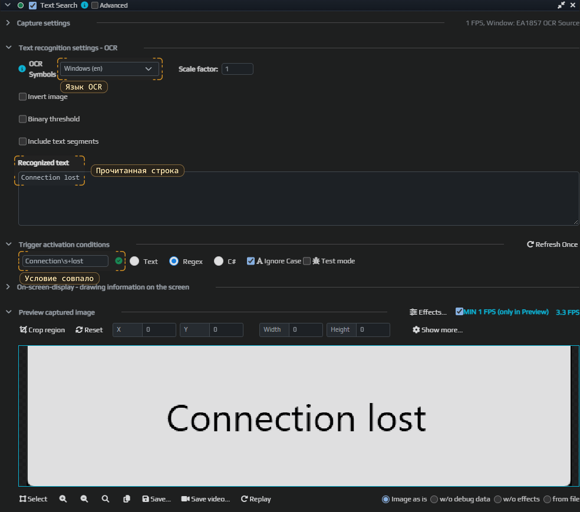

# Превратить видимую строку состояния в памятку

Аура читает строку **Status READY** в вашем открытом документе и показывает памятку **Проверьте готовый документ**. Когда строка меняется на **Status WAITING**, памятка скрывается. OCR читает пиксели на экране, а не сохранённый файл и не скрытое состояние приложения.

Что подготовить:

- Один несекретный документ в своём текстовом редакторе. По очереди показывайте в нём эти английские фразы крупными чёткими буквами, например шрифтом 32, тёмным по светлому фону.
- Окно не свёрнуто, и текст читается в захвате.
- В **OCR Symbols** доступен английский движок. Например, **Windows (en)** с установленной OCR-возможностью языка Windows или **Tesseract (eng)** с совместимыми загружаемыми языковыми данными. Одного сохранённого имени движка недостаточно.

Если английского варианта нет, сначала подготовьте язык и движок по странице [Text Search](/ru/triggers/images/text-search) и перезапустите EyeAuras. API-ключ и платный сервис не нужны.

## Сначала проверить распознанные слова

1. В меню создания дерева выберите **New Aura** и назовите ауру **Документ готов**. В **Triggers** нажмите **+** и добавьте **Text Search**. В **Capture settings → Target Window** выберите окно своего документа и проверьте сведения о выбранном окне.
2. Задайте **Image Capture Rate 1 FPS**. Откройте **Preview captured image** и через **Crop region** оставьте строку состояния с запасом вокруг букв, чтобы они попадали целиком. Заголовок окна и посторонний текст документа в область попадать не должны. Список эффектов пока оставьте пустым.
3. В **Text recognition settings - OCR** выберите доступный английский вариант **OCR Symbols**. Задайте **Scale factor 1**, выключите **Invert image**, **Binary threshold** и **Include text segments**.
4. Покажите Status READY, нажмите **Refresh Once** и посмотрите в **Recognized text**. Там должны быть нужные слова. Неверные буквы, пустой захват и ошибки языка исправьте до настройки условия.

   

| Параметр | Начальное значение |
| --- | --- |
| Image Capture Rate | 1 FPS |
| Scale factor | 1 |
| OCR Symbols | Ваш доступный английский движок |
| Invert image / Binary threshold | Выключены |
| Include text segments | Выключен для первого совпадения |

## Отобрать строку и показать результат

1. В **Trigger activation conditions** выберите **Regex** и введите `READY` как есть, без кавычек и косых черт по краям. Включите **Ignore Case**, **Test mode** оставьте выключенным. Regex ищет этот фрагмент во всей распознанной строке. Режим **Text** потребовал бы, чтобы с выражением совпала вся строка, вместе с остальными словами.
2. Обновите на Status READY — должно быть **Active**. Замените строку на экране на Status WAITING и обновите — если WAITING распознано правильно, должно быть **Not Active**. Верните READY и убедитесь, что совпадение вернулось.
3. Добавьте **Overlays → + → Text**: **Content** `Проверьте готовый документ`, **Font 24**, **Size to fit** выключен, **Window → Mode → Overlay**. Разблокируйте оверлей и разместите область 500 × 80, затем включите **Locked** и **Clickthrough**. Действия оставьте пустыми.
4. Оставьте ауру включённой, а EyeAuras — не на паузе. Выберите другую ауру и выйдите из редактора. При READY памятка должна быть видна, при WAITING — скрываться, как только придёт свежий результат распознавания.

Чтобы правило было точнее, замените `READY` в Regex на `Status\s+READY` и повторите обе проверки. Такое выражение допускает пробелы или перенос между словами. Если текст распознаётся правильно, а ошибка в выражении, настройки распознавания не трогайте.

Чтобы посмотреть области слов, включите **Include text segments**, обновите и откройте предпросмотр с разметкой. Сейчас Windows и Tesseract дают области отдельных слов, а не одну тесную рамку вокруг совпавшей фразы. Оценка слов у Windows здесь равна 1, Tesseract даёт собственную confidence.

[Захват](/ru/triggers/images/imagecapturetriggers), [Text Search](/ru/triggers/images/text-search), [сопоставление](/ru/features/text-match-expressions) и [Text](/ru/overlays/text) отвечают за разные части результата. Для начала оставьте Scale factor 1: координаты слов считаются от изображения, обработанного OCR, а не от точек на рабочем столе. Если буквы нужно подготовить, меняйте по одному [эффекту](/ru/triggers/images/effects) и каждый раз заново проверяйте Recognized text. При Unknown или пустом результате OCR сначала проверьте источник и движок.
