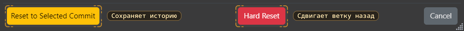

# Сохранить сбойное состояние перед возвратом к рабочему

Сначала сохраните всё, что нужно для разбора сбоя, и только потом откатывайте конфигурацию. В итоге у вас будут локальный архив отчёта, экспорт набора и профиль, восстановленный из выбранного снимка. Сохранение отчёта никуда его не отправляет.

Работайте в своём тестовом профиле, где нет чужих несохранённых изменений. Что нужно:

- файловое сохранение конфигурации и включённый **File system version control**;
- известный рабочий снимок;
- папка для копий **вне каталога config этого профиля**.

Возврат меняет конфигурацию профиля целиком и перезапускает EyeAuras. Если подходящего снимка нет, остановитесь после сохранения данных: восстановления с сервера здесь нет.

## Сохранить проблемный запуск до изменений

1. Запишите время сбоя, версию и профиль EyeAuras, затронутую папку. Своими словами опишите шаги, что получилось и что ожидалось. Причину не выдумывайте. Вредные действия ради отчёта не повторяйте.
2. В заголовке нажмите **Report a problem**. В **Error Report** введите описание. Выберите логи проблемного запуска. Если после сбоя был перезапуск, нужен более ранний лог. Проверьте снимки. Конфигурацию аур добавляйте, только если она нужна.
3. Нажмите **Save...**, выберите папку копий и дождитесь файла `.7z`. Откройте архив и проверьте **comment.txt**, выбранные логи и вложения. Обязательные сведения о системе и приложении могут быть в архиве и без конфигурации аур. Перед тем как кому-то его передать, проверьте личные пути, снимки и настройки. Закройте окно, не нажимая **Send**.
4. Выберите затронутую папку и откройте **Share/Export**. В **Content** проверьте состав и сообщение **Missing linked objects detected**. Прежде чем добавлять зависимости, посмотрите, что предлагает **Add linked objects**. Через **Destination → Local export → Save to file...** сохраните JSON рядом с отчётом. Это экспорт выбранного набора, а не всей истории профиля и не внешних файлов.
5. Запишите имена обоих файлов. Убедитесь, что они лежат вне config: при восстановлении неотслеживаемые файлы там могут быть удалены. Другие новые настройки, которые вам нужны, сохраните отдельно до продолжения. Экспорт не убирает секреты из полей.

## Выбрать точный снимок и намеренно восстановить

1. В главном окне нажмите **Version history**. Если нужный снимок не виден из-за периода, выберите **All-time → Refresh**. Ищите его по **Commit ID**, времени и описанию, а не берите просто верхнюю строку.
2. Если дата или объём не подходят, нажмите **Cancel**. Отчёт и экспорт остаются на месте, текущая конфигурация не меняется. Refresh только перечитывает список и не создаёт новый снимок ваших правок.
3. Для нужного снимка нажмите **Reset to Selected Commit**, проверьте дату в подтверждении и подтвердите. Смотрите на выбранную команду, даже если в заголовке подтверждения написано Hard-reset. Этот путь записывает накопленные данные, восстанавливает файлы снимка, сохраняет историю и создаёт коммит возврата. **Hard Reset** — другая операция: она убирает более поздние состояния ветки из обычного списка.

   
4. После перезапуска проверьте настройку, которая точно была в снимке, например прежнее имя своей папки. Локальную работу, которую хотели сохранить, проверьте отдельно. Отчёт и экспорт не удаляйте: возврат не доказывает причину сбоя и не возвращает автоматически новые сохранённые изменения.

| Сохранённый материал | Назначение |
| --- | --- |
| Архив отчёта проблемного запуска | Логи, описание и выбранные диагностические вложения |
| JSON экспорта | Выбранный текущий набор с включёнными зависимостями |
| Снимок истории | Состояние конфигурации профиля, к которому вы возвращаетесь |

Про диагностику читайте в [сообщении о проблеме](/ru/report-a-problem) и [составе архива](/ru/features/problem-reports), про выбранный набор — в [экспорте и импорте](/ru/features/export-import), про замену и перезапуск — в [истории конфигурации](/ru/features/config-rollback).

Это три разные копии. Они не обещают перенос без потерь между любыми версиями. Отчёт, сохранённый локально, никуда не загружен, и никто не подтверждал, что получил его.
