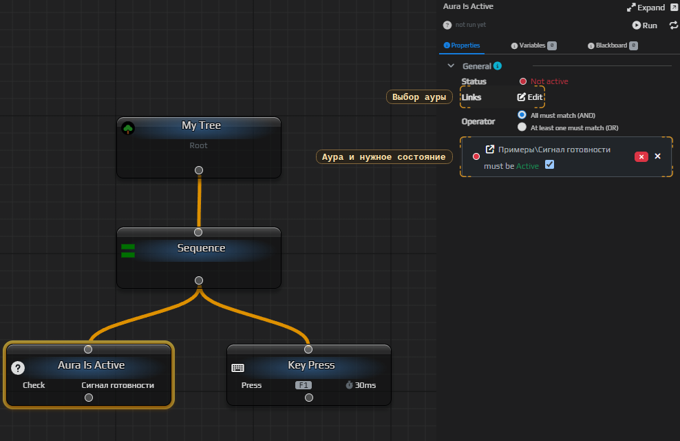

# Повторять готовность и закончить один управляемый проход

Дерево остаётся на вашей проверке готовности, пока она не пройдёт, потом подаёт сигнал. После этого вы перестаёте давать тики. Получается один сигнал **за намеренно завершённый проход**. Это не уведомление «один раз навсегда» в Main, который повторяется автоматически.

Нужны редактор Behavior Tree с узлами **Sequence**, **Until Success**, **Aura Is Active**, **Run Aura** и аудиовыход, который вы слышите. Источник готовности — состояние, которое вы переключаете вручную, а не предполагаемый API готовности приложения.

## Подготовить явный источник и звук

1. В корне создайте **New Aura → Готовность повтора**. В Triggers добавьте **Fixed Value → Is NOT Active**, без действий и оверлеев. Ауру оставьте загруженной и включённой.
2. Создайте вторую ауру **Сигнал повтора**, тоже загруженную и включённую, с **Fixed Value → Is NOT Active**. В **On Enter** добавьте ровно один **Play Sound**: **Audio notification → Ping**, **Volume 50%**, **Play in background** выключен. Проверьте предпрослушивание. While Active, On Exit и Overlays оставьте пустыми. Fixed Value у Сигнала повтора во время опыта не меняйте.
3. Создайте **New Behavior Tree**. Выберите My Tree, включите **Activation → Is Loaded**, задайте **Execution → When Activated → Do nothing**. Условия автоматической активации оставьте пустыми. Кнопку повтора не нажимайте: каждую попытку ниже запускает одна и та же верхняя Tick BT Once.

## Соединить повторную проверку перед сигналом

1. Через **Add new Node** добавьте Sequence, Until Success, Aura Is Active и Run Aura. Соедините их по схеме ниже. У Sequence два включённых ребёнка слева направо: Until Success и Run Aura. У Until Success один ребёнок — Aura Is Active.
2. У Aura Is Active через **General → Links → Edit** выберите только Готовность повтора, укажите **must be Active** и задайте **Operator → All must match (AND)**. Ребёнка этой проверке не добавляйте.

   

   На снимке связана аура Сигнал готовности. В этом дереве через Edit выберите Готовность повтора.
3. У Until Success проверьте **General → Child**: там должна быть эта проверка. У Run Aura выберите **General → Auras → Links → Сигнал повтора**, проверьте **1 action** и задайте **Strategy → run 1-by-1 in order of addition**.

```text
My Tree
└─ Sequence
   ├─ Until Success
   │  └─ Aura Is Active: Готовность повтора must be Active
   └─ Run Aura: Сигнал повтора, ordered, 1 action
```

4. Убедитесь, что Готовность повтора **Not Active**, и нажмите верхнюю **Tick BT Once**. Проверка вернёт Failure, но Until Success и Sequence останутся в **Running**. Сигнала быть не должно.
5. Пока источник Not Active, нажмите **ту же** верхнюю кнопку ещё раз. Будет ещё одна попытка проверки и снова Running без сигнала. У Until Success нет внутреннего цикла опроса и своей паузы между попытками.
6. Переведите Готовность повтора в **Is Active** и дождитесь, пока аура станет Active. Вернитесь к тому же выбранному дереву и нажмите ту же Tick BT Once. Проверка пройдёт, Sequence дойдёт до Run Aura, прозвучит один Ping, и проход закончится с **Success**. Больше не нажимайте: при Do nothing нового сигнала само по себе быть не должно.

| Операция | Ожидаемый результат |
| --- | --- |
| Ручной тик, когда состояние точно ложное | Одна неуспешная попытка, родитель в Running, сигнала нет |
| Следующий ручной тик после перехода в Active | Проверка прошла, один сигнал, проход завершён |
| Новых ручных тиков нет, выбран Do nothing | Новый проход не запрошен |
| Ещё один тик после Success | Начинается новый проход. Если условие совпадает, звук прозвучит снова |

Чтобы повторить намеренно, сначала верните Готовность повтора в **Is NOT Active**, дождитесь этого состояния и начните следующий проход через Tick BT Once.

Чтобы отказаться от сохранённого Running, выгрузите **своё дерево** через **Is Loaded**, дождитесь, пока оно закончит работу и очистится, и загрузите снова перед новым опытом. **Reset node status** только очищает отображение и не сбрасывает выполнение. Не запускайте отдельный узел через Run, пока прежний маршрут хранит продолжение.

[Until Success](/ru/behavior-trees/nodes/until-success) превращает каждый обычный Failure ребёнка в Running. [Sequence](/ru/behavior-trees/nodes/sequence) запоминает этот этап и пускает к [Run Aura](/ru/behavior-trees/nodes/execute-aura) только после успеха. [Узел состояния ауры](/ru/behavior-trees/nodes/aura-is-active) читает источник и не меняет его. Unknown, ошибки и отмена не считаются обычными повторными попытками.

При автоматической работе **Tick every** у [Root](/ru/behavior-trees/nodes/root) задаётся в **ms**. Это пауза после периодического обхода, а не гарантированный интервал опроса. **Run once** даёт один тик активации и не обязан довести Running до конца. **Run periodically** после завершения может начать следующий проход и снова подать звук. Ни один из режимов не делает постоянную защёлку для одиночного уведомления. Если нужно одно намеренное завершение, оставьте ручной путь из этого рецепта.
