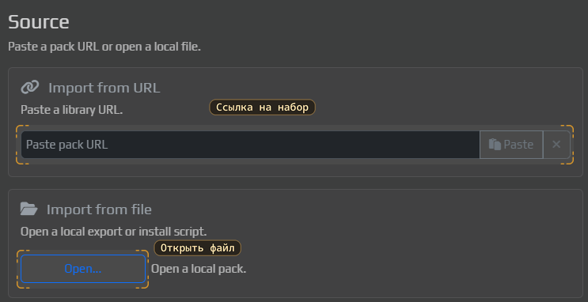

# Решить, готов ли набор для вашей среды

Разберите набор до того, как импортировать его в рабочее дерево. В конце должно быть ясное решение: набор подходит вашей подготовленной среде, требует конкретной настройки или ждёт недостающих сведений. По названию публикации и успешному скачиванию нельзя понять, что делают действия.

Нужны свой тестовый профиль без личных данных и файл набора, который вам разрешено изучать. Проще начать со своего небольшого набора. Для публикации подготовьте обычную ссылку и требования автора. Менять аккаунт и что-либо запускать не нужно. Закрытое содержимое может помешать полной проверке. Это неопределённость, а не доказательство безопасности.

## Просмотреть до применения

1. Откройте **Import → Source → Import from file → Open...** и выберите подготовленный JSON. Для доступной публикации вставьте обычную ссылку в **Source**, проверьте автора и имя и нажмите **Download**, чтобы получить **Preview**. Открыть источник — ещё не значит выполнить Import.

   

   Для сохранённого JSON выберите Open… в разделе Import from file.
2. У публикации посмотрите **Overview** и **Pack Options**. Запишите автора, показанную **rev.**, требуемую версию клиента и заявленные окна, язык, файлы, ресурсы, дополнительные модули. У локального JSON без сведений публикации нет её ревизии и подписки. Сверьте его с требованиями, которые вам дали отдельно.
3. В **Preview** раскройте папки и выбирайте ауры и папки, которые относятся к задаче. Посмотрите видимые Enabling Conditions, Triggers, действия и оверлеи. Отметьте выгруженные элементы, скрипты, изображения и звук, внешние пути. Прочитайте скрипты и объявления ресурсов там, где они доступны. Предпросмотр — не полная трасса выполнения, и все зависимости он показывать не обязан. Если видите **Item is not browsable**, не хватает требований или код недоступен, остановитесь и запросите пояснение обычным способом. Не считайте такое поведение безвредным.
4. Не путайте права папки с выполнением. **Read-Only** не мешает готовой логике работать, а **Private Content** может её скрывать. Учитывайте ограничения родительских папок. Набор есть в библиотеке, его можно скачать, его можно редактировать, ему нужна лицензия — это четыре разных факта. Не меняйте владельца и не разблокируйте набор, только чтобы закончить проверку.
5. В **Import Options** посмотрите обновления, подписку и конфликты. **Copy** сохраняет существующие объекты, а копии получают отдельные ID. **Replace** заменяет конфликтующие объекты целиком, а не отдельные поля. **Ignore Conflicts** может оставить набор неполным. Подписка тоже применяет текущую публикацию. Пока требования неясны, не нажимайте Import и кнопки, которые применяют решения по конфликтам.

## Превратить просмотр в решение

Для выбранного файла или ревизии запишите короткую памятку:

| Проверка | Что нужно установить |
| --- | --- |
| Условие и реакция | Настоящий источник данных, разрешение работы, On Enter/While Active/On Exit и автоматический вход дерева/макроса |
| Ссылки и ресурсы | Включённые и внешние ссылки на ауры, источники привязок, встроенные ресурсы, файлы, дополнительные модели/провайдеры и доступны ли они |
| Значения по умолчанию | Нужный Target Window и какие свойства захвата/действий наследуют его, а какие имеют своё значение |
| Доступ и версия | Что из содержимого можно изучить, какие настройки разрешены, подходят ли клиент и компоненты, какие лицензии заявлены |

Если нужное скрыто или недоступно, выберите **отложить** и закройте окно. Рабочее дерево не изменилось, потому что импорт не применялся.

Если требования понятны, результат — конкретный план настройки, а не сертификат безопасности. Например: «выбрать своё окно документа в папке, проверить обе привязки захвата, оставить подготовленную реакцию отключённой до проверки». Выделенная папка не становится новым местом назначения вместо путей импорта. И не рассчитывайте, что у Import есть универсальный безопасный или отключённый режим.

Когда решите продолжить, применяйте выбранную политику конфликтов и обновлений только в своём тестовом профиле. Загрузку и разрешение работы проверьте раньше, чем реакции.

Что почитать:

- [Экспорт и импорт](/ru/features/export-import) — как применяется набор.
- [Значения по умолчанию](/ru/features/default-properties) и [привязки](/ru/features/bindings) — как значение передаётся от источника к назначению.
- [Условия включения](/ru/features/enabling-conditions) — что разрешает работу. Выбор окна захвата не даёт ему фокус и не доставляет ввод.
- [Библиотека](/ru/aura-library) — где найти публикацию.
- [Права](/ru/features/permission-model) — кто может смотреть и редактировать. Безопасность невидимого содержимого они не обещают.
