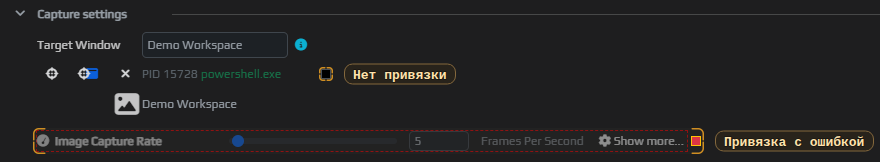

# Менять два источника захвата в одном месте

Вы выбираете окно один раз в папке, и обе визуальные проверки начинают смотреть в него. Это удобно, когда для одного приложения нужно несколько распознавателей: параметры поиска у каждого свои, а окно задаётся в одном месте.

Откройте два отдельных окна своего текстового редактора. В одном крупно напишите **SOURCE A**, в другом — **SOURCE B**. Оба окна должны быть не свёрнуты и видны, чтобы захват получал свежие пиксели. Это ваши окна и ваш текст, а не файлы из Wiki.

Рецепт заканчивается на том, что оба предпросмотра показывают правильное окно. Сам кадр не говорит, сработает ли условие Image Search или Color Search.

## Сделать папку источником общего выбора

1. На пустом месте дерева создайте **New folder** с именем **Общий визуальный источник**. Откройте **Triggers/Actions/Overlays Defaults**.
2. Включите флажок **Target Window**. Через **Click to select Window** выберите SOURCE A и проверьте сведения об окне, которое нашлось на самом деле. Если окно закрыть и открыть заново, его дескриптор может измениться, поэтому на время опыта оба окна не закрывайте.
3. В папке создайте **New Aura → Проверка значка** и добавьте **Triggers → + → Image Search**. Создайте вторую дочернюю ауру **Проверка цвета** с **Color Search**. Списки действий оставьте пустыми.
4. У Проверки значка в **Capture settings → Target Window** нажмите правой кнопкой маленький индикатор привязки рядом с полем и выберите **Bind to Default**. То же самое сделайте у Проверки цвета. Так каждое поле явно подключается к значению папки, даже если новый компонент уже получил такую привязку сам.

   Нажимайте правой кнопкой чёрный квадрат у **Target Window**. Красный индикатор ниже относится к другому полю — **Image Capture Rate**.

   

| Связь | Направление |
| --- | --- |
| Target Window в значениях папки | Даёт выражение сопоставления окна |
| Проверка значка → Target Window захвата | Получает значение через Bind to Default |
| Проверка цвета → Target Window захвата | Получает то же значение через свою привязку |

5. У обоих триггеров задайте **Image Capture Rate 5 FPS**, эффекты оставьте пустыми и начните с целого источника: **Crop region → Reset**. По очереди откройте **Preview captured image**. В обоих предпросмотрах и в сведениях о выбранном окне должен быть SOURCE A.
6. Вернитесь к папке и указателем смените только её включённый **Target Window** на SOURCE B. Снова посмотрите оба триггера: они должны показывать SOURCE B, хотя сами поля вы не трогали. Ауры при этом загружены и включены, EyeAuras не на паузе.
7. Верните в папке SOURCE A — оба предпросмотра должны вернуться к нему. Если переключился только один, проверьте привязку второго поля: там может быть ручное значение, другой источник или ошибка. У Image Search без образца может не быть пригодного результата совпадения, хотя кадр захватывается правильно.

[Свойства по умолчанию](/ru/features/default-properties) хранят общий выбор, [Bindings](/ru/features/bindings) соединяет источник с получателем, а [захват](/ru/triggers/images/imagecapturetriggers) даёт пиксели, которые вы видите в предпросмотре. Это свойство принимает выражение сопоставления окна. Найденный прямоугольник или обычный текст состояния не заменяют совместимый тип. Обратную привязку из триггера в папку не создавайте.

Чтобы дать одной проверке своё окно, выберите **Un-bind** у её индикатора и задайте отдельный Target Window. После этого изменение отвязанного поля не должно влиять на вторую проверку. **Apply to All** здесь не нужен: он может заменить и другие отмеченные defaults там, где у потомков свои привязки.

Для постоянной работы задайте устойчивое [выражение окна](/ru/features/window-matching-expressions) и перепроверьте результат после того, как окно откроется заново. Сам распознаватель настраивается отдельно: [Image Search](/ru/triggers/images/image-search) или [Color Search](/ru/triggers/images/color-search).

В этом рецепте нет действий ввода. Если вы добавите такое действие позже, у него может быть своя или унаследованная привязка. Отдельно проверьте, куда оно на самом деле целится, как доставляется ввод и нужен ли фокус. Выбор окна для захвата не разрешает отправлять в него ввод.
