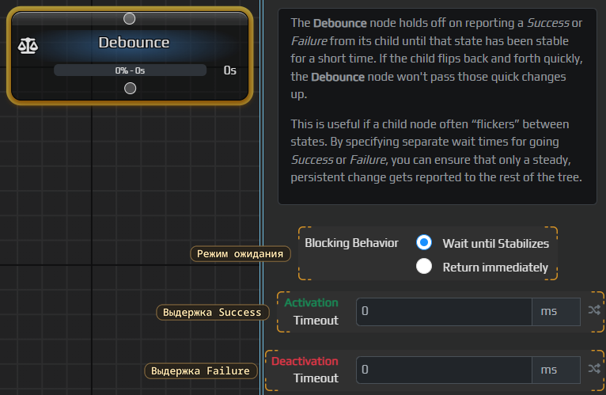

# Задержать предупреждение, которое действительно проверено

Предупреждение должно продержаться секунду, прежде чем прозвучит Ping. Если проверка в это время увидела ложный результат, секунда отсчитывается заново. Debounce знает только то, что увидел на ваших тиках. Был ли внешний сигнал истинным всё время между тиками, опыт не показывает.

Нужны редактор Behavior Tree с Debounce, Sequence, Aura Is Active и Run Aura и аудиовыход, который вы слышите. Возьмите отдельный набор, в котором есть только звук. EyeAuras не должен стоять на паузе.

## Подготовить предупреждение и сигнал

1. В корне создайте **New Aura → Источник предупреждения**. Добавьте **Triggers → Fixed Value → Is NOT Active**, без действий и оверлеев. Ауру оставьте загруженной и включённой.
2. Создайте вторую загруженную ауру **Сигнал предупреждения**, тоже с **Fixed Value → Is NOT Active**. В **On Enter** добавьте ровно один **Play Sound**: **Audio notification → Ping**, **Volume 50%**, **Play in background** выключен. Проверьте предпрослушивание. While Active, On Exit и Overlays оставьте пустыми. Саму звуковую ауру во время опыта не активируйте.
3. Создайте **New Behavior Tree**. Выберите **My Tree**, включите **Activation → Is Loaded**, задайте **Execution → When Activated → Do nothing**. Автоматическую активацию не добавляйте, кнопку повтора не нажимайте.
4. Через **Add new Node** соедините узлы по схеме. Дети Sequence идут слева направо. У Aura Is Active своего ребёнка нет.

```text
My Tree
└─ Sequence
   ├─ Debounce
   │  └─ Aura Is Active: Источник предупреждения must be Active
   └─ Run Aura: Сигнал предупреждения, ordered, 1 action
```

5. В Aura Is Active через **General → Links → Edit** выберите только Источник предупреждения, укажите **must be Active** и задайте **All must match (AND)**. В Run Aura выберите **General → Auras → Links → Сигнал предупреждения**, проверьте **1 action** и задайте **run 1-by-1 in order of addition**.
6. Настройте Debounce по таблице. Случайный разброс у обоих сроков выключите. Поле **Child** должно указывать на вашу проверку ауры.

| Настройка Debounce | Значение |
| --- | --- |
| General → Behavior | Wait until Stabilizes |
| Activation Timeout | 1000 ms |
| Deactivation Timeout | 1000 ms |



На снимке оба интервала равны нулю. Вам нужно ввести 1000 мс в каждое из двух полей.

## Увидеть допуск, отказ и новый вход

1. Переведите источник в **Is Active**, дождитесь, пока он точно станет Active, и нажмите верхнюю **Tick BT Once**. Debounce и Sequence вернут **Running**, Ping не прозвучит.
2. Переведите источник в **Is NOT Active**, дождитесь этого состояния и нажмите **ту же** верхнюю кнопку. Debounce увидит Failure, сбросит ожидающую активацию и начнёт отсчёт деактивации. Он вернёт Running. Подождите больше секунды и сделайте ещё один тик при ложном источнике — будет **Failure**, без звука.
3. Снова переведите источник в Active и сделайте тик. Начнётся новый отсчёт активации, результат — Running. Оставьте источник Active, подождите больше секунды и сделайте ещё тик. Debounce завершится успешно, прозвучит один Ping, Sequence вернёт **Success**. Больше тиков не давайте.

Чтобы повторить намеренно, сначала переведите источник в Not Active и **сделайте тик, чтобы Debounce это увидел**. Потом верните Active и повторите выдержку.

Успешное завершение не сбрасывает истёкший таймер Debounce. Поэтому лишний тик, пока источник всё ещё Active, может сразу подать звук. Если нужен полный сброс, выгрузите своё дерево, дождитесь очистки и загрузите снова. **Reset node status** очищает только отображение.

[Debounce](/ru/behavior-trees/nodes/Debounce) фильтрует результаты, которые увидел, [Aura Is Active](/ru/behavior-trees/nodes/aura-is-active) читает источник, а [Sequence](/ru/behavior-trees/nodes/sequence) пускает к [Run Aura](/ru/behavior-trees/nodes/execute-aura) после Success.

- Не добавляйте ребёнка проверке: Running проходит через Debounce и таймеры не сбрасывает.
- Изменение, которое случилось между тиками и не попало ни на один из них, Debounce не видит.
- Есть другой режим, Return immediately: до истечения срока он возвращает противоположный терминальный результат. Здесь он не используется.
- Unknown или ошибка проверки не значат, что предупреждения точно нет.
