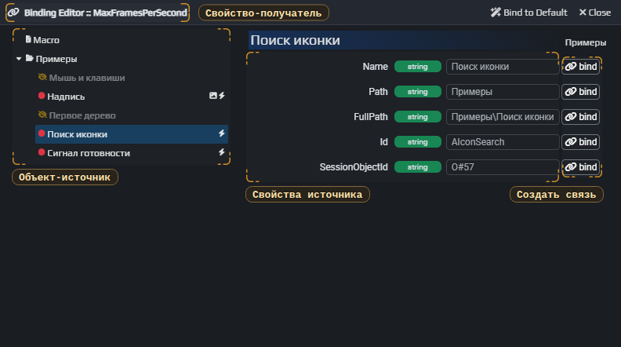

# Найти причину исчезновения связанной памятки

Памятка может пропасть по четырём разным причинам: ей запрещена работа, не выполнено условие, сломан источник текста или не виден оверлей. Сначала соберите небольшой набор, где всё известно. Потом меняйте по одной вещи — и увидите, где искать похожую проблему в своей конфигурации.

Нужны Text, Fixed Value, триггер Aura Is Active, Dependencies Viewer и Binding editor. Возьмите свои ауры только для показа, загруженные и включённые. EyeAuras не должен стоять на паузе. Если собираетесь пробовать на важном существующем наборе, сначала сохраните [экспорт](/ru/features/export-import).

## Создать известную зависимость и привязку текста

1. В корне создайте **New Aura → Источник текста** с **Fixed Value → Is Active** и оверлеем **Text**. В **Content** напишите `Проверьте заметки`, задайте **Font 24**, **Size to fit** выключите. Разблокируйте оверлей, разместите прямоугольник так, чтобы текст читался, и включите **Locked**. Действия оставьте пустыми.
2. В корне создайте **New folder → Группа памяток**. В **Enabling Conditions** добавьте только **Fixed Value → Is Active**. Внутри создайте ауру **Связанная памятка** с обычным **Triggers → Aura Is Active**. В **Links** выберите только Источник текста, укажите **Active** и задайте **Logical operator → All must match (AND)**.
3. Добавьте Связанной памятке Text с Font 24 и выключенным Size to fit. Нажмите индикатор привязки у **Content**. В **Binding editor** слева выберите Источник текста, справа раскройте **Overlays → Text → Content** и нажмите **bind**. Строка идёт от источника к назначению, обратной связи нет. Разместите этот оверлей отдельно от исходного и закрепите.

   На снимке редактор открыт для частоты захвата. Вам нужно открыть его у **Content**: источник выбирается в том же дереве, а кнопка **bind** стоит в строке свойства.

   

4. Вне Группы памяток создайте ауру **Граф** с **Fixed Value → Is Active** и оверлеем **Dependencies Viewer**. В **Graph → Auras → Links** оверлея выберите Связанную памятку. Включите **Show dependencies** и **Show connections**, разместите граф отдельно от текста. Ребро графа показывает зависимость от состояния ауры, а не привязку Content.
5. До изменений откройте **Show event log → Event Viewer**. Покажите фильтры, включите **Auras**, задайте **Level → Info**, очистите текстовый фильтр и снимите панель с паузы.

## Проверять по одному слою

1. У Источника текста замените **Content** на `Проверка завершена`. Оба Text на экране должны обновиться. Если изменился только исходный, проверьте индикатор привязки у назначения и то, какое свойство выбрано источником. Красный индикатор или ошибку преобразования разбирайте отдельно. Ребро графа привязку свойства не проверяет.
2. Переведите Fixed Value Источника текста в **Is NOT Active**. Выберите ауру вне группы и выйдите из редактора. Связанная памятка должна скрыться, а когда вернёте **Is Active** — появиться. Ребро графа при этом остаётся: оно показывает структуру. Смотрите на состояние триггера и на сообщения с контекстом в Event Viewer, а не на цвет графа.
3. У Группы памяток задайте **Enabling Conditions → Fixed Value → Is NOT Active**. Снова выберите другой объект и выйдите из редактора. Ребёнку запрещена работа, хотя Источник текста Active. Верните папке **Is Active**.
4. Если памятка должна быть скрыта, но остаётся на экране, проверьте **Locked** и то, какой объект выбран в редакторе. Для обычного наблюдения нужны **Window → Mode → Overlay**, **Opacity 100%**, видимое положение и Locked. Разблокированный оверлей или предпросмотр выбранной ауры может быть виден независимо от обычного условия.

| Симптом | Что проверить сначала |
| --- | --- |
| Ребёнок выгружен или ему запрещена работа | Загрузку, разрешение родителя и паузу. Обычные триггеры разбирайте после этого |
| Ребёнок загружен и разрешён, но условие ложное или Unknown | Настоящие Links у Aura Is Active, ожидаемое состояние и ауру-источник |
| Условие верное, но слова не следуют источнику | Направление Content источник→назначение и совместимый строковый тип |
| Текст и состояние верные, но памятки не видно или она вводит в заблуждение | Положение, прозрачность, блокировку и предпросмотр выбранной ауры |

[Условия включения](/ru/features/enabling-conditions), [привязки](/ru/features/bindings) и [общие параметры](/ru/overlays/common-options) управляют разными слоями. [Dependencies Viewer](/ru/overlays/dependencies-viewer) показывает структуру. Цвета активности и занятости и сохранённая раскладка не подтверждают, что всё сейчас работает. [Event Viewer](/ru/features/event-viewer) показывает только те сообщения, которые панель приняла, пока была открыта и разрешена. Это не полный аудит и не подтверждение, что внешнее действие завершилось.

Действий в этом наборе нет. В конце оставьте разрешение и источник активными: на экране должны быть две одинаковые памятки.
