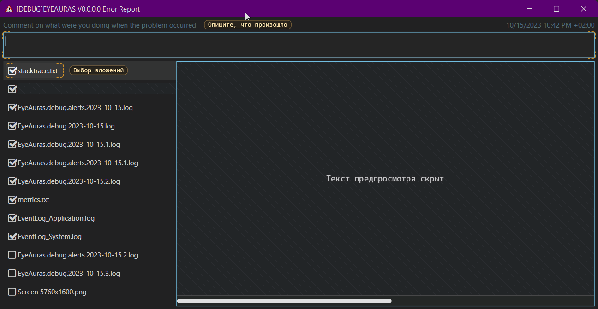

# Сохранить данные о проблеме и выбрать способ передачи

Триггер не сработал или действие сделало не то, чего вы ждали? Соберите описание и логи этого запуска через Report a problem. Архив можно сначала сохранить у себя и проверить.

## Если приложение продолжает работать

1. Нажмите **Report a problem** в заголовке EyeAuras. В мини-приложении такую кнопку может добавить его автор. Откроется **Error Report**.
2. Напишите, что сделали, что получили и чего ждали. Добавьте название набора или функции и версию. Например: «Выбрал окно, но предпросмотр остался пустым; ожидал изображение этого окна». Пишите то, что видели сами, а не то, что считаете причиной.
3. Выберите логи нужного запуска и просмотрите вложения. Если сбой был до перезапуска, найдите и более ранний лог. Конфигурацию добавляйте, если без неё проблему не повторить.

   
4. Нажмите **Save…**, выберите свою папку и дождитесь, пока появится `.7z`. Откройте архив и проверьте комментарий и выбранные файлы. Пока файл только сохранён, он никуда не отправлен.
5. Чтобы отправить отчёт в поддержку, нажмите **Send** и дождитесь подтверждения с ID. Если автор набора попросил файл напрямую, передайте сохранённый архив через согласованный [контакт](/ru/contacts).

| Кнопка или состояние | Как понять результат |
| --- | --- |
| Save… | Выбранные данные упакованы в архив на вашем диске. Открывается папка с ним. |
| Send | Архив уходит настроенному обработчику. В штатном EyeAuras это сервер EyeAuras, мини-приложение может задать свой. Без обработчика отправка недоступна. |
| Compressing report… / Sending report… | Работа ещё идёт, подтверждения доставки нет. |
| Report sent / Report sent successfully | Обработчик вернул ID. Сохраните его для обращения. |
| Copy | Копирует ID отправленного отчёта или текущий текст состояния. |
| Закрытие окна | Открыть или закрыть окно — ещё не значит отправить отчёт. |

Предзаполненный комментарий можно исправить или стереть. Данные собираются для конкретного окна отчёта. Если после этого что-то изменилось и нужно новое состояние, откройте новое окно.

## Что вы передаёте

| Данные | Когда включаются |
| --- | --- |
| systemInfo.txt | Сведения о системе, процессе, путях и командной строке. Собираются автоматически. |
| applicationInfo.txt | Текущий EyeAuras сам добавляет сведения о приложении, отправителе, лицензии, запуске, статистику дерева и подписки. В старых архивах файла может не быть. |
| stacktrace.txt | Доступные сведения об исключении. Если отчёт открыт вручную, исключения может не быть. |
| Логи и снимки окон приложения | Недавние логи и доступные снимки окон обычно уже выбраны. Проверьте список. |
| Снимки рабочего стола и конфигурация аур | По умолчанию не выбраны. Добавьте, если нужны. |

В логах, изображениях, путях и настройках могут быть личные данные. Если снять флажок с аур, обязательные сведения об аккаунте и подписках всё равно останутся. Полный состав, формат и маршрут отчётов для авторов описаны в [отчётах о проблемах](/ru/features/problem-reports). Отправка в EyeAuras не значит, что отчёт отдельно получит каждый автор из списка подписок.

## Если приложение завершилось

| Ситуация | Что сохранить |
| --- | --- |
| Открылось окно Error Report | Описание последних действий и вложения этого сбоя. Закроется ли приложение после окна, зависит от ошибки. |
| Процесс исчез без окна | Время сбоя, версию и логи предыдущего запуска. Когда приложение снова запустится, откройте Report a problem и выберите их. |
| Сбой повторяется ещё до открытия интерфейса | Копию каталога данных и логи. Что с ними делать — в разделе ниже. |

Когда интерфейс не открывается совсем

1. Закройте оставшийся экземпляр EyeAuras и найдите его каталог данных. Для обычного профиля release это `%appdata%\EyeAuras\release`. У другого профиля или переносимой установки путь свой.
2. Скопируйте **весь каталог** в безопасное место. В нём могут быть `config.cfg`, `backups`, отдельное хранилище аур и история. Одного config.cfg мало.
3. Запишите время последнего сбоя и сохраните папку `logs`. Напишите по [контактам](/ru/contacts) и договоритесь, какие файлы нужны. В архиве всего профиля могут быть конфиденциальные настройки, не выкладывайте его сразу в общий чат.
4. Если программа предложила загрузить резервную конфигурацию или сбросить её, сначала сохраните свою копию. Возврат настроек меняет рабочее состояние. Подробнее — [история конфигурации](/ru/features/config-rollback).

Раньше советовали удалить config.cfg и запустить программу с пустыми настройками. С отдельным хранилищем аур это не полный сброс. Для проверки на чистых данных используйте отдельный профиль, согласованный с поддержкой. Исходный каталог не удаляйте.

