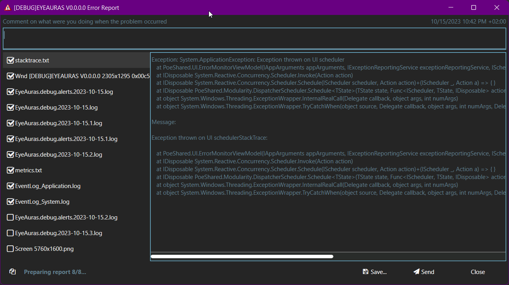

# Сохранить данные о проблеме и выбрать способ передачи

Если триггер не сработал или действие завершилось иначе, чем вы ожидали, подготовьте описание и логи того запуска. В EyeAuras это делается через Report a problem. Сначала можно сохранить архив у себя и проверить его; отправка — отдельное действие.

## Если приложение продолжает работать

1. Нажмите **Report a problem** в заголовке EyeAuras. В мини-приложении такая кнопка может быть предусмотрена его автором. Откроется **Error Report**.
2. Напишите, что сделали, что получили и что ожидали. Добавьте название набора или функции и версию. Например: «Выбрал окно, но предпросмотр остался пустым; ожидал изображение этого окна». Используйте свои наблюдения, а не предполагаемую причину.
3. Выберите логи нужного запуска и просмотрите вложения. Если сбой был до перезапуска, найдите и более ранний лог. Добавляйте конфигурацию, если она нужна для повторения проблемы.
4. Нажмите **Save…**, выберите свой каталог и дождитесь появления `.7z`. Откройте архив для чтения и проверьте комментарий и выбранные файлы. Пока вы только сохранили файл, он никуда не отправлен.
5. Для отправки штатной поддержке нажмите **Send** и дождитесь подтверждения с ID. Если автор набора попросил файл напрямую, передайте сохранённый архив через согласованный [контакт](/ru/contacts).

| Кнопка или состояние | Как понять результат |
| --- | --- |
| Save… | Выбранные данные упакованы в локальный архив, открывается его расположение. |
| Send | Архив передаётся настроенному обработчику: в штатном EyeAuras — серверу EyeAuras; мини-приложение может задать свой обработчик. Без обработчика отправка недоступна. |
| Compressing report… / Sending report… | Работа ещё идёт; подтверждения доставки нет. |
| Report sent / Report sent successfully | Обработчик вернул ID. Сохраните его для обращения; это не уведомление, что отчёт уже прочитан. |
| Copy | Копирует ID отправленного отчёта или текущий текст состояния. Архив не копирует и не отправляет. |
| Закрытие окна | Само открытие или закрытие окна не считается отправкой. |

Предзаполненный комментарий можно исправить или очистить. Выбранные сведения собираются для этого окна отчёта; если нужно новое состояние после изменений, откройте новое окно.

## Что вы передаёте

| Данные | Когда включаются |
| --- | --- |
| systemInfo.txt | Сведения о системе, процессе, путях и командной строке собираются автоматически. |
| applicationInfo.txt | Текущий EyeAuras автоматически добавляет приложение, отправителя, лицензию, запуск, статистику дерева и подписки. У старых архивов файла может не быть. |
| stacktrace.txt | Доступные сведения об исключении; у вручную открытого отчёта исключение необязательно. |
| Логи и снимки окон приложения | Недавние логи и доступные снимки окон обычно выбраны; проверьте список. |
| Снимки рабочего стола и конфигурация аур | Не выбраны по умолчанию; добавляются при необходимости. |

Логи, изображения, пути и настройки могут содержать личные данные. Снятие флажка с аур не удаляет обязательные сведения об аккаунте и подписках. Полный состав, формат и маршрут отчётов для авторов разобраны в [отчётах о проблемах](/ru/features/problem-reports). Отправка в EyeAuras не означает отдельную передачу каждому автору из списка подписок.

## Если приложение завершилось

| Ситуация | Что сохранить |
| --- | --- |
| Открылось окно Error Report | Описание последних действий и вложения этого сбоя. Завершение после окна зависит от характера ошибки; не каждый отчёт означает закрытие приложения. |
| Процесс исчез без окна | Время сбоя, версию и логи предыдущего запуска. После успешного перезапуска откройте Report a problem и выберите их. |
| Сбой повторяется ещё до открытия интерфейса | Копию каталога данных и логи для согласованной диагностики ниже. |

Исчезновение процесса не устанавливает причину. Это может быть ошибка нативного компонента или внешнее завершение; для вывода нужны данные Windows, журналы и обстоятельства. Старые списки совместимых защит не подтверждают совместимость нынешней версии, а добавление всей программы в исключения не является универсальным решением.

Когда интерфейс не открывается совсем

1. Закройте оставшийся экземпляр EyeAuras и найдите его каталог данных. Для обычного профиля release это `%appdata%\EyeAuras\release`; другой профиль или переносимая установка использует свой путь.
2. Скопируйте **весь каталог** в своё безопасное место. В нём могут быть `config.cfg`, `backups`, отдельное хранилище аур и история. Копия одного config.cfg не заменяет все эти данные.
3. Сохраните время последнего сбоя и папку `logs`. Обратитесь по [контактам](/ru/contacts), чтобы согласовать нужные файлы. Архив всего профиля может содержать конфиденциальные настройки; его не нужно сразу публиковать в общем чате.
4. Если программа предложила загрузить резервную конфигурацию или сбросить её, сначала сохраните свою копию. Возврат настроек изменяет рабочее состояние. Подробности — [история конфигурации](/ru/features/config-rollback).

Прежний способ удалить config.cfg и запустить с пустыми настройками проверял только старое монолитное хранилище. При отдельном хранилище аур это не полный сброс. Для проверки на чистых данных используйте согласованный с поддержкой отдельный профиль; исходный каталог не удаляйте.

