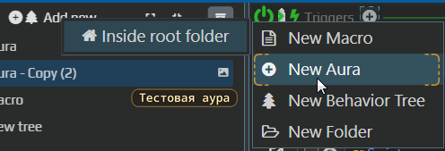
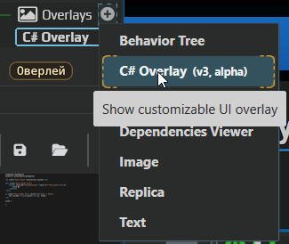

# Своя панель в EyeAuras

В EyeAuras можно написать на C# свою панель с кнопками, счётчиком или настройками и показать её поверх рабочего окна. Проще всего начать с **C# Overlay**: в нём уже есть готовый счётчик. Отдельный веб-сайт не нужен.

[Blazor](https://dotnet.microsoft.com/en-us/apps/aspnet/web-apps/blazor) связывает разметку интерфейса с обработчиками на C#. В EyeAuras компонент показывается внутри окна приложения. В [Razor](https://learn.microsoft.com/en-us/aspnet/core/blazor/components/?view=aspnetcore-8.0) разметка и обращения к C# пишутся рядом.

| Часть | За что отвечает |
| --- | --- |
| [HTML](https://www.w3schools.com/html/) | Текст, кнопки и расположение элементов. |
| [CSS](https://www.w3schools.com/html/html_css.asp) | Цвет, размеры, отступы и оформление. |
| Razor, файл `.razor` | Связывает разметку с данными и событиями компонента. |
| C#, файл `.cs` | Хранит состояние компонента и выполняет обработчики. Этот код можно оставить и в блоке `@code` внутри Razor. |
| `Script.csx` | Точка входа скрипта. Это отдельный контекст, а не сам Razor-компонент. |

## Открыть готовый счётчик

1. Создайте тестовую ауру через **Add new → New Aura**.

2. В разделе **Overlays** добавьте **C# Overlay**. На старом снимке он называется `C# Overlay (v3, alpha)`.

3. Сгенерированные файлы не меняйте. Чтобы панель была видна постоянно, добавьте в эту ауру **Fixed Value** со значением **Is Active** и оставьте ауру загруженной.

4. Нажмите **Click Me** в появившемся окне. С каждым нажатием число на панели растёт.

Число хранится в самом компоненте. Если компонент создаётся заново, счёт начнётся с нуля. Когда окно просто скрыто, компонент не обязательно пересоздаётся.

## Куда двигаться дальше

| Задача | Следующий шаг |
| --- | --- |
| Выбрать обычное окно или оверлей, настроить видимость и ввод | [Устройство окна и WebView2](/ru/scripting/blazor-windows/2-webview). |
| Изменить текст, кнопку и обработчик | [Файлы первого компонента](/ru/scripting/blazor-windows/3-hello-world). Там есть полный пример и вариант с `@code`. |
| Переключать свою ауру кнопкой | [Один переключатель](/ru/scripting/blazor-windows/4-toggle-hotkeyisactive). |
| Создать диалог из действия C# Script и передать ему данные | [Окно из скрипта](/ru/scripting/blazor-windows/getting-started). |

Тот же счётчик без оформления стандартного шаблона:

Учебный пакет и дополнительные материалы

[Скачать примеры](https://tinyurl.com/msfhaupc) — отдельный учебный набор. [Tutorial — Blazor Windows, revision 3](https://eyeauras.net/share/S20250511162645vYh4n3mqSLm0/3) сделан для EyeAuras **1.7.8354.0**, его файлы и снимки показывают прежний редактор. В текущем редакторе проще начать с нового C# Overlay, как выше.

На [CodePen](https://codepen.io/) есть примеры оформления на HTML/CSS. Разметку и стили оттуда придётся подогнать под свой компонент: пример для браузера сам окно EyeAuras не создаёт.

[Генератор RazorComponentTemplate](https://github.com/iXab3r/EyeAuras/blob/20fd3d424d886f6c99b979536a148774d289d110/Sources/EyeAuras.Blazor.Shared/CodeEditor/Templates/RazorComponentTemplate.cs) создаёт две части компонента с общим namespace. Когда редактируете их, следите, чтобы имена и namespace совпадали.

