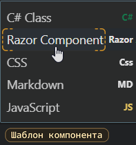
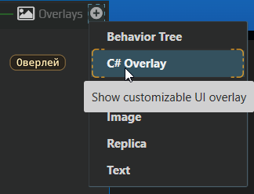

# Открыть своё окно из C# Script

Небольшой диалог настроек можно открывать на время одного запуска скрипта. Сделаем окно со счётчиком и заголовком, который передаёт скрипт. Оно появится по **Run**. Когда окно закроют или запуск остановят, его ресурсы освободятся.

Если панель должна показываться и скрываться вместе с аурой, проще взять [C# Overlay](/ru/scripting/blazor-windows/1-intro). Здесь используем **C# Script**: скрипт сам создаёт окно и владеет им.

| Способ | Когда подходит |
| --- | --- |
| C# Overlay | Индикатор или панель, которая показывается по активности ауры. |
| C# Script + `CreateWindow<T>` | Диалог, который открывается отдельным запуском. Компонент и начальные данные задаёт скрипт. |

## Создать проект окна

1. Создайте тестовую ауру и добавьте **C# Script** в **On Enter**. Для начала запускайте действие вручную через **Run**, чтобы повторные активации не открыли несколько окон.


2. В редакторе проекта выберите **New file → Component(with code-behind)** и задайте имя `UserComponent`. Появятся файлы `.razor` и `.cs`. На старом снимке шаблон называется **Razor Component**.



[Полный снимок меню](https://s3.eyeauras.net/media/2024/11/EyeAuras_I6MYDieptaZe5a8u.png)

3. Создайте обычный C#-файл `WindowModel.cs`. Замените содержимое всех четырёх файлов кодом ниже. Namespace `BlazorDemo` должен совпадать в модели и в обеих частях компонента, а `Script.csx` подключает его через `using`.

### Script.csx

```csharp
using BlazorDemo;
using EyeAuras.Shared.Scripting;

{
    using var window = GetService<IDialogWindowUnstableScriptingApi>()
        .CreateWindow<UserComponent>(new WindowModel { Title = "Моё окно" });

    window.Title = "Пробный диалог";
    window.Width = 480;
    window.Height = 260;
    window.WindowStartupLocation = System.Windows.WindowStartupLocation.CenterScreen;
    window.ShowDialog(cancellationToken);
}
```

### WindowModel.cs

```csharp
namespace BlazorDemo;

public sealed class WindowModel
{
    public string Title { get; set; } = "Настройки";
}
```

### UserComponent.cs

```csharp
using System.Threading.Tasks;
using PoeShared.Blazor;

namespace BlazorDemo;

public partial class UserComponent : BlazorReactiveComponent<WindowModel>
{
    private int count;

    private async Task Increment()
    {
        count++;
        await Refresh("dialog counter clicked");
    }
}
```

### UserComponent.razor

```razor
@namespace BlazorDemo
@using Microsoft.AspNetCore.Components.Web
@using PoeShared.Blazor
@inherits BlazorReactiveComponent<WindowModel>

<h2>@DataContext.Title</h2>
<button class="btn btn-primary" @onclick="Increment">Прибавить один</button>
<p>Нажатий: @count</p>
```

4. Дождитесь компиляции и нажмите **Run**. В центре экрана должно открыться окно **Пробный диалог**, в нём — заголовок **Моё окно** и кнопка счётчика.
5. Нажмите кнопку, затем закройте диалог — запуск завершится. При следующем Run счёт снова начнётся с нуля. **Stop** отменяет ожидание окна через `cancellationToken` и освобождает окно.

На старом снимке окно создано так же, но текст и оформление — из прежнего примера:


## Что связывает файлы

| Часть | Назначение |
| --- | --- |
| `GetService<IDialogWindowUnstableScriptingApi>()` | Получает оконный сервис в контексте `Script.csx`. `Unstable` в имени значит, что контракт может меняться между версиями. |
| `CreateWindow<UserComponent>(model)` | Создаёт окно с указанным компонентом и передаёт ему модель как `DataContext`. |
| `BlazorReactiveComponent<WindowModel>` | Даёт компоненту типизированный `DataContext`. Это объект, который передали явно, а не доступ к локальным переменным скрипта. |
| `ShowDialog(cancellationToken)` | Показывает окно и держит запуск, пока окно не закроют или запуск не отменят. |
| `using var window` | Освобождает окно при выходе из блока — после закрытия диалога или отмены ожидания. Сервис также привязывает окно к своему сроку жизни, поэтому после Stop оно не остаётся бесхозным. |

`WindowModel` здесь хранит только начальные данные. Если изменить её обычное свойство извне, окно само не перерисуется. Для живых данных нужно наблюдение, как в [примере с триггером](/ru/scripting/blazor-windows/reactive-toggle). В классе и в Razor нет глобальных `GetService`, `AuraTree`, `Variables` и `cancellationToken` из скрипта.

<details>
<summary>Если нужна постоянно видимая панель</summary>

Добавьте C# Overlay вместо действия, оставьте его ауру активной и редактируйте `UserOverlay`, как в [начале серии](/ru/scripting/blazor-windows/1-intro). На старых снимках видно, где добавляется оверлей и как выглядит стандартный шаблон:




На том же механизме строятся и более плотные панели состояния:


В отличие от диалога выше, в `Script.csx` оверлея не нужно вызывать `ShowDialog`: окном управляет сам C# Overlay.

</details>

Другие способы работы с окном — в [оконном API](/ru/scripting/api/IDialogWindowUnstableScriptingApi) и [карте Blazor](/ru/scripting/api/core/blazor).
