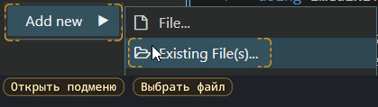
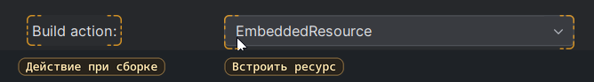

# Добавить справку в проект скрипта

Встроенный ресурс — это файл, который хранится прямо в сборке скрипта. Он переносится вместе с проектом, и для чтения не нужен путь на диске. Для примера добавим `docs/help.txt`. Так же можно положить картинку, видео, модель или DLL.

Нужен редактируемый проект `C# Script`. `GetService`, `Log` и `cancellationToken` в примерах даёт сам EyeAuras коду верхнего уровня. Обычному классу передавайте нужное явно.

## Добавить файл и прочитать текст

1. Создайте текстовый файл `help.txt` с содержимым `Справка проекта`.
2. Откройте дерево файлов кнопкой `File Tree`. В контекстном меню дерева выберите `Add` → `Existing File(s)...` и добавьте файл. На старом снимке команда называется `Add Existing File...`.



3. Через `Rename...` назовите ресурс `docs/help.txt`. Если выбрать его в дереве, откроется служебное описание, а не редактор текста.


4. В `Script.csx` вставьте код:

```csharp
using System.IO;
using EyeAuras.Repl;

{
    var files = GetService<IScriptFileProvider>();
    var file = files.GetFileInfo("docs/help.txt");
    if (!file.Exists)
    {
        Log.Warn("Ресурс docs/help.txt не найден");
        return;
    }
    using var stream = file.CreateReadStream();
    using var reader = new StreamReader(stream);
    Log.Info(reader.ReadToEnd());
}
```

5. Нажмите `Run`. В журнале появится `Справка проекта`. Если сработал `Log.Warn`, проверьте имя ресурса и правила поиска ниже.

Поток и `StreamReader` закрываются сами при выходе из блока. `IScriptFileProvider` освобождать не нужно.

Чтобы убрать ресурс, удалите файл из списка проекта. Чтобы заменить содержимое, удалите старый ресурс и добавьте новый файл с тем же именем или импортируйте его из IDE. Потом перекомпилируйте скрипт.

Через `New file` можно создать обычный текстовый документ проекта, например Markdown. Служба файлов его тоже видит. Этот случай разобран в [примере с README](/ru/scripting/examples/basic/file-provider).

## Понять имя и выбрать способ чтения

Имя ресурса начинается с `DefaultNamespace` проекта, а если он не задан — с имени проекта. Слеши в пути заменяются точками: `MyScript` и `Images/logo.png` дают `MyScript.Images.logo.png`.

| Способ | Как найти ресурс |
| --- | --- |
| `IScriptFileProvider.GetFileInfo` | Понимает полное имя манифеста, полное имя со слешами и однозначный суффикс на границе имени. Полные имена сравниваются без учёта регистра. |
| `Images/logo.png` | Может найти `MyScript.Images.logo.png`. Учитываются и варианты с `wwwroot`. Если подходит несколько файлов, получите `Exists == false`, а не случайный первый файл. |
| `Assembly.GetManifestResourceNames()` | Возвращает полные имена ресурсов конкретной сборки как есть. |
| `Assembly.GetManifestResourceStream(fullName)` | Открывает поток по точному полному имени. Поток нужно закрыть. |
| `GetDirectoryContents` | Показывает имена в виде дерева для диагностики. Это не обязательно исходная структура папок без префикса проекта. |

Частичный путь с точками — не то же самое, что путь со слешами. Если короткое имя подходит к нескольким файлам, пишите полное: `MyScript.Images.logo.png` или `MyScript/Images/logo.png`.

Посмотреть полные имена в `Script.csx`:

```csharp
foreach (var name in typeof(Script).Assembly.GetManifestResourceNames())
{
    Log.Info(name);
}
```

`Script` здесь — сгенерированный тип вашего скрипта. В обычной библиотеке такого типа нет. То же самое с подписью в журнале:

```csharp
var asm = typeof(Script).Assembly;
foreach (var name in asm.GetManifestResourceNames())
{
    Log.Info($"Resource: {name}");
}
```

Список файлов через службу файлов. В начало `Script.csx` добавьте `using EyeAuras.Repl;`:

```csharp
var files = GetService<IScriptFileProvider>();
foreach (var fi in files.GetDirectoryContents("/"))
{
    Log.Info($"Found: {fi.Name} ({fi.Length} b)");
}
```

Служба может искать в нескольких источниках. Сначала проверяются ресурсы сборки, потом прежний источник файлов. Побеждает первый найденный файл, но неоднозначность внутри одного источника это не снимает. Короткий готовый пример — [прочитать README](/ru/scripting/examples/basic/file-provider).

## Сохранить ресурсы при работе в IDE

При [экспорте проекта](/ru/scripting/ide-integration) EyeAuras записывает файлы на диск и добавляет в `.csproj` элементы `EmbeddedResource`. Например, для `Image 12.jpg`:

```xml
<ItemGroup>
   <EmbeddedResource Include="Image 12.jpg" />
   <None Remove="Image 12.jpg" />
</ItemGroup>
```

В Rider или Visual Studio это `Build Action = EmbeddedResource`:



При обратном импорте EyeAuras читает явные `Include` и сами файлы по путям относительно проекта. Указывайте каждый ресурс явно. Импорт не выполняет произвольные MSBuild targets. `None Remove` только убирает файл из набора `None`.

<details>
<summary>Изображение в Blazor и чтение большого файла</summary>

Если ресурс `Image 12.jpg` добавлен в проект, в **Razor-компоненте подготовленного окна** можно написать так:

```html

```

Окно должно отдавать файлы проекта, см. [Blazor Windows](/ru/scripting/blazor-windows/getting-started).

Большой файл читайте потоком, а не целиком в массив. Добавьте `video/tutorial.mp4`. Этот отдельный `Script.csx` только считает байты. Проверка отмены нужна, чтобы скрипт остановился по `Stop`:

```csharp
using System.IO;
using EyeAuras.Repl;

{
    var file = GetService<IScriptFileProvider>().GetFileInfo("video/tutorial.mp4");
    if (!file.Exists) { Log.Warn("Видео не найдено"); return; }
    using var stream = file.CreateReadStream();
    var buffer = new byte[8192];
    long total = 0;
    int count;
    while ((count = stream.Read(buffer, 0, buffer.Length)) > 0)
    {
        cancellationToken.ThrowIfCancellationRequested();
        total += count;
    }
    Log.Info($"Прочитано {total} байт");
}
```

</details>

<details>
<summary>DLL как ресурс</summary>

Если библиотека есть в [NuGet](https://nuget.org/), лучше подключить [пакет](/ru/scripting/nuget): он задаёт версию и зависимости. Свою DLL добавьте в ресурсы и в начале `Script.csx` укажите относительный путь:

```csharp
#r "assemblyPath: MyDll.dll"
```

Для файла с другим именем:

```csharp
#r "assemblyPath: MyLib.dll"
```

При компиляции ссылка берёт метаданные из ресурса. При выполнении обработчик загрузки может прочитать подходящую сборку из ресурсов. О зависимостях этой DLL и её совместимости нужно позаботиться самому.

Например, **после добавления совместимой `Newtonsoft.Json.dll`** в проект можно выполнить:

```csharp
#r "assemblyPath: Newtonsoft.Json.dll"
using Newtonsoft.Json;
Log.Info(JsonConvert.SerializeObject(new { Hello = "World" }));
```

</details>

## Почему не видно изменения файла

Ресурсы вшиты в DLL. Если поменять файл на диске, уже загруженная сборка не изменится: `Watch` у этого источника возвращает `NullChangeToken`. Обновите ресурс в проекте или импортируйте его из IDE, дождитесь компиляции и запустите новую версию.

Если `Exists == false`, проверьте три вещи: есть ли файл в проекте, верно ли полное имя, нет ли одинаковых окончаний вроде `a/logo.png` и `b/logo.png`. Для DLL проверьте ещё директиву `assemblyPath` и диагностику её зависимостей.
