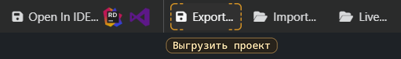
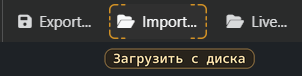

# Изменить проект в IDE и вернуть результат в EyeAuras

Когда скрипт разросся до нескольких классов и папок, удобнее писать его в IDE. EyeAuras экспортирует скрипт в обычное C#-решение. Вы правите файлы в IDE и загружаете их обратно. Запускается скрипт по-прежнему в EyeAuras: экспортированный проект компилируется, но сам EyeAuras в IDE не работает.

Что нужно:

- свой редактируемый `C# Script`;
- отдельная пустая папка для экспорта;
- IDE с поддержкой C# и `.sln`: [Rider](https://www.jetbrains.com/rider/), [Visual Studio](https://visualstudio.microsoft.com/) или [VS Code](https://code.visualstudio.com/);
- для сборки в IDE — совместимый .NET SDK и доступ к источникам зависимостей.

Начать можно с [Hello, world](/ru/scripting/examples/basic/hello-world).

## Проверить один полный цикл

1. В редакторе действия нажмите `Export...` и выберите отдельную папку. **Экспорт удаляет из неё все файлы и подпапки, кроме `.git`.** Не выбирайте папку, где лежит что-то нужное.



2. Откройте полученный `.sln` в IDE. Рядом лежат проекты и настройки NuGet для SDK EyeAuras. Восстановите зависимости и проверьте, нет ли ошибок.


3. В `Script.csx` замените сообщение на `Log.Info("Hello from IDE");` и сохраните файл.
4. В EyeAuras нажмите `Import...`, выберите экспортированный `.sln` и дождитесь загрузки. Импорт заменяет проект скрипта тем, что лежит на диске. Правки, которые вы после экспорта сделали только в EyeAuras, пропадут.



5. Нажмите `Run` в EyeAuras и найдите `Hello from IDE` в `Event Log`.


В нынешнем EyePad файлы открытого решения помечены `Read-only`: правьте их в IDE, а результат проверяйте здесь. В режиме `CompileOnce` импорт и наблюдение за файлами недоступны. Чтобы редактировать свою копию, сначала выключите этот режим.

## Выбрать способ обновления

| Команда | Что происходит |
| --- | --- |
| `Export...` | Создаёт в выбранной папке `.sln`, `.csproj`, исходники, ресурсы и ссылки на зависимости. |
| `Import...` | Один раз загружает проект с диска в скрипт EyeAuras. Это замена: правки с двух сторон не сливаются. |
| `Live Import` / `Live...` | Следит за выбранным решением и переносит сохранённые изменения в EyeAuras. |
| `Open in IDE...` | Экспортирует проект, открывает `.sln` программой, которая назначена для этого расширения в Windows, и включает `Live Import`. |

Чтобы не импортировать вручную после каждой правки, включите `Live Import` и выберите свой `.sln`. Измените сообщение в IDE и сохраните файл. Дождитесь сообщения об обновлении проекта, перезапустите действие и посмотрите в журнал. Если код не поменялся, проверьте выбранный путь и диагностику синхронизации.


Синхронизация идёт в одну сторону — с диска в EyeAuras. Состояние запущенного кода при этом не сохраняется: изменение может пересоздать контекст скрипта и сбросить его поля. Наблюдение учитывает `.gitignore`, `.eaignore` и пропускает сгенерированные файлы. Подробности — в [рабочем процессе проекта](/ru/scripting/api/scripting/project-workflow).

## Редактировать интерфейс оверлея

У `C# Overlay` так же можно править Razor-компоненты окна [Blazor Windows](/ru/scripting/blazor-windows/getting-started). После импорта и успешной компиляции проверьте в окне конкретный текст или элемент. Обновление может пересоздать содержимое окна.


<details>
<summary>Границы экспорта и возможности IDE</summary>

В IDE есть автодополнение, навигация, документация, работа с обычными классами, папками, NuGet и Razor. Чистую логику можно вынести в классы и тестировать отдельным проектом. Только не подключайте тестовый проект как зависимость скрипта: импорт берёт проект скрипта и связанные с ним проекты, а не всё решение.

В экспорте есть служебные заглушки окружения. Они нужны, чтобы проект компилировался. `Log`, `Variables`, `Sleep` и `cancellationToken` от этого не становятся доступны в обычных классах. Передавайте зависимости явно. Выбрать контекст поможет [карта контекстов и API](/ru/scripting/api/core/app-runtime-contexts).

Pre-/post-build действия при импорте в EyeAuras не выполняются. Если IDE генерирует JavaScript из TypeScript, импортируйте уже готовые файлы. Про библиотеки читайте во [встроенных ресурсах](/ru/scripting/embedded-resources) и NuGet.

Так же работают с [макросами](/ru/macros/getting-started) и [деревьями поведения](/ru/behavior-trees/scripting), с [поиском изображений](/ru/scripting/examples/basic/image-search), [вводом](/ru/scripting/examples/basic/send-text), [памятью](/ru/scripting/api/memory) и [ImGui](/ru/scripting/imgui/getting-started). Как экспорт выглядел вначале, описано в [истории версии](/ru/changelogs/7930).


Если экспорт вашего рабочего скрипта не собирается, отправьте [отчёт о проблеме](/ru/features/problem-reports). Во вложении `Auras.zip` уходит ваша конфигурация, поэтому перед отправкой проверьте, что в нём лежит.

</details>

## Подключить инструменты MCP к IDE

MCP — это протокол, по которому AI-клиент вызывает инструменты программы. EyeAuras даёт через него анализ **выбранного экспортированного проекта EyePad**: ошибки компиляции, символы, документацию, ссылки и пакеты. Проект выбирается заново при каждом вызове, поэтому смотрите, какой проект вернулся. Сам код на диске правит IDE или её клиент.

1. Откройте [AI Assistant](/ru/features/ai-assistant), вкладку `AI`.
2. Если настроек не видно, нажмите `Show Settings`. Проверьте `MCP Port` и нажмите `Start MCP`.
3. Дождитесь надписи `MCP server is running.`. По умолчанию порт `48080`. Берите тот адрес, который показан у вас:

```text
http://127.0.0.1:48080/mcp
```

4. В клиенте добавьте HTTP-сервер MCP с этим адресом. В Rider это `Settings | Tools | AI Assistant | Model Context Protocol (MCP)`:

```text
http://127.0.0.1:48080/mcp
```

В VS Code адрес задают в настройках MCP или в `mcp.json`, в Visual Studio — в настройках AI-инструмента с поддержкой MCP. Интерфейс зависит от версии клиента, см. инструкции [JetBrains](https://www.jetbrains.com/help/ai-assistant/mcp.html) и [VS Code](https://code.visualstudio.com/docs/copilot/chat/mcp-servers).

Как именно выбирается проект, видно в [исходном коде](https://github.com/iXab3r/EyeAuras/blob/c8b2304ac9ada59d217984035c8302b6e375ad10/Sources/EyeAuras.UI/AI/Mcp/EyeAurasMcpOnDiskScriptingPlugin.cs).
