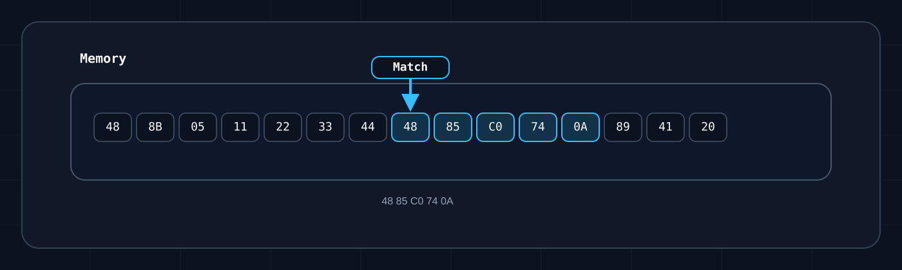

# Pattern Scanning в Memory API

`Pattern scanning` нужен, когда адрес нельзя держать жёстко: мешают обновления, `ASLR` и плавающие layout'ы. Вместо "читать по `0x12345678`" вы ищете устойчивую последовательность байтов рядом с нужным местом. По теме хорошо зайти через [Dynamic Memory Allocation](https://gamehacking.academy/pages/2/08/) и [Pattern Scanner](https://gamehacking.academy/pages/7/02/).

## С чего начинать

Примеры с `LocalProcess` рассчитаны на верхний уровень C#-скрипта в запущенном EyeAuras с загруженным модулем памяти. `Log` даёт хост скрипта. В обычном C#-классе передайте логгер и процесс явно. Одна ссылка на SDK не запускает модуль: во встраиваемом хосте сначала нужны запуск приложения, `UseMemory()` и ожидание `EnsureReadyAsync()`; подробнее в [Embedded SDK](/ru/scripting/api/nuget/embedded-sdk).

`LocalProcess.ByProcessId(...)` возвращает новый `ILocalProcess`, который освобождает создавший его код. `process.Memory` используется вместе с этим reader'ом; отдельно закрывать заимствованный сервис хоста не нужно. Эти примеры не проверяют доступность нативных компонентов вашей сборки.

Почти всегда сканировать стоит не весь процесс, а память конкретного модуля:

```csharp
using System.Diagnostics;
using EyeAuras.Memory;
using EyeAuras.Memory.Scaffolding;

{
    using var process = LocalProcess.ByProcessId(Process.GetCurrentProcess().Id);
    using var memory = process.MemoryOfModule("kernel32.dll");
}
```

Поиск будет ограничен базой и размером выбранного модуля. Само представление `IMemory` не проверяет границы каждого прямого чтения; не передавайте ему произвольные адреса.

## Какие сигнатуры поддерживаются

Всё строится вокруг `BytePattern`. Из коробки поддерживаются:

- точные байты
- hex-строки
- wildcard через `?` и `??`
- C-style запись вида `\xAA\xBB`
- маска плюс байты
- маркер `^`, который отмечает точку интереса внутри совпадения

```csharp
var exact = BytePattern.FromPattern(new byte[] { 0x48, 0x85, 0xC0, 0x74, 0x0A });
var hex = BytePattern.FromTemplate("48 85 C0 74 0A");
var wildcards = BytePattern.FromTemplate("48 85 ?? 74 0A");
var cStyle = BytePattern.FromTemplate(@"\x48\x85\xC0\x74\x0A");
var masked = BytePattern.FromMaskedPattern(new byte[] { 0x48, 0x85, 0xC0, 0x74, 0x0A }, "xxxxx");
var withOffset = BytePattern.FromTemplate("48 ^ 85 C0 74 0A");
```

В примере ниже мы будем использовать один и тот же паттерн `48 85 C0 74 0A`, чтобы было проще связать схему, код и результат поиска.

`^` задаёт `PatternOffset` внутри шаблона. В реализации этой версии одиночные `FindOffset`/`GetOffset` возвращают начало совпадения и не прибавляют `PatternOffset`. Методы `FindOffsets`/`GetOffsets` прибавляют его. Поэтому одинаковая сигнатура с `^` даёт разные координаты в этих двух маршрутах.



## Как искать

Основные методы:

- `FindOffset(...)` — вернуть offset или `-1`
- `GetOffset(...)` — вернуть offset или бросить исключение
- `FindOffsets(...)` и `GetOffsets(...)` — то же самое для нескольких сигнатур

Сначала удобно проверить шаблон на известном буфере. Это полный пример для верхнего уровня C#-скрипта EyeAuras; `Log` даёт хост, доступ к процессам не нужен.

```csharp
using EyeAuras.Memory;
using EyeAuras.Memory.Scaffolding;

{
    using var memory = MemoryAccessor.FromByteArray(
        new byte[] { 0x90, 0x48, 0x85, 0xC0, 0x74, 0x0A, 0x90 });
    var pattern = BytePattern.FromTemplate("48 ^ 85 ?? 74 0A");
    var raw = memory.FindOffset(pattern);
    var marked = memory.GetOffsets(pattern)[pattern];
    Log.Info($"Raw=0x{raw:X}, marked=0x{marked:X}");
}
```

Результат — `Raw=0x1, marked=0x2`. Здесь адреса буфера являются индексами массива, а не VA процесса. Это проверка понимания шаблона, не проверка доступа к Windows-процессу.

Для поиска в загруженном модуле используйте отдельный скрипт с модулем памяти EyeAuras. Вход — имя `kernel32.dll` в текущем процессе и точная сигнатура; её наличие зависит от сборки Windows.

```csharp
using System.Diagnostics;
using EyeAuras.Memory;
using EyeAuras.Memory.Scaffolding;

{
    using var process = LocalProcess.ByProcessId(Process.GetCurrentProcess().Id);
    using var memory = process.MemoryOfModule("kernel32.dll");
    var pattern = BytePattern.FromTemplate("48 85 C0 74 0A");
    var offset = memory.FindOffset(pattern);
    if (offset >= 0)
    {
        var va = memory.BaseAddress + offset;
        Log.Info($"Offset=0x{offset:X}, VA=0x{va:X}");
    }
    else
    {
        Log.Info("Сигнатура не найдена в kernel32.dll");
    }
}
```

Результат — смещение и абсолютный VA либо сообщение об отсутствии сигнатуры. Прибавлять базу к `-1` нельзя. Методы синхронные, без токена отмены. Одиночный поиск читает весь указанный блок; нечитаемая память может привести к исключению даже у `Find*`.

## Offset и адрес

- `offset` — смещение внутри текущего `IMemory`
- `VA` — абсолютный адрес в процессе

Если вы ищете внутри `MemoryOfModule(...)`, абсолютный адрес обычно считается как `memory.BaseAddress + offset`.

Если взять схему выше, `FindOffset(BytePattern.FromTemplate("48 85 C0 74 0A"))` вернет offset на первый подсвеченный байт `48`.

## Что выбрать — Find или Get

- `Find*` — если отсутствие сигнатуры это нормальный сценарий
- `Get*` — если отсутствие сигнатуры уже означает несовместимую версию клиента или ошибку

## Практические советы

- Сканируйте модуль, а не весь процесс, если знаете нужный `.exe` или `.dll`.
- Не делайте сигнатуру слишком короткой.
- Нестабильные байты лучше закрывать wildcard'ами.
- Для точки внутри совпадения учитывайте разницу одиночного и группового поиска с `^`.
- `FindOffsets(pattern1, pattern2)` ищет по одному результату для каждой сигнатуры, а не все вхождения. Групповой поиск не гарантирует наименьший offset, не учитывает `StartOffset` и может пропустить совпадение на границе блоков по 84000 байт.
- `BytePattern` сравнивается по `Template`; шаблоны с разными `Name`/`StartOffset` могут оказаться одинаковыми ключами словаря.
- Для игровых сценариев вроде `entity list` или `view matrix` сигнатура обычно выступает только как опорная точка. Дальше вы уже читаете указатели и структуры.

Контракты на этой странице сверены по EyeAuras `20fd3d4`; это чтение исходников, без запуска примеров. Полные сигнатуры и ограничения своей версии проверяйте по [карте API памяти](/ru/scripting/api/memory) и SDK/XML reference.

## Что читать дальше

- [PE basics](/ru/scripting/memory-api/pe-basics)
- [Code Cave](/ru/scripting/memory-api/code-caves)
- [API pattern scanning](/ru/scripting/api/pattern-scanning)
- [Контракты поиска и ограничения версии](/ru/scripting/api/memory/pattern-scanning)
