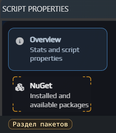
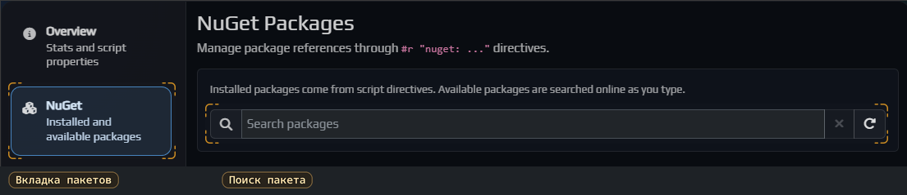

# Прочитать JSON с помощью NuGet-пакета

Если скрипту нужна сторонняя библиотека, подключите её [NuGet-пакет](https://www.nuget.org/). Для примера разберём строку JSON через `Newtonsoft.Json` и достанем из неё задержку `250` миллисекунд. Файлы и сеть сам пример не трогает.

Нужен редактируемый `C# Script` и доступ к серверу пакетов, чтобы пакет скачался в первый раз. Директивы `#r` пишут в `Script.csx`, а не в обычном `.cs`-классе.

1. Откройте скрипт и нажмите `Properties`.



[Всё окно редактора с кнопкой Properties](https://s3.eyeauras.net/media/2026/04/EyeAuras_Vlj2LmgbOY.png)

2. На вкладке `NuGet` найдите `Newtonsoft.Json`, выберите версию `13.0.3` и нажмите `Add Package`. Если уже стоит другая версия, нажмите `Update Package`.



[Всё окно со списком и сведениями об установленном пакете](https://s3.eyeauras.net/media/2026/04/EyeAuras_9TwUfSgAH2.png)

3. Вставьте код ниже. Если пакет уже добавлен через интерфейс, директиву `#r` не дублируйте: на эту версию должна остаться одна ссылка.

```csharp
#r "nuget: Newtonsoft.Json, 13.0.3"

using Newtonsoft.Json.Linq;

var settings = JObject.Parse("{\"delayMs\":250}");
var delayMs = settings.Value<int>("delayMs");
Log.Info($"Delay: {delayMs} ms");
```

4. Дождитесь, пока пакет восстановится и скрипт скомпилируется, и нажмите `Run`. В `Event Log` появится `Delay: 250 ms`. Если тип `JObject` не найден, смотрите диагностику зависимостей, а не только список установленных пакетов.

[Версия 13.0.3](https://www.nuget.org/packages/Newtonsoft.Json/13.0.3) выбрана, чтобы пример можно было повторить точь-в-точь. В своём проекте брать именно её не обязательно.

## Как задать ссылку

| Способ | Что он подключает |
| --- | --- |
| `Properties` → `NuGet` | Здесь пакеты ищут, добавляют, обновляют и удаляют, тут же выбирают версию. Работает через тот же механизм, что и `#r "nuget: ..."`. |
| `#r "nuget: ID, version"` | Пакет по точному идентификатору и версии. Удобно, когда `Script.csx` нужно переносить. |
| `Properties` → `References` | Сборку из уже загруженных в EyeAuras или внешнюю DLL по пути. |
| `#r "assemblyPath: ..."` | Конкретную DLL с диска или из [встроенных ресурсов](/ru/scripting/embedded-resources). |
| `#r "assemblyName: ..."` | Сборку по имени из тех, чьи метаданные доступны окружению. Если библиотеки нет, она не скачается. |

Ссылка только показывает компилятору типы. Восстановить пакет, загрузить его код и зарегистрировать службы — это три разных шага. Некоторым SDK нужно [расширение контейнера](/ru/scripting/script-container-extensions). Нативные компоненты и MSBuild targets пакета сами по себе не поддерживаются.

<details>
<summary>Локальная DLL и уже загруженная сборка</summary>

Для этого фрагмента нужна своя DLL по указанному пути. Подставьте свой путь. Строка в журнале говорит только, что скрипт выполнился. Типы библиотеки она не проверяет:

```csharp
#r "assemblyPath: D:\Work\EAExile\EAExileAgent.Shared.dll"

Log.Info("Assembly reference declared"); // Проверяйте диагностику и доступность нужных типов
```

На другом компьютере этого файла не будет. Чтобы DLL переносилась вместе со скриптом, добавьте её как ресурс. Её зависимости тоже должны находиться.

По имени можно подключить сборку, которую EyeAuras умеет найти сам. Например, уже загруженную через `Assembly.Load` в [AssemblyLoadContext](https://learn.microsoft.com/en-us/dotnet/api/system.runtime.loader.assemblyloadcontext?view=net-9.0) / [AppDomain](https://learn.microsoft.com/en-us/dotnet/api/system.appdomain?view=net-9.0). Того, что файл лежит в [GAC](https://learn.microsoft.com/en-us/dotnet/framework/app-domains/gac), для этого мало.

```csharp
#r "assemblyName: Grpc.Net.Client"

Log.Info("Assembly reference declared"); // Это ещё не проверка сетевого вызова
```

Фрагмент сработает, если `Grpc.Net.Client` доступна. В сеть он не ходит. Набор сборок, которые EyeAuras подключает по умолчанию, меняется от версии к версии. Не рассчитывайте, что случайно доступный тип останется на месте.

</details>

## Если проект открыт в IDE

В [экспортированном проекте](/ru/scripting/ide-integration) есть `.csproj` и настройки источников NuGet. Из основного проекта скрипта импортируются `PackageReference` с явными ID и Version: при загрузке они превращаются в ссылки скрипта. Весь MSBuild-процесс при этом не выполняется, а у зависимостей вспомогательных проектов свои ограничения. После импорта проверьте восстановление и диагностику в EyeAuras, даже если в IDE решение собирается.
