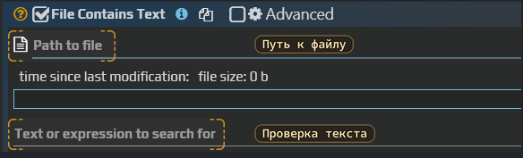

# File Contains Text: перейти со старой инструкции

Это старая инструкция к триггеру **File Contains Text**, который проверяет содержимое файла. Триггер тот же самый, новый создавать не нужно. Актуальная полная инструкция — [«Файл содержит текст»](/ru/triggers/file-contains-text).

Пример: есть небольшой текстовый файл настроек, и нужно заметить, что в нём записано `enabled=true`.

1. Сохраните локальный файл в UTF-8. Для проверки возьмите небольшой файл, где строка `enabled=true` появляется только при нужном состоянии.
2. Откройте существующий **File Contains Text** или добавьте его в ауру. В **File path** выберите файл кнопкой **…** и посмотрите в **File contents**, что прочиталось.

   

   На снимке эти поля называются Path to file и Text or expression to search for.
3. Выберите **Regex** и введите `(?m)^enabled=true\r?$`. Подойдёт только отдельная строка с точным значением, `enabled=false` не подойдёт. Выключите **Test mode**.
4. Сохраните в файле строку `enabled=true` — триггер станет активным. Замените её на `enabled=false` и сохраните — станет неактивным. Чтобы увидеть реакцию, добавьте оверлей или действие в **On Enter**, как в актуальной инструкции.

| Что переносится из старой настройки | Как понимать сейчас |
| --- | --- |
| Путь к файлу | Один конкретный локальный файл. Не папка и не только новые строки журнала. |
| Text, Regex, C# | Способы [проверки текста](/ru/features/text-match-expressions). Выражение C# выполняется в контексте оценщика, это не самостоятельный скрипт. |
| Пересчёт при изменении | После сохранения файл читается заново целиком. Триггер активен, пока выражение совпадает. Это не импульс на каждую запись. |
| Большой журнал | По-прежнему читается целиком. Читать только дописанную часть триггер не умеет. Если большой файл часто меняется, лучше завести небольшой файл состояния. |

Если файла по выбранному пути нет, результат — **Unknown**. Если файл есть, но не читается, проверьте доступ к нему и то, что показано в **File contents**.
