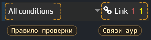

# Aura Is Active — объединить готовые условия

Aura Is Active смотрит на состояние других аур. Так можно собрать одно правило из нескольких готовых условий.

Пример: сигнал нужен, только когда открыт Блокнот и вы включили ручной переключатель. Две ауры отвечают каждая за своё условие, а третья связывает их и подаёт звук.

## Соедините окно и переключатель

1. Создайте ауру «Блокнот открыт» с одним [Window Exists](/ru/triggers/window-exists). В **Target Window** задайте `notepad` и проверьте совпадения. Действия в этой ауре не нужны.
2. Создайте ауру «Разрешить сигнал» с одним [Fixed Value](/ru/triggers/fixed-value). Пока выберите **Is NOT Active**.
3. Создайте ауру «Сигнал разрешён». Добавьте в неё **Aura Is Active** и через **Links** свяжите две предыдущие ауры. Для обеих ссылок оставьте требуемое состояние Active.
4. В **Logical operator** выберите **All must match (AND)**. В **On Enter** добавьте [Play Sound](/ru/actions/play-sound) со звуком Ping и проверьте громкость.
5. Откройте Блокнот. Затем в ауре «Разрешить сигнал» выберите Is Active.

Оба условия выполнены — аура «Сигнал разрешён» становится активной и подаёт звук. Выключите переключатель или закройте все подходящие окна, и она станет неактивной. Когда оба условия выполнятся снова, сигнал прозвучит ещё раз.

Чтобы видеть результат постоянно, добавьте в ауру «Сигнал разрешён» оверлей [Text](/ru/overlays/text) и впишите своё сообщение в **Content**. Текст виден, пока аура активна. В [общих параметрах](/ru/overlays/common-options) его можно разместить, заблокировать и проверить, как он выглядит вне редактора.

## Настройки связей

| Настройка | Что делает |
| --- | --- |
| Links | Список связанных аур. Связывать можно и папки, но для первого примера выберите две конкретные ауры. |
| Требуемое состояние ссылки | Какое состояние связанной ауры считается совпадением. В примере везде Active. |
| Logical operator — All must match (AND) | Должны совпасть все связи. В старом редакторе — All Conditions (AND). |
| Logical operator — At least one must match (OR) | Хватит хотя бы одного совпадения. |

Триггер только следит за состоянием связанных аур, их действия он не запускает. Чтобы запустить готовую цепочку действий, возьмите [Execute Actions](/ru/actions/execute).

Без ссылок Aura Is Active неактивен. Связанная аура в состоянии Unknown не считается Active, поэтому в режиме AND составная аура не активируется. Стройте связи от исходных условий к итоговому и не замыкайте их в круг.
