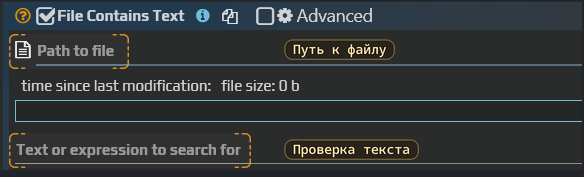

# Показать, что проверка файла завершена

**File Contains Text** читает локальный текстовый файл и проверяет всё его содержимое. Например, в небольшом файле состояния меняется `Ожидание` на `Готово` — и EyeAuras показывает надпись «Проверка завершена».

## Настроить небольшой файл состояния

1. Создайте в доступной вам папке обычный файл `status.txt` в кодировке **UTF-8**. Впишите `Ожидание` и сохраните. Для первой пробы не берите большой журнал, который постоянно растёт.
2. Добавьте ауре триггер **File Contains Text**. В **File path** укажите полный путь к `status.txt` или выберите файл кнопкой **…**. В **File contents** должно появиться `Ожидание`.
3. В проверке текста выберите **Regex** и введите `\AГотово\s*\z`. Так проверяется весь файл: после слова допускаются пробелы и перевод строки в конце. Выключите **Test mode**.
4. Добавьте этой ауре [Text overlay](/ru/overlays/text) с текстом `Проверка завершена`, видимый при активной ауре. Уберите принудительный просмотр в редакторе.
5. Замените содержимое файла на `Готово` и сохраните. **File contents** и состояние триггера обновятся, надпись появится. Верните `Ожидание` и сохраните — надпись исчезнет.

| Настройка или результат | Что означает |
| --- | --- |
| File path | Один конкретный файл на компьютере с EyeAuras. Это не маска поиска по папке. |
| File contents | Текст, который прочитал триггер. Смотрите сюда первым делом, если выражение не совпадает. |
| Text | Точное сравнение всего текста. Правила режимов — в [сопоставлении текста](/ru/features/text-match-expressions). |
| Regex | Регулярное выражение по всему прочитанному тексту. В примере якоря `\A` и `\z` не дают совпасть со старой строкой в середине журнала. |
| C# | Выражение в контексте текстового оценщика, не самостоятельный скрипт. Контекст и ограничения описаны в том же руководстве. |
| Ignore Case | Не учитывать регистр. |
| Test mode | Подставляет тестовый текст вместо файла. После проверки выключите, чтобы состояние снова зависело от файла. |

## Когда пересчитывается состояние

Первый раз файл читается при подключении к нему. Дальше EyeAuras следит, когда файл меняют, создают, удаляют или переименовывают. События, которые идут подряд, объединяются в окно около `250 мс`.

Есть совпадение — триггер активен, нет — неактивен. Пока подходящий текст остаётся в файле, триггер остаётся активным. Чтобы выполнить действие один раз, когда появился результат, добавьте его в **On Enter**. Повторное сохранение того же подходящего текста само по себе не запустит On Enter ещё раз.

Если путь не выбран или файла по нему нет, состояние — **Unknown**. Если файл переименовать, триггер продолжит смотреть на старый путь. Укажите новый путь или верните файл на место. Ошибка чтения существующего файла — не то же самое, что его отсутствие. Сначала проверьте доступ и прочитанное содержимое.

Файл каждый раз читается целиком. Кодировка определяется по метке, без неё используется UTF-8. Выбрать старую кодовую страницу в этом редакторе нельзя. На большом или часто меняющемся журнале это может стоить много памяти и времени: читать только добавленный хвост триггер не умеет.
