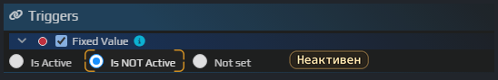

# Fixed Value — проверить ауру вручную

Fixed Value — это ручной переключатель: вы сами задаёте, активен триггер или нет. Он нужен, чтобы проверить действие, не дожидаясь нужного окна или надписи. Например, включите ауру вручную и убедитесь, что она подала звук.

## Проверьте один звуковой сигнал

1. Создайте ауру и добавьте в неё только триггер **Fixed Value**.
2. Выберите **Is NOT Active**, чтобы начать с неактивного состояния.
3. В **On Enter** добавьте [Play Sound](/ru/actions/play-sound), выберите Ping и проверьте громкость кнопкой прослушивания.
4. В Fixed Value выберите **Is Active**.

Аура станет активной и один раз выполнит On Enter — прозвучит Ping. Чтобы проверить ещё раз, выберите Is NOT Active, затем снова Is Active. Действия в **While Active** повторяются всё время, пока аура активна.

Нужна видимая памятка вместо звука — возьмите [Text](/ru/overlays/text) со своим **Content**. Как его разместить и заблокировать, описано в [общих параметрах](/ru/overlays/common-options). Чтобы несколько аур слушались одного переключателя, оставьте Fixed Value в одной ауре, а в остальных используйте [Aura Is Active](/ru/triggers/aura-is-active).

## Какое значение выбрать

| Значение | Состояние триггера |
| --- | --- |
| Is Active | Всегда Active, пока выбрана эта настройка. |
| Is NOT Active | Всегда Not Active. |
| Not set | Unknown — результат условия не задан. Это отдельное состояние, а не другое название Not Active. |

Если триггеров несколько, итог зависит от правила, по которому они объединяются. Unknown тоже участвует в расчёте по этому правилу.

После проверки замените Fixed Value на настоящий источник события, например [Window Exists](/ru/triggers/window-exists). Если постоянный Is Active остаётся рядом с другими условиями, проверьте правило объединения: аура не должна становиться активной независимо от них.
