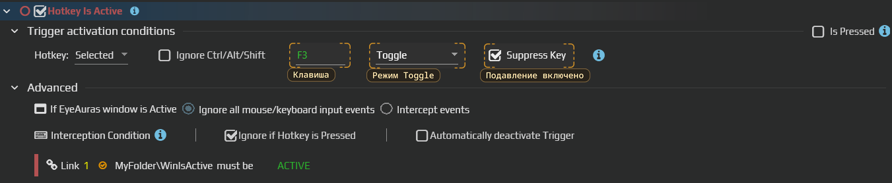

# Hotkey Is Active — запустить действие клавишей

Hotkey Is Active следит за клавишей, сочетанием или кнопкой мыши. Пример ниже: вы нажимаете F6, и аура играет звук. Действие стоит в On Enter, поэтому срабатывает в момент, когда аура становится активной.

## Проверьте клавишу F6

Проверять удобно в Блокноте. Если F6 у вас занята, возьмите другую свободную клавишу.

1. Создайте ауру с одним триггером **Hotkey Is Active**. В некоторых версиях его имя пишется слитно — HotkeyIsActive.
2. В **Hotkey** оставьте вариант **Selected** и задайте F6 в редакторе комбинации.
3. В **Mode** выберите **Toggle Trigger state on Click** (в старом редакторе — Toggle). **Suppress Key** оставьте выключенным, условия перехвата пока не добавляйте.
4. В **On Enter** добавьте [Play Sound](/ru/actions/play-sound) со звуком Ping. Проверьте громкость кнопкой прослушивания.
5. Перейдите в Блокнот, нажмите и отпустите F6. Потом ещё два раза.

Первое нажатие включит триггер, прозвучит Ping. Второе выключит его без звука. Третье снова включит, и сигнал повторится. Пока триггер активен, On Enter не повторяется. Для действий, которые должны повторяться, есть **While Active**.

В режиме Toggle нажатия в окнах самой EyeAuras по умолчанию игнорируются, поэтому мы и проверяем в Блокноте. Чтобы проверять прямо в редакторе EyeAuras, включите обработку её окон в Advanced. На режим Hold это ограничение не действует.

## Основные настройки

| Настройка | Что делает |
| --- | --- |
| Hotkey — Selected | Следит за заданной клавишей, сочетанием, кнопкой мыши или прокруткой колеса. Мышь и колесо задавайте в редакторе комбинации. |
| Mode — Hold | Активен, пока клавиша или кнопка удерживается. |
| Mode — Toggle Trigger state on Click | Переключает состояние после нажатия и отпускания. Первое нажатие включает, следующее выключает. |
| Suppress Key | Не передаёт нажатие другим приложениям. Подавить можно не любой ввод. Без условий перехвата подавление может действовать и за пределами нужного приложения. |
| Ignore Ctrl/Alt/Shift | Триггер срабатывает, даже если зажаты модификаторы. Если задано сочетание с модификаторами, настройка сбрасывается. |
| Is Pressed | В старом редакторе показывает состояние. Его можно переключить вручную для проверки. |

Отслеживать любую клавишу или кнопку

Вместо Selected можно выбрать группу ввода.

| Вариант | Что отслеживает |
| --- | --- |
| Any Keyboard key | Любую клавишу клавиатуры. |
| Any Mouse button | Любую кнопку мыши. |
| Any Keyboard/Mouse key | Клавиши клавиатуры и кнопки мыши. |

Движение мыши и время бездействия эти группы не отслеживают. Направление колеса задаётся отдельной комбинацией в Selected.

## Разрешите обработку только в нужном окне

1. Создайте отдельную ауру «Блокнот активен» с [Window Is Active](/ru/triggers/window-is-active). В Target Window задайте `notepad` и проверьте совпадения.
2. Вернитесь к Hotkey Is Active. В **Advanced → Interception Condition → Links** добавьте ауру «Блокнот активен» как условие Active.
3. Переключите **Mode** в Hold. Нажмите и недолго подержите F6 в Блокноте, потом то же самое в другой программе. Сигнал должен звучать только в Блокноте.

Если используете Toggle, выберите, что делать при уходе из окна:

| Настройка в Advanced | Что делает |
| --- | --- |
| If EyeAuras window is Active | Intercept events разрешает обработку в окнах EyeAuras. Ignore all mouse/keyboard input events отключает её для Toggle, Hold продолжает работать. |
| Ignore If Hotkey Is Pressed | Уже включённый переключатель обрабатывается, даже если связанное условие перестало выполняться. Так Toggle можно выключить после перехода в другое окно. На выключенный переключатель это не действует. |
| Automatically deactivate Trigger | Выключает активный триггер, когда условие перехвата перестаёт выполняться. После возвращения в окно Toggle нужно включить заново. |

Если связей несколько, проверьте выбранные состояния и правило их объединения.
