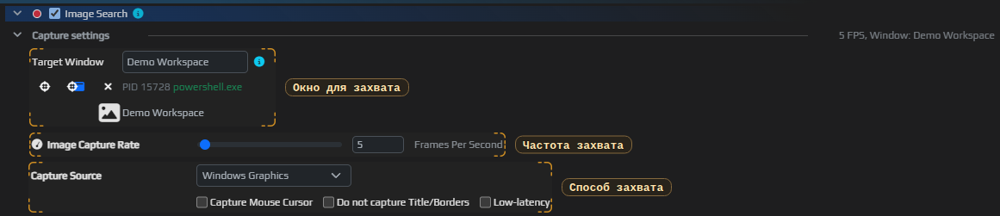

# Захват изображения для поиска

Вы попали сюда по старой ссылке `Image / Text / Color Search`. Отдельного старого триггера нет: это общая секция захвата, она есть у каждого триггера поиска. Как она устроена, описано в [актуальном руководстве по захвату](/ru/triggers/images/imagecapturetriggers).

## Проверить собственный источник

Пример: вы хотите следить за цветом небольшого индикатора в своём приложении. Сейчас нужно только убедиться, что триггер видит правильную область. Цвет и реакцию настроите потом.

1. Откройте приложение и добавьте в ауру `Color Search`.
2. В `Capture settings → Target Window` выберите его окно. Задайте `Image Capture Rate = 5 Frames Per Second`.
3. Раскройте `Preview captured image`. Если кадр не тот, откройте `Show more... → Capture Source` и сравните доступные методы. Начните с `Windows Graphics`, если он есть.

   

   Снимок сделан в Image Search. У Color Search эти поля находятся в том же блоке.
4. В `Crop region` обрежьте кадр до индикатора, глядя на предпросмотр. Поменяйте состояние индикатора в приложении — в кадре должен измениться тот же участок.

Теперь триггер получает свежие пиксели индикатора. Это ещё не `Active`: для этого настройте [условие Color Search](/ru/triggers/images/color-search). Звук или другую реакцию добавьте отдельно в действия ауры.

## Соответствие старых подписей

| Прежняя настройка | Где искать сейчас |
| --- | --- |
| Target FPS | Image Capture Rate. Желаемая частота захвата и анализа. Тяжёлая обработка может снизить реальную |
| Mouse Cursor | Capture Mouse Cursor. Курсор умеют захватывать не все источники |
| Settings → Max Capture FPS | Общий предел для триггеров. Он может ограничить их собственную частоту |
| Выбор метода захвата | Show more... → Capture Source. После смены заново проверьте пиксели и границы |

| Capture Source | Как выбирать |
| --- | --- |
| Windows Graphics | Системный захват окна через Windows Graphics Capture. Доступен, если его поддерживает ваша Windows. Убрать системную рамку можно, только если есть нужный API |
| Shared Surface | Другой способ получить поверхность окна через графическую подсистему. Сравните кадр, если системный метод не подошёл |
| Desktop duplication | Захват рабочего стола через GPU, из которого вырезается нужная область. Учитывайте окна, которые её перекрывают |
| Print Window | Оконный Win32-метод. Приложения с аппаратным рисованием могут вернуть пустой или неполный кадр |
| Copy Device Context | Способ GDI, работает с частью окон. Пригодится как запасной вариант при настройке |
| Copy From Screen | Копия видимой области экрана. Зависит от положения окна и от того, что его перекрывает |

Старые общие рейтинги скорости и памяти не помогут выбрать метод для конкретного окна. Сначала проверьте, что картинка правильная. Потом посмотрите реальный FPS и время обработки в подсказке предпросмотра. От свёрнутого или недоступного окна свежего кадра не ждите.

Обрезка, эффекты и разовая проверка описаны в [актуальном руководстве](/ru/triggers/images/imagecapturetriggers). Когда источник настроен, выбирайте, что искать: [изображение](/ru/triggers/images/image-search), [цвет](/ru/triggers/images/color-search), [текст](/ru/triggers/images/text-search) или [AI Search](/ru/triggers/images/ai-search-trigger).
