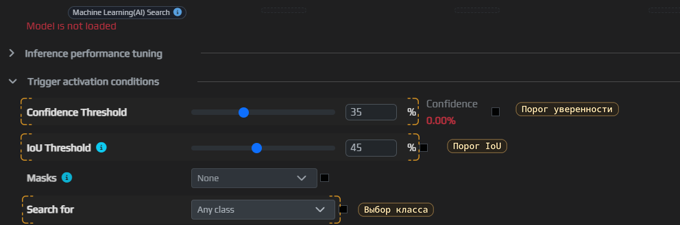
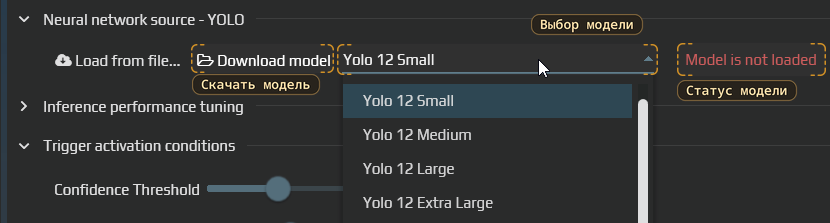

# AI Search: поиск объектов моделью

AI Search ищет объекты с помощью нейросети. Он берёт кадр выбранного окна, отдаёт его модели и становится активным, если модель нашла нужный класс с достаточной уверенностью. Например, человека на фотографии — в любой позе и любого размера. Для этого нужна модель, обученная классу `person`.

В отличие от Image Search, картинку-образец здесь не загружают. Что триггер умеет находить, зависит только от модели. Если вписать в настройки название нового класса, модель его искать не научится.

## Найти человека на открытой фотографии

Возьмите свою фотографию, где хорошо виден человек, и откройте её в обычном просмотрщике изображений. Чтобы скачать модель в первый раз, нужен интернет. В примере используется **Yolo 8 Nano** из списка: её ONNX-файл содержит классы COCO, в том числе `person`.

1. Добавьте в ауру триггер **AI Search**. В **Capture settings → Target Window** выберите просмотрщик фотографии и задайте **Image Capture Rate = 1**.
2. Раскройте **Preview captured image**. Через **Crop region** оставьте только фотографию, без панелей просмотрщика. Человек должен попадать в кадр целиком или почти целиком. Если кадр не тот, сначала настройте [захват](/ru/triggers/images/imagecapturetriggers).
3. В **Neural network source — YOLO** выберите **Yolo 8 Nano** и нажмите **Download model**. Дождитесь, пока исчезнет **Model is loading...**. Пока показано **Model is not loaded** или ошибка загрузки, искать объекты нечем.
4. В **Inference performance tuning → Provider** выберите **Cpu**, если он есть в списке. Число потоков пока не трогайте. Видеокарта для этого примера не нужна.
5. В **Trigger activation conditions → Search for** выберите **person**. Задайте **Confidence Threshold = 50%**, **IoU Threshold = 45%** и нажмите **Refresh Once**.

   

   На снимке из EyeAuras 1.9.9572.0 модель ещё не загружена, выбраны Any class, 35% и 45%. В примере загрузите модель, выберите person и поставьте пороги 50% и 45%.

6. Посмотрите список результатов и разметку в предпросмотре. Если модель нашла `person` с оценкой **выше 50%**, в списке появится результат, и триггер станет активным. Для модели обнаружения в предпросмотре можно включить **Bounding Boxes** и **Labels** — увидите рамку и подпись.
7. Откройте в том же просмотрщике фотографию без людей и проверьте ещё раз. Подходящих результатов нет — триггер должен стать неактивным. Верните первую фотографию и убедитесь, что человек снова найден.

Модель может пропустить человека или принять за него что-то другое. Если результата нет, проверьте кадр, выбранный класс и оценки, попробуйте более чёткую фотографию. Если снизить порог, пройдёт больше слабых результатов, но правильнее распознавание от этого не станет.

## Модель и входное изображение

| Настройка | Что важно |
|---|---|
| Download model | Скачивает выбранную готовую модель. Сейчас в списке есть семейства Yolo 8, 10, 11, 12 и 12-turbo разных размеров. Пункт в списке не гарантирует, что удалённый файл доступен |
| Варианты Yolo 8 с Classification / Segmentation | Решают другую задачу: классифицируют кадр или находят объекты с масками. Для рамок вокруг людей в примере выбран обычный Yolo 8 Nano |
| Load from file... | Загружает вашу ONNX-модель. Подойдёт не любой файл ONNX: важны формат входов и выходов и поддерживаемая разновидность YOLO |
| Save... / Clear | Сохраняет модель в файл или удаляет её из триггера |
| Информация о загруженной модели | Здесь видны тип, размеры входа и классы. У Yolo 8 Nano из примера вход 640×640. Размер кадра подгоняет обработчик модели |
| Search for | Список классов загруженной модели. Any class принимает любой класс, не только человека |
| Confidence Threshold | Отбрасывает результаты с низкой оценкой. Оценка должна быть строго выше порога. Confidence — это оценка самой модели, а не измеренная точность на ваших данных |
| IoU Threshold | Убирает рамки, которые перекрывают друг друга. Это отбор дубликатов, а не порог уверенности и не показатель качества модели |

В старом редакторе выбран Yolo 12 Small, модель ещё не загружена. В примере с фотографией выберите Yolo 8 Nano и нажмите Download model.

Детектор возвращает рамки объектов. Сегментация добавляет к ним маски. Классификация оценивает изображение целиком и не обязана находить, где стоит каждый объект. Во всех случаях триггер проверяет оставшиеся результаты выбранного класса. Если модель умеет находить людей, это не значит, что она определит игровые предметы, ресурс персонажа или поведение.

Производительность, зависимости и разметка

| Настройка | Смысл выбора |
|---|---|
| Calculation threads | Число потоков внутри вычислений модели. Больше потоков сильнее грузят CPU, а ускорение не гарантировано |
| InterOp threads | Потоки между узлами вычислительного графа. Начните с текущего значения и меняйте, только измерив время обработки |
| Provider | На чём считать модель. Cpu использует процессор. Cuda, TensorRt и DirectML зависят от железа и установленных компонентов. Не выбирайте вариант, которого нет в вашем списке, по инструкции с другого компьютера |
| Image Capture Rate | Как часто запрашивается анализ. Начните с 1 FPS: модель может не успевать за более частыми кадрами |
| Bounding Boxes / Labels в предпросмотре | Рамки и подписи найденного. Masks появляется для модели сегментации |
| On-screen-display → Window / Region / Bounding Boxes / Labels / Masks | Отдельная разметка поверх исходного окна. Masks доступен для сегментации. В обычной работе эту диагностику можно отключить |

Следите за **Processing time** в подсказке FPS. Обрежьте лишние панели, чтобы в кадре остался объект без ненужного окружения. Слишком маленький объект или сильно уменьшенный кадр могут ухудшить результат.

Свою модель готовят вне этого редактора. С чего начать, написано в [документации Ultralytics](https://docs.ultralytics.com/) и в [руководстве по обучению детектора](https://docs.ultralytics.com/tasks/detect/#train). Что такое пересечение рамок, объясняет [статья про IoU](https://www.pyimagesearch.com/2016/11/07/intersection-over-union-iou-for-object-detection/). Но настройка IoU в триггере точность модели не измеряет.

Если нужного класса в готовой модели нет, начните с [подготовки данных и модели в YoloEase](/ru/YoloEase/getting-started). У этого инструмента свои требования к версии и окружению. Вернитесь сюда с совместимой ONNX-моделью и проверьте её задачу и классы, прежде чем добавлять реакцию.

Когда триггер надёжно различает фотографии, добавьте действие в **OnEnter**, например [Play Sound](/ru/actions/play-sound). Сначала проверяйте результаты модели. Действие реагирует на смену состояния ауры и ошибки распознавания не исправит.
