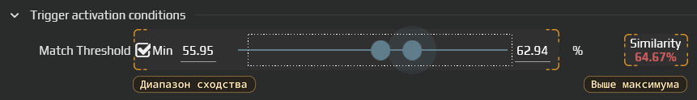

# Поиск цвета

Color Search следит за цветом области в окне. Например, замечает, что индикатор из серого стал зелёным — «готово». Триггер берёт пиксели из выбранного окна, сравнивает их с **Target Color** и проверяет, попало ли сходство в заданный диапазон. Как это состояние называется в самой программе, он не знает.

Для настройки нужен индикатор с ровной по цвету серединой, который можно переключить в другое состояние. Текст, рамку и фон панели в область не берите: они изменят средний цвет.

## Настроить проверку зелёного индикатора

1. Откройте приложение, в котором индикатор сейчас зелёный. Добавьте в ауру **Color Search**.
2. В **Capture settings → Target Window** выберите его окно, задайте **Image Capture Rate = 5** и раскройте **Preview captured image**.
3. Через **Crop region** оставьте только однотонную середину индикатора. В предпросмотре должен быть тот же цвет, что и в приложении. Если это не так, сначала поправьте [метод захвата](/ru/triggers/images/imagecapturetriggers).
4. В **Comparison Granularity** выберите **Aggregate Average Color of Entire Area**, а в **Comparison Method** — **Human Perception**.
5. Нажмите **Copy Captured Color to Target Color**. Средний цвет области станет образцом. Проверьте плашку **Target Color**.
6. В **Match Threshold** включите флажок **Min**, чтобы видеть обе границы, и задайте **Min = 95%**, **Max = 100%**. Пока индикатор не меняется, **Similarity** должна быть около 100%, а триггер — активен.
7. Переключите индикатор в серое или другое обычное состояние. Сходство должно выйти из диапазона, а триггер — стать неактивным. Верните зелёный и убедитесь, что триггер снова включился.

Если порог проходят оба состояния, проверьте область и посмотрите реальную Similarity для каждого. Границу ставьте между ними. Не рассчитывайте, что 95% подойдёт для всех приложений: сглаживание, эффекты и подсветка при наведении меняют пиксели.

## Выбрать образец и способ сравнения

| Настройка | Смысл выбора |
|---|---|
| Target Color | Цвет, с которым сравнивается кадр. Его можно задать вручную |
| Captured Color | Средний цвет всей захваченной области. В локальных режимах он может не совпадать с цветом найденного фрагмента |
| Copy Captured Color to Target Color | Копирует средний цвет области в образец. Удобно для однородного индикатора |
| Pick Color from Preview Pane | Берёт конкретный цвет из предпросмотра. Пригодится, если нужен отдельный пиксель, а не среднее по области |
| Comparison Method → Human Perception | CIEDE2000: сравнивает цвета так, как их различает человек |
| Comparison Method → Mathematical | Евклидово расстояние в RGB: прямое математическое сравнение каналов |
| Match Threshold | Допустимый диапазон сходства, границы включены. Например, 95–100% значит «достаточно близко к образцу» |
| Similarity | Текущее сходство. Не во всех режимах это процент площади нужного цвета |

На снимке из старого редактора значение 64,67% выше диапазона 55,95–62,94%, поэтому условие не выполнено.

**Comparison Method** действует только на средний цвет всей области. В режимах отдельных пикселей и блоков работает поиск цветового шаблона. Пороги, подобранные для CIEDE2000, туда не переносите.

## Вся область, пиксель или блок

| Comparison Granularity | Когда подходит |
|---|---|
| Aggregate Average Color of Entire Area | Проверить общее состояние небольшой области, как в примере с индикатором. На среднее влияет каждый её пиксель |
| Individual Pixel Color | Найти хотя бы один подходящий пиксель внутри области. Совпадение может дать и случайный шум |
| Average Color of 2x2 / 4x4 / 4x8 / 8x4 / 8x8 / 16x16 / 32x32 Pixel Blocks | Найти локальный участок выбранного размера. Блок должен помещаться в кадр. Сравнивается цвет блока, а не среднее всего окна |

Если индикатор стоит на месте, начните с маленькой области и её среднего цвета. Если цветная метка двигается внутри панели, лучше подойдёт локальный режим. Ограничьте поиск панелью, иначе триггер может сработать на похожий цвет в другом месте.

Измерить заполнение полоски по изображению

Старый приём с белой заполненной частью и чёрной пустой по-прежнему годится для полоски прогресса. Через [Effects...](/ru/triggers/images/effects) приведите два цвета к белому и чёрному, уберите рамку и надписи. Затем сравнивайте средний цвет всей области с белым методом **Mathematical**. У идеальной двухцветной полоски сходство равно доле белых пикселей.

Сначала проверьте известные состояния: пустую, наполовину заполненную и полную полоску. Градиент, свечение, текст и скругления эту зависимость нарушают. EyeAuras измеряет картинку полоски. Внутреннее значение ресурса или прогресса из приложения он так не получает.

Когда оба состояния надёжно различаются, добавьте реакцию в **OnEnter** ауры, например [Play Sound](/ru/actions/play-sound). Поиск цвета только меняет состояние триггера. Действие выполняется, когда меняется состояние всей ауры.
