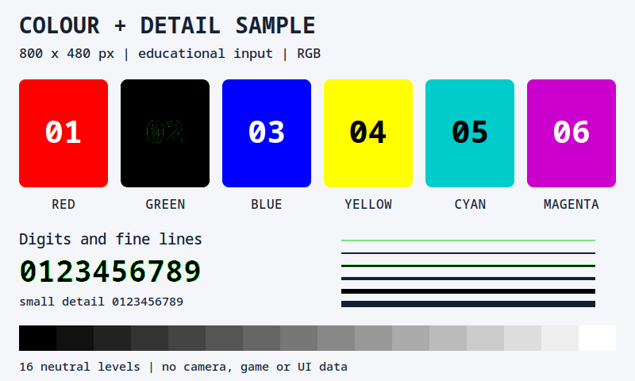
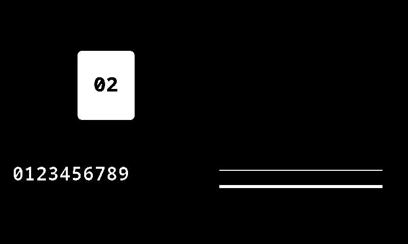
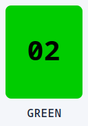
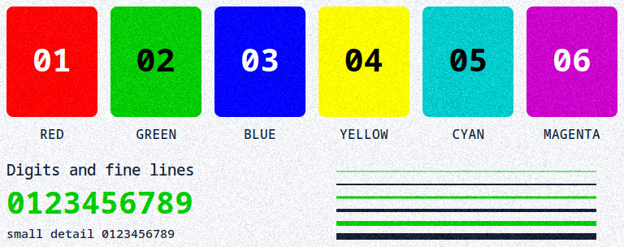
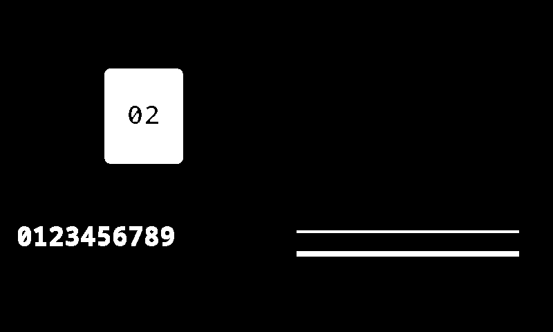
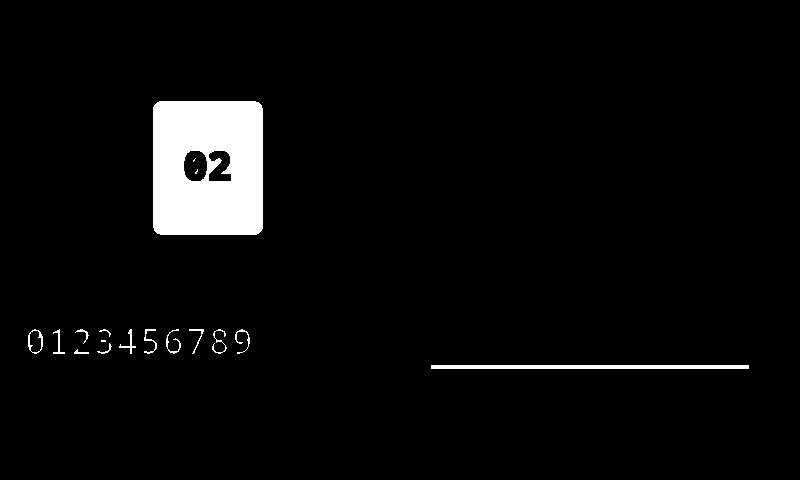
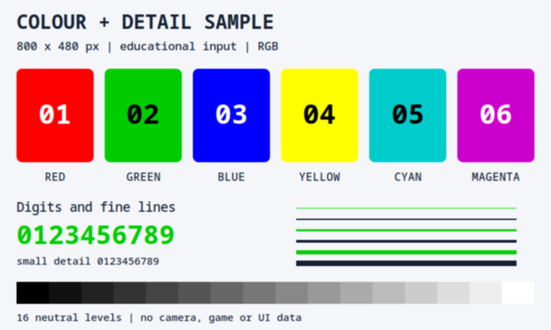
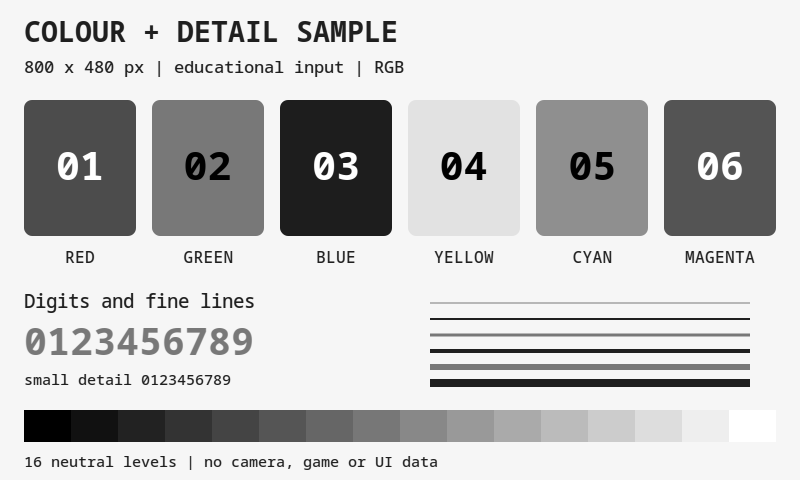
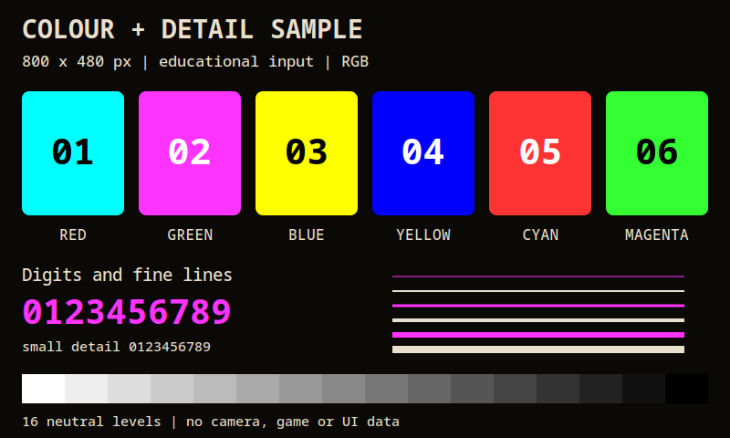
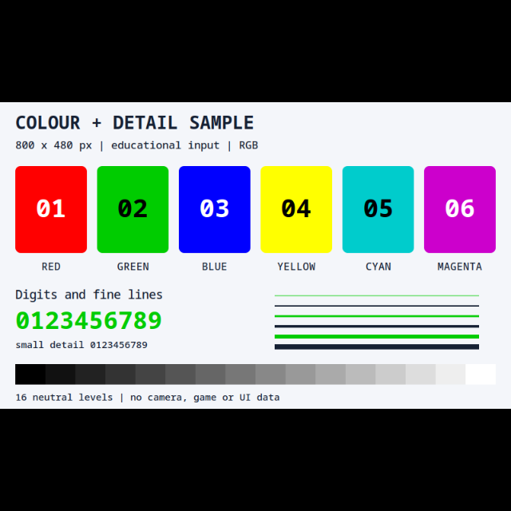

# Эффекты изображения

Если светлые буквы на тёмном фоне плохо различимы для поиска текста, попробуйте сначала перевести кадр в оттенки серого, затем инвертировать его. Effects изменяют захваченные пиксели **перед анализом**. Они не меняют исходное окно и сами не запускают действия.

Эффекты подходят и для других задач: убрать цветовой фон, соединить разорванные светлые участки, уменьшить разрешение или оставить нужный фрагмент. Результат зависит от изображения: фильтр может как помочь поиску, так и уничтожить полезные детали.

## Сделать тёмный текст на светлом фоне

Нужен уже настроенный триггер захвата с видимым светлым текстом на тёмном фоне. Сначала проверьте исходный кадр в **Preview captured image**. Для этого примера достаточно изменить изображение в предпросмотре; перенастраивать условие поиска текста пока не нужно.

1. Рядом с **Preview captured image** нажмите **Effects...**.
2. В списке **Image Effects** нажмите **Add** и добавьте **Grayscale**. Проверьте, что флажок эффекта включён.
3. Через **Add** добавьте **Negate**. Он должен идти **после Grayscale**; при необходимости используйте кнопки перемещения вверх и вниз.
4. Вернитесь к предпросмотру в режиме **Image as is**. Цвета должны исчезнуть, а светлые буквы — стать тёмными на более светлом фоне.
5. Переключитесь на **w/o effects**, чтобы сравнить с исходным кадром, затем верните **Image as is**. Это помогает увидеть именно вклад фильтров, а не изменение исходного приложения.
6. Если буквы стали менее различимы, отключите флажок Negate или уберите лишний эффект. Затем отдельно проверьте фактический результат поиска текста: красивый предпросмотр сам по себе не доказывает улучшение распознавания.

Эффекты выполняются по порядку. Обрезка перед уменьшением и обрезка после уменьшения работают с разными размерами и координатами. При изменении цепочки перепроверяйте итоговый кадр и область поиска.

| Элемент редактора | Что делает |
|---|---|
| Add | Добавляет эффект в цепочку |
| Флажок у эффекта | Временно исключает его из обработки, сохраняя настройки |
| Move effect up / down | Меняет порядок применения |
| Remove effect | Удаляет эффект после подтверждения |
| Copy / Paste effects | Переносит настройки цепочки через буфер обмена |
| Область эффекта, если доступна | Ограничивает действие фильтра частью кадра. Возможность и смысл ограничения зависят от конкретного эффекта |

После изменения эффектов для OCR проверяйте результат [Text Search](/ru/triggers/images/text-search), а не только внешний вид предпросмотра. Чтобы измерить заполненную долю полосы, используйте пример с бинарной полосой в [Color Search](/ru/triggers/images/color-search): сама цепочка эффектов эту долю не вычисляет.

## Выбрать преобразование

| Эффект | Задача и ограничение |
|---|---|
| Color Removal — HSV Range | Заменяет цвета выбранного диапазона HSV чёрным. Это не прозрачность шаблона |
| Color Replacement — HSV Range | Заменяет совпавшие цвета заданным цветом; позволяет также заменить несовпавшие. Удобен для выделения цветной метки |
| Crop | Обрезает кадр до нужного фрагмента. Для исходной области захвата также есть Crop region в самом триггере |
| Denoise | Подавляет шум; мелкие полезные детали тоже могут измениться |
| Dilate | Расширяет светлые области, помогает соединить разрывы |
| Erode | Сужает светлые области, может убрать мелкие светлые точки |
| Gaussian Blur | Размывает мелкие детали. Полезен перед некоторыми измерениями, но может ухудшить поиск маленького текста |
| Grayscale | Убирает цветность, сохраняя градации яркости. Не делает изображение строго двухцветным |
| Negate | Инвертирует цвета: чёрное становится белым и наоборот |
| Rescale, % | Меняет размер в процентах. 50% от 1920×1080 даёт 960×540: пикселей становится в четыре раза меньше |
| Resize, in pixels | Задаёт размер в пикселях; режим с сохранением пропорций и полями полезен, когда нужен фиксированный размер без растяжения |
| Binary Threshold | Разделяет яркости порогом на два уровня. Выбор порога определяет, какие детали останутся |
| Color Quantization (alpha) | Уменьшает число цветов. Проверяйте, не слились ли разные нужные элементы |

После изменения размера шаблон Image Search должен соответствовать **обработанному** кадру. Для AI не обязательно вручную приводить вход к размеру модели: её собственная подготовка входа уже учитывает размеры модели. Дополнительное уменьшение может потерять мелкие объекты.

Старые иллюстрации: как меняются пиксели

Это примеры преобразований, а не готовые настройки для изображённого приложения. Они не обещают распознавание объектов или навигацию.

Исходный кадр для сравнения цветовых эффектов:

Это новая учебная карточка, а не снимок приложения или игры. Два результата ниже вычислены из её точных пикселей; это иллюстрации алгоритмов, а не снимки работы EyeAuras. [Исходная карточка SVG](/assets/wiki-media/m004-source.svg).

Для обоих цветовых примеров выбран один диапазон, включая границы:

| Параметр | Значение |
|---|---|
| H | 55–65 |
| S | 200–255 |
| V | 150–255 |
| Зелёный участок карточки | RGB (0, 204, 0), HSV (60, 255, 204) |

Это шкалы H, S и V редактора: H до 180, S и V до 255, а не градусы и проценты. Диапазон выделяет насыщенный зелёный; сглаженные края букв и линий могут оказаться за его пределами.

**Color Removal** заменяет выбранный диапазон чёрным; оставшиеся цвета продолжают участвовать в анализе.

**Color Removal:** Invert выключен. Все 19 194 пикселя выбранного диапазона стали чёрными, RGB (0, 0, 0). Остальные 364 806 пикселей сохранились без изменений; это удаление цвета, а не выделение объекта.

**Color Replacement** позволяет получить контрастную маску, отдельно задавая цвет совпавших и остальных пикселей.

**Color Replacement:** включены оба цвета замены. Для совпавших задан белый, RGB (255, 255, 255), для несовпавших — чёрный, RGB (0, 0, 0). Получилось 19 194 белых и 364 806 чёрных пикселей; исходные цвета вне диапазона тоже заменены.

**Crop** оставляет фрагмент изображения. Проверьте, что нужный объект не обрезан.

Учебный Crop из [исходной цветовой карточки](/assets/wiki-media/m004.png): x = 144, y = 92, ширина 128, высота 184. Результат — точные 128×184 пикселя без пересчёта цветов; координаты относятся к изображению, а не к экрану или окну. Примеры Crop, Resize, Grayscale, Negate и Gaussian Blur на этой странице независимо рассчитаны из этой карточки; это иллюстрации алгоритмов, а не снимки работы EyeAuras.

**Denoise**: исходный шумный фрагмент и результат подавления шума. Сравнивайте также сохранность мелких деталей.

Учебный вход 768×304: фрагмент [цветовой карточки](/assets/wiki-media/m004.png) с x = 16, y = 92, шириной 768 и высотой 304. К трём каналам добавлен один и тот же гауссов шум с σ = 12, затем значения округлены и ограничены диапазоном 0–255. Это синтетический шум, а не снимок приложения или камеры; ниже обработан именно этот сохранённый PNG.

Результат `fastNlMeansDenoisingColored`: **Strength = 12**, **Template Window Size = 3**, **Search Window Size = 7**, внутренний параметр hColor = 3. Учебная обработка выполнена OpenCV 4.13 отдельно от EyeAuras с Emgu/OpenCV 4.9. На ровном фоне шум стал слабее, но остаточная пятнистость видна, а мелкие края изменились. Подавление шума не гарантирует сохранность каждой детали или улучшение распознавания.

**Dilate** расширяет светлые элементы; **Erode** сужает их. Выбирайте направление по тому, нужно ли соединить разрывы или убрать выступы.

Оба учебных результата ниже независимо рассчитаны из одной [исходной маски Color Replacement](/assets/wiki-media/m006.png): Iterations = 1, квадратное ядро 3×3 с центром в среднем пикселе. Это численные иллюстрации, а не снимки работы EyeAuras.

**Dilate:** каждый пиксель получает максимум по девяти соседним пикселям, включая себя; за границей кадра используется 0. Белых пикселей стало 22 696 вместо 19 194. Белые штрихи утолщились, а чёрные цифры 02 стали тоньше.

**Erode:** каждый пиксель получает минимум по девяти соседним пикселям, включая себя; за границей кадра используется 255. Белых пикселей осталось 15 751. Тонкая верхняя белая линия исчезла, нижняя сузилась; чёрные цифры 02 расширились.

**Gaussian Blur** сглаживает резкие мелкие изменения яркости.

Учебный Gaussian Blur, 800×480: Kernel Size = 3, sigma = 0. По каждой оси использованы веса 1/4, 1/2, 1/4; края продолжены по Reflect101 без повторения граничного пикселя, итог округлён к ближайшему целому, половины вверх. Мелкие края стали мягче; это не подавление шума методом Denoise.

**Grayscale** оставляет оттенки серого; **Negate** меняет светлое и тёмное местами, как в сценарии выше.

Учебный Grayscale, 800×480: BGR → Gray → BGR. Каждый пиксель получает яркость `(3735·B + 19235·G + 9798·R + 16384) >> 15`, одинаковую во всех трёх каналах. Красный участок стал серым с яркостью 76, зелёный — 120, синий — 29; изображение сохранило градации, а не стало двухцветным.

Учебный Negate, 800×480: побитовый NOT каждого 8-битного канала, то есть `255 − исходное значение`. Например, красный RGB (255, 0, 0) превратился в бирюзовый (0, 255, 255), а чёрное стало белым. Надписи цветов остались частью исходной карточки.

**Resize, in pixels** меняет габариты. Области-поля позволяют сохранить пропорции вместо растяжения содержимого.

Учебный Resize: Target Size — 640×640, Method — **Letterbox - black edges**. Масштаб 0,8 даёт содержимое 640×384, сверху и снизу — по 128 чёрных строк. Билинейный расчёт использует центры пикселей и округление к ближайшему целому, половины вверх; это математический пример, без обещания побайтового совпадения с библиотекой OpenCV. Надпись 800×480 внутри относится к исходной карточке.

На иллюстрации **Binary Threshold** показано, как разные способы пороговой обработки выделяют цифры на неравномерно освещённом листе. Это сравнение методов; надписи на картинке не означают, что все они доступны как отдельные переключатели этого эффекта.

Дополнительные иллюстрации пороговой обработки: [руководство LearnOpenCV](https://learnopencv.com/opencv-threshold-python-cpp/) и [вводная статья](https://medium.com/@manik.butex41/an-introduction-to-thresholding-operations-in-opencv-64aff0cb2826). Их примеры кода не нужно вставлять в настройки EyeAuras.

Оценивайте нагрузку по **Effects time** в подсказке FPS у предпросмотра. Скорость зависит от размера кадра и цепочки; несколько фильтров не обязательно бесплатны. Для изменения только сохранённого образца используйте [редактор шаблона](/ru/triggers/images/image-editor), а не эффекты каждого нового кадра.
