# Эффекты изображения

Effects меняют захваченный кадр **перед анализом**. Исходное окно они не трогают и действий сами не запускают. Например, если поиск текста плохо видит светлые буквы на тёмном фоне, переведите кадр в оттенки серого, а потом инвертируйте.

Эффектами можно также убрать цветной фон, соединить разорванные светлые участки, уменьшить разрешение или оставить нужный фрагмент. Всё зависит от картинки: фильтр может помочь поиску, а может стереть полезные детали.

## Сделать тёмный текст на светлом фоне

Нужен уже настроенный триггер захвата, в кадре которого виден светлый текст на тёмном фоне. Сначала посмотрите на исходный кадр в **Preview captured image**. В этом примере мы меняем только картинку в предпросмотре, условие поиска текста пока не трогаем.

1. Рядом с **Preview captured image** нажмите **Effects...**.
2. В списке **Image Effects** нажмите **Add** и добавьте **Grayscale**. Проверьте, что флажок эффекта включён.
3. Через **Add** добавьте **Negate**. Он должен стоять **после Grayscale**. Порядок меняется кнопками перемещения вверх и вниз.
4. Вернитесь к предпросмотру в режиме **Image as is**. Цвета должны исчезнуть, а светлые буквы — стать тёмными на более светлом фоне.
5. Переключитесь на **w/o effects**, чтобы сравнить с исходным кадром, и верните **Image as is**. Так видно, что изменили именно фильтры, а не само приложение.
6. Если буквы стали читаться хуже, снимите флажок Negate или уберите лишний эффект. Потом отдельно проверьте, что реально находит поиск текста. Красивый предпросмотр ещё не значит, что распознавание стало лучше.

Эффекты выполняются по порядку. Обрезка до уменьшения и обрезка после уменьшения работают с разными размерами и координатами. Поменяли цепочку — заново проверьте итоговый кадр и область поиска.

| Элемент редактора | Что делает |
|---|---|
| Add | Добавляет эффект в цепочку |
| Флажок у эффекта | Временно выключает эффект, настройки сохраняются |
| Move effect up / down | Меняет порядок применения |
| Remove effect | Удаляет эффект после подтверждения |
| Copy / Paste effects | Переносит настройки цепочки через буфер обмена |
| Область эффекта, если доступна | Ограничивает фильтр частью кадра. Есть ли она и что даёт, зависит от конкретного эффекта |

Если меняете эффекты для OCR, проверяйте результат [Text Search](/ru/triggers/images/text-search), а не только вид предпросмотра. Чтобы измерить, насколько заполнена полоска, возьмите пример с двухцветной полоской в [Color Search](/ru/triggers/images/color-search). Сама цепочка эффектов эту долю не считает.

## Выбрать преобразование

| Эффект | Задача и ограничение |
|---|---|
| Color Removal — HSV Range | Закрашивает чёрным цвета из выбранного диапазона HSV. Это не прозрачность шаблона |
| Color Replacement — HSV Range | Заменяет совпавшие цвета заданным цветом. Несовпавшие тоже можно заменить. Удобен, чтобы выделить цветную метку |
| Crop | Обрезает кадр до нужного фрагмента. Исходную область захвата можно обрезать и через Crop region в самом триггере |
| Denoise | Подавляет шум. Мелкие полезные детали тоже могут измениться |
| Dilate | Расширяет светлые области, помогает соединить разрывы |
| Erode | Сужает светлые области, может убрать мелкие светлые точки |
| Gaussian Blur | Размывает мелкие детали. Полезен перед некоторыми измерениями, но может ухудшить поиск мелкого текста |
| Grayscale | Убирает цвет и оставляет градации яркости. Строго двухцветным изображение не становится |
| Negate | Инвертирует цвета: чёрное становится белым и наоборот |
| Rescale, % | Меняет размер в процентах. 50% от 1920×1080 даёт 960×540: пикселей становится в четыре раза меньше |
| Resize, in pixels | Задаёт размер в пикселях. Режим с сохранением пропорций и полями нужен, когда требуется фиксированный размер без растяжения |
| Binary Threshold | Делит яркости порогом на два уровня. От порога зависит, какие детали останутся |
| Color Quantization (alpha) | Уменьшает число цветов. Проверьте, не слились ли разные нужные элементы |

Если вы меняете размер кадра, шаблон Image Search должен соответствовать **обработанному** кадру. Для AI подгонять кадр под размер модели вручную не обязательно: она сама готовит вход нужного размера. Лишнее уменьшение может потерять мелкие объекты.

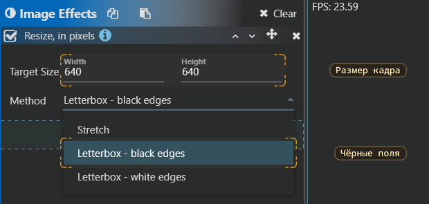

В старом редакторе Image Effects для Resize заданы ширина и высота 640 пикселей. Режим Letterbox - black edges сохраняет пропорции и заполняет свободное место чёрным.

Старые иллюстрации: как меняются пиксели

Это примеры преобразований, а не готовые настройки для какого-то приложения. Распознавания объектов или навигации они не обещают. Примеры Crop, Resize, Grayscale, Negate и Gaussian Blur рассчитаны из одной учебной карточки отдельно от EyeAuras. Это иллюстрации алгоритмов, а не снимки работы программы.

Исходный кадр для сравнения цветовых эффектов:

[Исходная карточка SVG](/assets/wiki-media/m004-source.svg).

В обоих цветовых примерах выбран один диапазон, границы включены:

| Параметр | Значение |
|---|---|
| H | 55–65 |
| S | 200–255 |
| V | 150–255 |
| Зелёный участок карточки | RGB (0, 204, 0), HSV (60, 255, 204) |

Это шкалы H, S и V редактора: H до 180, S и V до 255. Не градусы и не проценты. Диапазон выделяет насыщенный зелёный. Сглаженные края букв и линий могут в него не попасть.

**Color Removal** закрашивает выбранный диапазон чёрным. Остальные цвета по-прежнему участвуют в анализе.

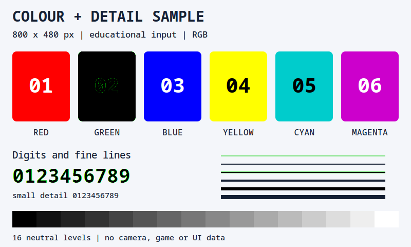

**Color Removal:** Invert выключен. Все 19 194 пикселя выбранного диапазона стали чёрными, RGB (0, 0, 0). Остальные 364 806 пикселей не изменились. Это удаление цвета, а не выделение объекта.

**Color Replacement** даёт контрастную маску: цвет совпавших и остальных пикселей задаётся отдельно.

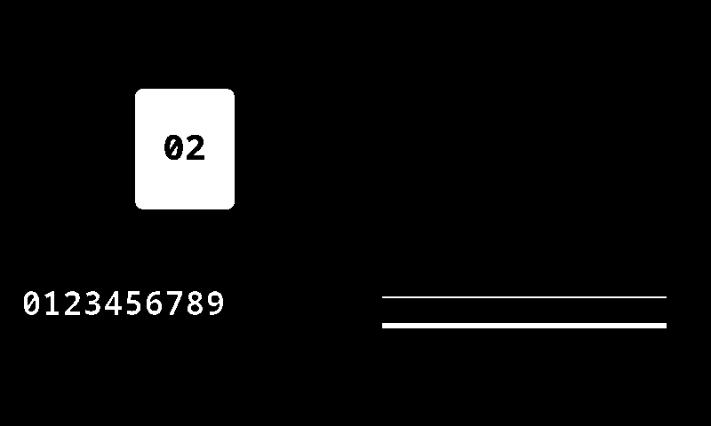

**Color Replacement:** включены оба цвета замены. Для совпавших задан белый, RGB (255, 255, 255), для несовпавших — чёрный, RGB (0, 0, 0). Получилось 19 194 белых и 364 806 чёрных пикселей. Исходные цвета вне диапазона тоже заменены.

**Crop** оставляет фрагмент изображения. Проверьте, что нужный объект не обрезан.

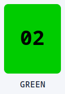

Crop из [исходной цветовой карточки](/assets/wiki-media/m004.png): x = 144, y = 92, ширина 128, высота 184. Получилось ровно 128×184 пикселя, цвета не пересчитывались. Координаты относятся к изображению, а не к экрану или окну. Примеры Crop, Resize, Grayscale, Negate и Gaussian Blur рассчитаны из этой карточки независимо друг от друга.

**Denoise**: шумный фрагмент и результат подавления шума. Сравнивайте и то, как сохранились мелкие детали.

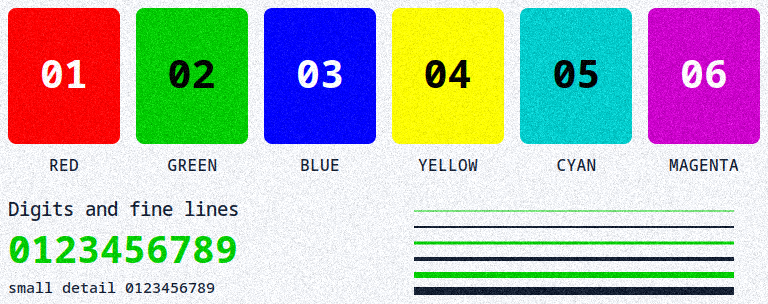

Вход 768×304: фрагмент [цветовой карточки](/assets/wiki-media/m004.png) с x = 16, y = 92, шириной 768 и высотой 304. К трём каналам добавлен один и тот же гауссов шум с σ = 12, затем значения округлены и ограничены диапазоном 0–255. Шум синтетический, это не снимок приложения или камеры. Ниже обработан именно этот PNG.

Результат `fastNlMeansDenoisingColored`: **Strength = 12**, **Template Window Size = 3**, **Search Window Size = 7**, внутренний параметр hColor = 3. Обработка выполнена в OpenCV 4.13, в EyeAuras используется Emgu/OpenCV 4.9. На ровном фоне шум стал слабее, но пятнистость осталась, а мелкие края изменились. Подавление шума не гарантирует, что уцелеет каждая деталь или что распознавание улучшится.

**Dilate** расширяет светлые элементы, **Erode** сужает их. Выбирайте по задаче: соединить разрывы или убрать выступы.

Оба результата ниже рассчитаны из одной [исходной маски Color Replacement](/assets/wiki-media/m006.png): Iterations = 1, квадратное ядро 3×3 с центром в среднем пикселе.

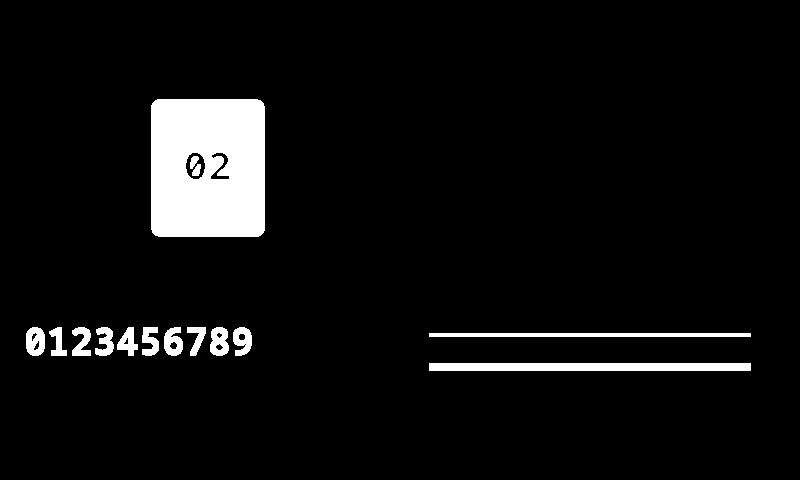

**Dilate:** каждый пиксель получает максимум по девяти соседним пикселям, включая себя. За границей кадра используется 0. Белых пикселей стало 22 696 вместо 19 194. Белые штрихи утолщились, а чёрные цифры 02 стали тоньше.

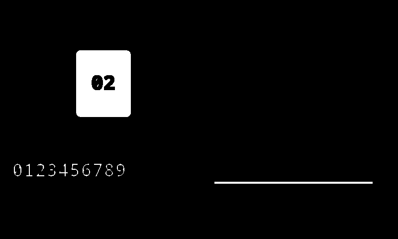

**Erode:** каждый пиксель получает минимум по девяти соседним пикселям, включая себя. За границей кадра используется 255. Белых пикселей осталось 15 751. Тонкая верхняя белая линия исчезла, нижняя сузилась, чёрные цифры 02 расширились.

**Gaussian Blur** сглаживает резкие мелкие перепады яркости.

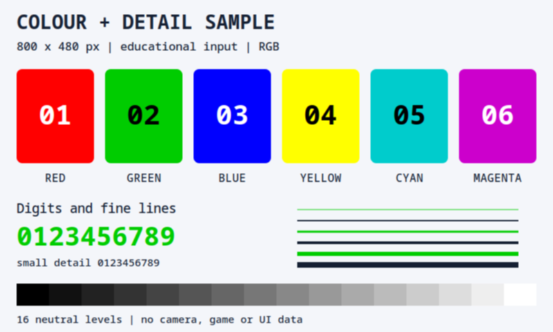

Gaussian Blur, 800×480: Kernel Size = 3, sigma = 0. По каждой оси использованы веса 1/4, 1/2, 1/4. Края продолжены по Reflect101 без повторения граничного пикселя, итог округлён к ближайшему целому, половины вверх. Мелкие края стали мягче. Это не то же самое, что подавление шума в Denoise.

**Grayscale** оставляет оттенки серого. **Negate** меняет светлое и тёмное местами, как в примере выше.

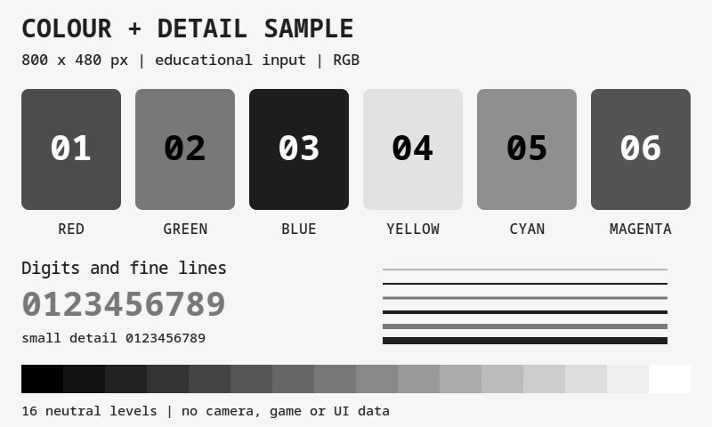

Grayscale, 800×480: BGR → Gray → BGR. Каждый пиксель получает яркость `(3735·B + 19235·G + 9798·R + 16384) >> 15`, одинаковую во всех трёх каналах. Красный участок стал серым с яркостью 76, зелёный — 120, синий — 29. Градации сохранились, двухцветным изображение не стало.

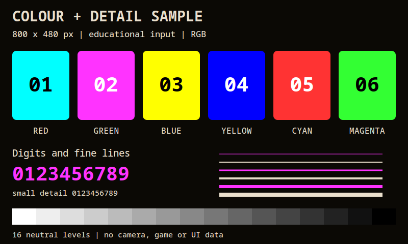

Negate, 800×480: побитовый NOT каждого 8-битного канала, то есть `255 − исходное значение`. Например, красный RGB (255, 0, 0) превратился в бирюзовый (0, 255, 255), а чёрное стало белым. Надписи цветов остались частью исходной карточки.

**Resize, in pixels** меняет размеры кадра. Поля сохраняют пропорции, и содержимое не растягивается.

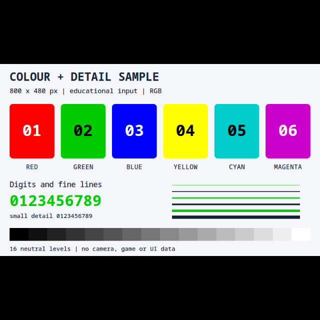

Resize: Target Size — 640×640, Method — **Letterbox - black edges**. Масштаб 0,8 даёт содержимое 640×384, сверху и снизу — по 128 чёрных строк. Билинейный расчёт использует центры пикселей и округление к ближайшему целому, половины вверх. Это математический пример, побайтового совпадения с библиотекой OpenCV он не обещает. Надпись 800×480 внутри относится к исходной карточке.

Иллюстрация **Binary Threshold** показывает, как разные способы пороговой обработки выделяют цифры на неравномерно освещённом листе. Это сравнение методов. Надписи на картинке не означают, что все они есть в этом эффекте как отдельные переключатели.

Ещё примеры пороговой обработки: [руководство LearnOpenCV](https://learnopencv.com/opencv-threshold-python-cpp/) и [вводная статья](https://medium.com/@manik.butex41/an-introduction-to-thresholding-operations-in-opencv-64aff0cb2826). Код из них в настройки EyeAuras вставлять не нужно.

Нагрузку смотрите по **Effects time** в подсказке FPS у предпросмотра. Скорость зависит от размера кадра и цепочки, каждый фильтр чего-то стоит. Чтобы изменить только сохранённый образец, используйте [редактор шаблона](/ru/triggers/images/image-editor), а не эффекты на каждом кадре.
