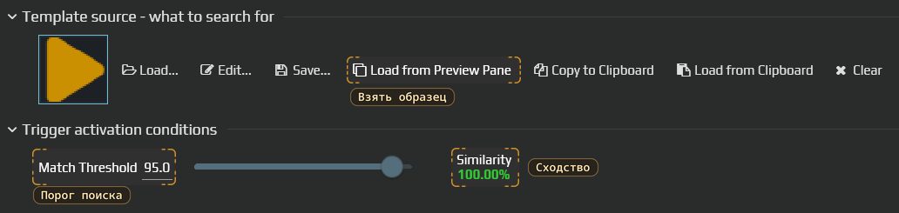

# Поиск изображения

Image Search ищет в окне знакомую картинку. Например, отметку о том, что экспорт завершён. Вы один раз сохраняете её как **шаблон**, а триггер ищет похожий фрагмент в новых кадрах. Он сравнивает пиксели и не знает, что значок означает в самой программе.

Для настройки нужен настоящий значок на экране и возможность показать состояние, где его нет. Масштаб интерфейса, тема и размер значка не должны меняться. Реакцию на найденное совпадение добавляют отдельно.

## Сохранить значок и проверить оба состояния

1. Откройте в своей программе состояние с отметкой о завершении. Добавьте в ауру триггер **Image Search**.
2. В **Capture settings → Target Window** выберите окно программы. Задайте **Image Capture Rate = 5** и раскройте **Preview captured image**. Значок должен попадать в кадр. Если картинка не та, сначала настройте [захват](/ru/triggers/images/imagecapturetriggers).
3. В **Crop region** оставьте только место, где появляется значок. Дайте запас, если он немного смещается, но не захватывайте соседние похожие элементы.
4. Чтобы шаблон получился чистым, выберите в предпросмотре **w/o debug data**. Затем в **Template source — what to search for** нажмите **Load from Preview Pane**. Эта команда копирует изображение предпросмотра целиком.
5. Нажмите **Edit...**, инструментом **Crop** оставьте только сам значок и нажмите **Save**. Проценты, время и имя файла, которые меняются, в образец не берите. Как чистить шаблон и делать фон прозрачным — в [редакторе шаблона](/ru/triggers/images/image-editor).
6. В **Trigger activation conditions** задайте **Match Threshold = 95%** и нажмите **Refresh Once**. Посмотрите на реальную **Similarity** и найденную область. 95% — стартовое значение, его нужно проверить на своём значке.
7. Переведите программу в состояние без отметки и проверьте ещё раз. Совпадение должно исчезнуть, а триггер — стать неактивным. Верните отметку: совпадение и активное состояние должны вернуться.

Значок виден, а совпадения нет — сначала сравните масштаб и кадр с образцом. Триггер активен без значка — сузьте область или возьмите более характерный шаблон. Если снизить порог, триггер найдёт и изменившуюся картинку, но ложных совпадений станет больше.

## Что сохраняется и что сравнивается

| Элемент | Как использовать |
|---|---|
| Load... | Загружает шаблон из файла. Копия хранится внутри триггера. Если потом изменить исходный файл, шаблон не обновится |
| Load from Preview Pane | Берёт текущий предпросмотр. После копирования обрежьте лишнее через Edit... |
| Load from Clipboard / Copy to Clipboard | Переносит изображение через буфер обмена |
| Edit... / Save... / Clear | Изменяет встроенный образец, сохраняет его в отдельный файл или очищает |
| Прозрачные пиксели шаблона | Не участвуют в сравнении. Так можно убрать фон или меняющийся угол и оставить характерную часть значка |
| Match Threshold | Минимальное сходство. Если результат не ниже порога, триггер активен |
| Similarity | Реальное сходство найденного кандидата. Это не вероятность того, что приложение завершило работу |

На снимке из старого редактора порог для жёлтого треугольника — 95%, измеренное сходство — 100%.

Поиск сам не подгоняет шаблон под поворот или другой масштаб. Для другого размера подготовьте отдельный образец. [AI Search](/ru/triggers/images/ai-search-trigger) решает другую задачу: ищет классы, которым обучена модель, а не любой значок, загруженный в Image Search.

Несколько совпадений и разметка

| Настройка | Что меняется |
|---|---|
| Match Collection → Include All Matches | Собирает несколько подходящих совпадений, а не одно лучшее |
| IoU Threshold | Определяет, как удаляются перекрывающиеся результаты при сборе совпадений. Не заменяет Match Threshold |
| On-screen-display → Window / Region / Bounding Boxes | Показывает поверх экрана окно, область захвата и рамки найденных фрагментов. Это диагностика, её можно отключить |

Все совпадения нужны, когда важно несколько экземпляров одного значка. Для условия «есть хотя бы один» хватит обычного поиска. Чем меньше область, тем меньше работы и посторонних кандидатов.

Чтобы держать найденный участок перед глазами, возьмите [Replica](/ru/overlays/replica) и укажите ауру поиска в **Linked auras**. Сначала проверьте найденную рамку: оверлей копирует область исходного окна, нажатия в него он не передаёт.

После проверки добавьте действие в **OnEnter** ауры, например [Play Sound](/ru/actions/play-sound). Если такой триггер в ауре один, звук прозвучит один раз, когда значок найден, а не на каждом кадре. Если в ауре есть другие триггеры или условия включения, учитывайте и их состояние.
