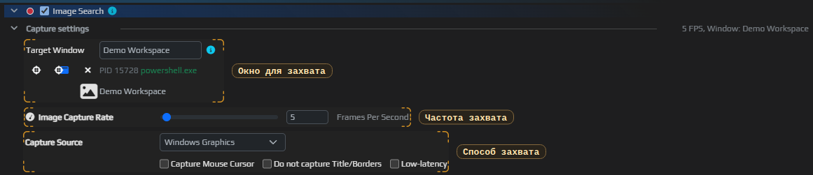
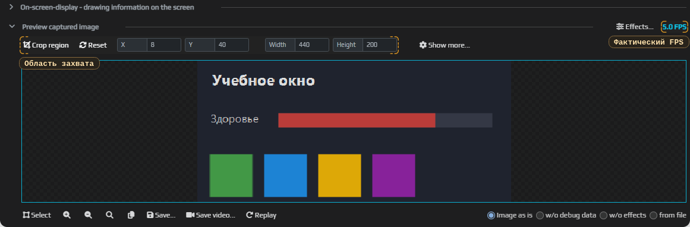

# Захват и анализ изображения

Прежде чем искать значок, цвет или текст, EyeAuras должен получить картинку нужной части окна. Откройте предпросмотр триггера и проверьте, что он видит. Если там чёрный кадр, соседнее окно или слишком большая область, поиск не заработает, как бы вы ни крутили порог совпадения.

Эти настройки одинаковы у Image Search, Color Search, Text Search и AI Search.

## Получить область с индикатором приложения

Допустим, вы хотите следить за небольшим индикатором в приложении. Сначала добейтесь, чтобы в предпросмотре был виден только он, без остальной панели.

1. Откройте приложение так, чтобы индикатор был виден. Добавьте в ауру, например, **Color Search**.
2. В **Capture settings → Target Window** выберите окно приложения. Под полем показано, какое окно выбрано. Если окон несколько, уточните выбор [выражением сопоставления](/ru/features/window-matching-expressions).
3. Задайте **Image Capture Rate = 5 Frames Per Second**. Для неподвижного индикатора этого хватит, потом значение можно поменять.
4. Раскройте **Preview captured image**. Если кадр пустой или не тот, нажмите **Show more...** в настройках захвата и проверьте **Capture Source**. Начните с **Windows Graphics**, если он доступен. Не помогло — попробуйте другие методы из таблицы ниже.
5. В **Crop region** задайте **X**, **Y**, **Width** и **Height** так, чтобы в кадре остался индикатор. Координаты считаются от выбранного источника, поэтому смотрите на предпросмотр, а не на положение окна на рабочем столе. **Reset** убирает обрезку.
6. Измените состояние индикатора в приложении. В предпросмотре должен измениться тот же участок. Только после этого выбирайте цвет, образец или текст для поиска.

## Что регулирует захват

| Настройка | Для чего менять |
|---|---|
| Target Window | Откуда брать пиксели. Если подошло несколько окон, уточните выражение |
| Image Capture Rate, ранее Max FPS | Как часто захватывать и анализировать кадр. 5 FPS — примерно одна проверка в 200 мс, 30 FPS — в 33 мс |
| Settings → Max Capture FPS | Общий предел частоты. Он может урезать значение отдельного триггера, тогда редактор покажет предупреждение MAX … FPS |
| Crop region | Область для анализа. Чем она меньше, тем обычно меньше работы и лишних совпадений |
| Capture Mouse Cursor | Добавляет курсор в кадр, если метод это умеет. Для неподвижного значка курсор обычно лучше убрать |
| Do not capture Title/Borders | Убирает заголовок и рамку, если источник это поддерживает. После изменения перепроверьте область |
| Low-latency | Меняет режим получения кадров. Проверяйте результат и нагрузку на своём приложении, а не выбирайте по названию |
| Effects... | Обрабатывает кадр перед анализом: например, уменьшает его или переводит в оттенки серого |

Фактический FPS показан рядом с предпросмотром. Наведите на него мышь: в подсказке отдельно указано время захвата, эффектов и обработки, возраст последнего кадра и размер результата. Если обработка занимает 100 мс, от установки 30 FPS она не станет занимать 33 мс. Сначала уменьшите область, отключите лишние эффекты или снизьте частоту.

## Как выбрать метод

Какие методы доступны, зависит от Windows, видеодрайвера и самого приложения. Сначала смотрите, правильный ли кадр, потом — на нагрузку.

| Capture Source | Когда пробовать |
|---|---|
| Windows Graphics | Современный системный захват окна. Нужна поддержка Windows Graphics Capture, без неё метод недоступен |
| Shared Surface | Берёт поверхность окна через графическую подсистему. Запасной вариант, если Windows Graphics даёт неверный кадр |
| Desktop duplication | Захват рабочего стола через GPU. Проверьте, что в области виден нужный контент: в кадр могут попасть перекрывающие окна |
| Print Window | Старый оконный способ. Некоторые приложения, в том числе с аппаратным рисованием, отдают пустое или неполное изображение |
| Copy Device Context | Копирует контекст окна средствами GDI. Запасной вариант для обычных совместимых окон |
| Copy From Screen | Копирует видимый участок экрана. Учитывайте перекрытия и положение окна |

После смены метода снова проверьте границы области и содержимое кадра. От свёрнутого, закрытого или недоступного окна свежих пикселей не ждите.

Предпросмотр, разовая проверка и старый Min FPS

| Элемент | Что учитывать |
|---|---|
| Refresh Once в редакторе поиска | Запускает одну проверку. Удобно при настройке, когда высокая постоянная частота не нужна |
| MIN … FPS (only in Preview) | Минимальная частота, пока открыт предпросмотр. Она может оказаться выше значения триггера, поэтому обычную нагрузку оценивайте с закрытым предпросмотром |
| Image as is / w/o debug data / w/o effects | Показывают кадр с разметкой, без отладочной разметки и без эффектов |
| from file | Подставляет в предпросмотр изображение из файла. После проверки верните обычный режим, чтобы снова работать с окном |
| Старый Min FPS | Раньше задавал срок актуальности результата: при задержке триггер переходил в Unknown. В текущем редакторе этого поля нет, и на сохранённое значение как на таймер устаревания рассчитывать нельзя |

Если поиск нужен только в определённом режиме, задайте [условия включения](/ru/features/enabling-conditions) для ауры или её папки. Обычный триггер со значением false не останавливает остальные триггеры захвата и поиска.

Когда источник и область готовы, переходите к поиску [изображения](/ru/triggers/images/image-search), [цвета](/ru/triggers/images/color-search), [текста](/ru/triggers/images/text-search) или к [AI Search](/ru/triggers/images/ai-search-trigger). Если перед анализом нужно изменить сами пиксели, добавьте [эффекты](/ru/triggers/images/effects).
