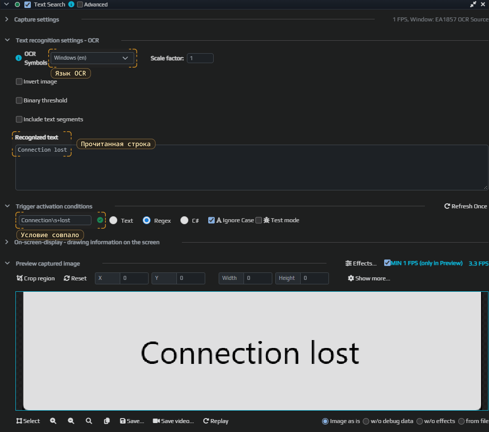

# Text Search — отреагировать на надпись в окне

Text Search читает текст с картинки выбранной области и проверяет его по вашему условию. Например, в приложении появилось «Connection lost» — и вы сразу получаете уведомление. Чтение текста с картинки называется OCR.

## Настройте поиск надписи

1. Добавьте триггер Text Search в ауру и выберите окно приложения.
2. Выделите небольшую область, где появляется надпись. В предпросмотре должны быть видны буквы.
3. В OCR Symbols выберите доступный движок для языка надписи. В этом примере — английского.
4. Нажмите Refresh Once и посмотрите распознанный текст. Если вместо слов ошибка или пустая строка, сначала исправьте захват и распознавание.
5. В проверке текста выберите Regex, укажите `Connection\s+lost` и включите сравнение без учёта регистра. `\s+` допускает между словами пробелы или перенос строки.
6. Покажите и уберите надпись в окне. Состояние триггера должно меняться вместе с результатом поиска.

Для первой пробы подойдёт обычное окно с набранной фразой. Потом повторите проверку в нужном приложении при его обычном размере и масштабе.

## Добавьте реакцию

Поместите Play Sound в **On Enter** этой ауры. Когда распознанный текст впервые совпадёт с условием и аура включится, прозвучит уведомление. Вместо звука можно настроить [отправку в Telegram](/ru/actions/send-telegram-message).

Нужен постоянный индикатор на экране, а не разовый звук? Добавьте в эту ауру оверлей [Text](/ru/overlays/text) со своей надписью. Он показывает её, пока аура активна. В Content остаются слова, которые ввели вы: распознанная строка туда сама не попадает. Про блокировку оверлея и проверку его обычной видимости вне редактора читайте в [общих параметрах](/ru/overlays/common-options).

## Настройки

| Настройка | Зачем нужна |
| --- | --- |
| Окно и область захвата | Где искать надпись. Начните с области без постороннего текста. |
| OCR Symbols | Движок и набор символов. Выбирайте по языку текста. |
| Проверка текста | Что считать совпадением. Для сложных условий есть [Text, Regex и Lambda](/ru/features/text-match-expressions). |
| Scale factor | Увеличивает картинку перед распознаванием. Может помочь с мелкими буквами. |
| Invert image | Меняет светлое и тёмное местами. Попробуйте, если текст светлый на тёмном фоне, и сравните результат. |
| Binary threshold | Делает картинку чёрно-белой перед распознаванием. Проверяйте, не пропали ли части букв. |
| Include text segments | Добавляет данные об отдельных словах. Для простого поиска фразы обычно не нужно. |

Как понимать состояние триггера

| Состояние | Что означает |
| --- | --- |
| Active | Текст распознан и совпал с условием. |
| Not Active | Проверка выполнена, совпадения нет. |
| Unknown | Результат получить не удалось, например нет изображения окна или OCR-движок недоступен. |

## Если надпись не находится

Смотрите на распознанную строку. Буквы распознаны с ошибками — дело в захвате, языке или обработке картинки. Слова правильные, а совпадения нет — дело в выражении. Меняйте по одному параметру и сравнивайте результат через Refresh Once.

Общие параметры захвата описаны [отдельно](/ru/triggers/images/imagecapturetriggers).
