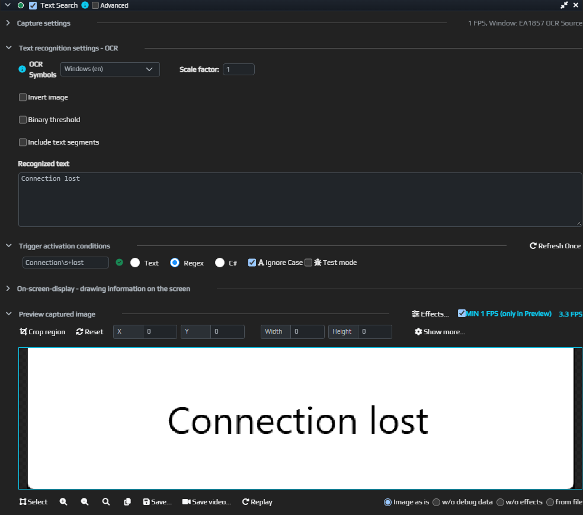

# Text Search — отреагировать на надпись в окне

В приложении появляется «Connection lost», и вы хотите сразу получить уведомление. Text Search читает текст с изображения выбранной области и проверяет его по вашему условию. Получение текста с картинки называется OCR.

Сначала добейтесь правильного распознавания надписи, затем подключайте звук, отправку сообщения или другое действие.

## Настройте поиск надписи

1. Добавьте триггер Text Search в ауру и выберите окно приложения.
2. Выделите небольшую область, где появляется нужная надпись. В предпросмотре должны быть видны сами буквы.
3. В OCR Symbols выберите доступный движок для языка надписи — в этом примере английского.
4. Нажмите Refresh Once и посмотрите распознанный текст. Если вместо слов получилась ошибка или пустая строка, сначала исправьте захват и распознавание.
5. В проверке текста выберите Regex, укажите `Connection\s+lost` и включите сравнение без учёта регистра. Здесь `\s+` допускает пробелы или перенос строки между словами.
6. Покажите и уберите надпись в окне. Проверьте, что состояние триггера меняется вместе с результатом поиска.

Внизу — изображение из выбранного окна, в Recognized text — прочитанная строка. Условие Regex совпало с ней; триггер активен. Это пример с обычным окном, в котором набрана фраза «Connection lost».

Для первого опыта можно использовать обычное окно с набранной фразой. Проверку в нужном приложении затем повторите при его обычном размере и масштабе.

## Добавьте реакцию

Поместите Play Sound в **On Enter** этой ауры. Когда распознанный текст впервые совпадёт с условием и аура активируется, прозвучит уведомление. Вместо звука можно настроить [отправку в Telegram](/ru/actions/send-telegram-message).

Если в ауре есть другие триггеры, её итоговое состояние зависит и от них.

Если нужен постоянный видимый индикатор вместо разового звука, добавьте [Text](/ru/overlays/text) с собственной надписью в эту ауру. Он показывает заданные вами слова при активности ауры; [общие параметры](/ru/overlays/common-options) объясняют блокировку и проверку обычной видимости вне редактора. Content по-прежнему содержит введённые вами слова, а не автоматически привязан к распознанной строке.

## Настройки

| Настройка | Зачем нужна |
| --- | --- |
| Окно и область захвата | Где искать надпись. Начните с области без постороннего текста. |
| OCR Symbols | Движок и набор символов. Выбирайте по языку текста. |
| Проверка текста | Что считать совпадением. Для сложных условий есть [Text, Regex и Lambda](/ru/features/text-match-expressions). |
| Scale factor | Увеличивает изображение перед распознаванием; может помочь с мелкими буквами. |
| Invert image | Меняет светлое и тёмное местами. Полезно сравнить результат на светлом тексте с тёмным фоном. |
| Binary threshold | Преобразует изображение в чёрно-белое перед распознаванием. Проверяйте, не пропали ли части букв. |
| Include text segments | Добавляет данные об отдельных словах; для простого поиска фразы обычно не нужно. |

Как понимать состояние триггера

| Состояние | Что означает |
| --- | --- |
| Active | Текст распознан и совпал с условием. |
| Not Active | Проверка выполнена, совпадения нет. |
| Unknown | Результат не удалось вычислить, например нет изображения окна или OCR-движок недоступен. |

## Если надпись не находится

Посмотрите именно распознанную строку. Ошибка в буквах — вопрос захвата, языка или обработки изображения; правильные слова без совпадения — вопрос выражения. Меняйте по одному параметру и сравнивайте результат через Refresh Once.

Общие параметры захвата описаны [отдельно](/ru/triggers/images/imagecapturetriggers).
