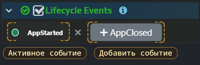

# Показать, что EyeAuras уже запущен

**Lifecycle Events** запоминает события самого EyeAuras. Например, по **AppStarted** можно показать надпись «EyeAuras готов», когда окно приложения загрузилось.

1. Создайте ауру с триггером **Lifecycle Events**.
2. Нажмите **+ AppStarted**. Если EyeAuras уже сообщил о запуске в этом сеансе, индикатор события сразу станет активным. Перезапускать приложение для проверки не нужно.
3. Добавьте этой ауре [Text overlay](/ru/overlays/text) с текстом `EyeAuras готов`, видимый, пока аура активна. Отключите принудительный просмотр оверлея в редакторе.
4. Посмотрите на индикатор **AppStarted** и надпись. Затем удалите подписку крестиком рядом с событием: без выбранных событий триггер перейдёт в **Unknown**. Добавьте **AppStarted** снова — уже случившееся событие сразу учтётся.

В подсказке выбранного события показано время срабатывания либо **Not triggered yet**.

## Выбрать событие и понимать состояние

| Событие или состояние | Что означает |
| --- | --- |
| AppStarted | EyeAuras сообщает, что его окно загрузилось. Подходит для реакции на старт EyeAuras. |
| AppClosed | EyeAuras сообщает, что его окно закрывается, перед дальнейшим завершением. |
| Active | Хотя бы одно выбранное событие уже произошло в этом запуске EyeAuras. |
| Inactive | Подписки есть, но ни одно выбранное событие ещё не произошло. |
| Unknown | Ни одно событие не выбрано. |
| Несколько событий | Достаточно любого из них. Для разных реакций на старт и закрытие сделайте отдельные ауры с отдельными подписками. |

Результат сохраняется, а не мелькает коротким импульсом. Если подписаться на событие позже, чем оно случилось, оно всё равно учтётся — в пределах того же запуска приложения.

Если вместо надписи нужно выполнить действие, добавьте его отдельно в **On Enter**. **AppClosed** не включит заново ауру, которая уже активна из-за **AppStarted**: нового перехода в активность не будет. Не поручайте событию закрытия долгую отправку или сохранение, которые обязательно должны завершиться.

Чтобы отследить появление окна другого приложения, берите [Window Exists](/ru/triggers/window-exists): AppStarted относится только к EyeAuras. Если при запуске у вас выполняется действие, посмотрите его сообщения и ошибки в [Event Viewer](/ru/features/event-viewer), прежде чем считать работу сделанной.

Событие активно, но реакция приостановлена

Проверьте общую настройку **Pause Everything if Active**. Она приостанавливает ауры и деревья, пока активно главное окно EyeAuras или его оверлеи. Событие старта уже могло произойти, но пауза не даёт реакции выполниться.

Обычно достаточно помнить об этой паузе и проверять поведение, убрав фокус с EyeAuras. Отключение опции меняет работу всех аур, поэтому не выключайте её только потому, что какое-то действие не сработало.

В Pack, который вы распространяете, то же поведение задаётся в **Packing configuration**. Выберите нужную политику и проверьте её до распространения.

