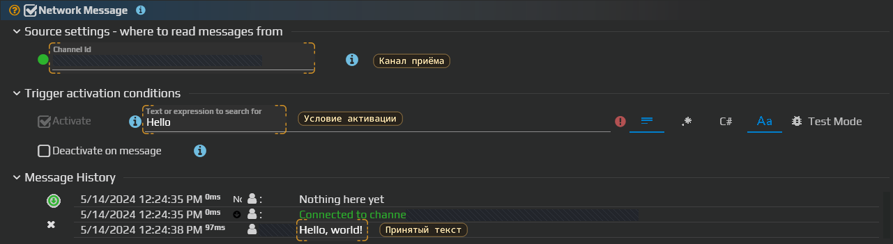
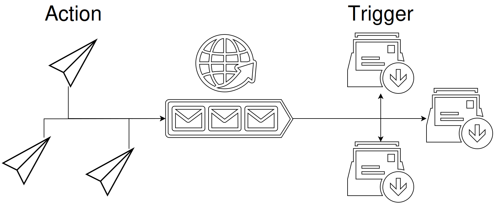
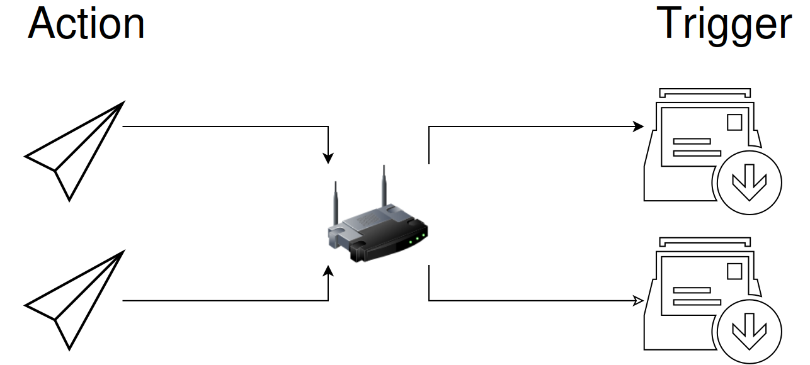

# Сохранить состояние по командам из канала

**Network Message** получает сообщения EyeAuras и сравнивает их текст с условием. Например, команда `проверка` включает надпись «Идёт проверка», а команда `готово` убирает её. Сообщение меняет только состояние триггера. Надпись или другое действие добавляются отдельно.

Начните с двух аур в одном EyeAuras. Каналу `local://review-status` не нужны ни сеть, ни второй компьютер.

1. Добавьте принимающей ауре триггер **Network Message**. В **Source settings - where to read messages from → Channel Id** введите `local://review-status`.
2. В **Activate** выберите **Regex** и задайте `\Aпроверка\z`.
3. Включите **Deactivate on message**, выберите у появившегося условия **Regex** и задайте `\Aготово\z`. Выключите **Test mode** у обоих условий.
4. Добавьте этой ауре [Text overlay](/ru/overlays/text) с текстом `Идёт проверка`. Он должен быть виден, только пока аура активна. Принудительный просмотр в редакторе для проверки не годится.
5. В другой ауре добавьте два действия [Send Network Message](/ru/actions/send-network-message) с тем же **Channel Id** `local://review-status`. У первого **Message text** — `проверка`, у второго — `готово`.
6. Выполните первое действие кнопкой **Execute**: запись появится в **Message history**, триггер станет активным, надпись покажется. Выполните второе: триггер станет неактивным, надпись исчезнет. Текст `отчёт` не подходит ни одному условию и состояние не меняет.

На снимке видны источник, условия и история. В текущем редакторе условие отключения подписано **Deactivate on message**.

Снимок старый: в истории `Hello, world!`, а отключение по сообщению выключено. Для примера выше включите его и задайте оба условия. Идентификатор канала и имя отправителя на снимке скрыты.

## Как долго сохраняется состояние

| Настройка | Результат |
| --- | --- |
| Activate | Подходящее сообщение включает неактивный триггер. Пустое выражение подходит любому сообщению. |
| Deactivate on message включён | Триггер остаётся активным до сообщения, которое подходит условию отключения. В примере это `готово`. |
| Deactivate on message выключен | После активации триггер сам запрашивает отключение примерно через `50 мс`. Это короткое событие, а не сохраняемый флаг. Сколько оно реально видно, зависит ещё и от обработки состояния ауры. |
| Пустое условие отключения | Подходит любому сообщению. Это не то же самое, что отдельная команда `готово`: активный триггер может выключить любое следующее сообщение. |
| Text, Regex, C# | Способы проверки текста, с **Ignore Case** и **Test mode**. Контексты и синтаксис описаны в [сопоставлении текста](/ru/features/text-match-expressions). |
| Message history / Clear history | Последние сообщения и очистка списка. Очистка не сбрасывает состояние триггера. |

Не каждая строка истории — новый переход в **Active**. Если триггер уже активен, а условие `готово` непустое, повторная `проверка` ничего не меняет, и **On Enter** заново не запускается. Пока не пришло первое подходящее сообщение, результата команды ещё нет. Отключённый получатель пропущенные сообщения не копит и потом их не воспроизводит.

На схеме отдельно показаны отправка, канал и получатели. Как реагировать на текст, решают условия каждого получателя.

Это серверный канал: действия отправляют в него сообщения, а подписанные триггеры получают их и проверяют текст. Локальному каналу из первого примера сервер не нужен. [Исходная схема SVG](/assets/wiki-media/m077-original.svg).

## Получать сообщения с другого компьютера

| Channel Id | Что требуется |
| --- | --- |
| Одинаковое имя серверного канала или `eye://…` | Оба экземпляра подключены к службе сообщений EyeAuras. Используется уже настроенная серверная связь приложения. |
| У получателя `broadcast://255.255.255.255:55055/review-status` | Доступный UDP-порт `55055` в локальной сети. |
| У отправителя `broadcast://192.168.0.21:55055/review-status` | Вместо `.21` — настоящий адрес принимающего ПК. Путь и порт должны совпадать с получателем. |
| Без явно указанного порта | Используется `53082`. Свой порт выбирайте из `49152–65535` и меняйте его с обеих сторон. |

Следующая схема показывает обмен по локальной сети. Подготовка сети, широковещательная рассылка и пример с Hyper-V разобраны в [действии отправки](/ru/actions/send-network-message).

Действия отправляют сообщения, а триггеры у получателей проверяют их текст. [Схема SVG](/assets/wiki-media/m016-restored.svg).

Канал — это не произвольный HTTP/TCP-адрес. По локальной сети EyeAuras шлёт UDP-пакеты в формате Protobuf, а не голый текст. Сервер сообщений для этого не нужен, но всё зависит от сети: подтверждения доставки и гарантированной задержки нет. Приём на `255.255.255.255` отбирает сообщения по пути канала, а не принимает все команды из сети.

Идентификатор канала держите в секрете: списка тех, кому разрешено в него писать, нет. Индикатор соединения показывает только состояние связи. Что конкретная команда принята, доказывает её запись в истории. Триггер сам не отвечает на сообщения — для ответа добавьте отдельное действие отправки.
