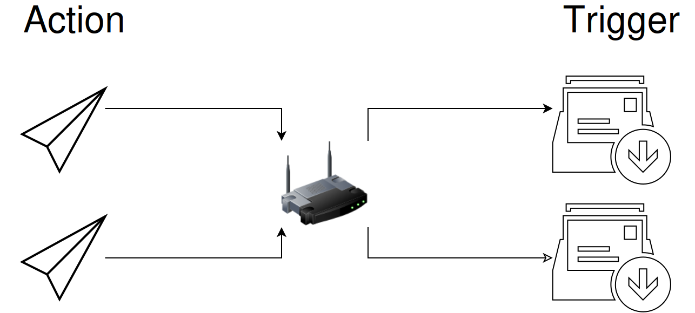

# Сохранить состояние по командам из канала

**Network Message** получает сообщения EyeAuras и сравнивает их текст с условием. Можно, например, включить надпись «Идёт проверка» командой `проверка` и убрать её командой `готово`. Получение текста меняет состояние триггера; надпись или другое действие добавляются отдельно.

Начните с двух аур в одном EyeAuras. Канал `local://review-status` не требует сети или второго компьютера.

1. Добавьте принимающей ауре триггер **Network Message**. В **Source settings - where to read messages from → Channel Id** введите `local://review-status`.
2. В **Activate** выберите **Regex** и задайте `\Aпроверка\z`.
3. Включите **Deactivate on message**, выберите у появившегося условия **Regex** и задайте `\Aготово\z`. Выключите **Test mode** у обоих условий.
4. Добавьте этой ауре [Text overlay](/ru/overlays/text) с текстом `Идёт проверка`. Его обычная видимость должна зависеть от активности ауры; принудительный просмотр в редакторе не подходит для проверки этого условия.
5. В другой ауре добавьте два действия [Send Network Message](/ru/actions/send-network-message) с одинаковым **Channel Id** `local://review-status`. У первого **Message text** — `проверка`, у второго — `готово`.
6. Выполните первое действие кнопкой **Execute**: запись появится в **Message history**, триггер станет активным, надпись будет видна. Выполните второе: триггер станет неактивным, надпись исчезнет. Текст `отчёт` не подходит ни одному условию и не должен менять сохранённое состояние.

На снимке находятся источник, условия и история. В текущем редакторе подпись условия отключения — **Deactivate on message**.


## Как долго сохраняется состояние

| Настройка | Результат |
| --- | --- |
| Activate | Совпавшее сообщение активирует неактивный триггер. Пустое выражение подходит любому сообщению. |
| Deactivate on message включён | Активное состояние сохраняется до сообщения, подходящего условию отключения. В примере это `готово`. |
| Deactivate on message выключен | После активации запрашивается автоматическое отключение примерно через `50 мс`. Это короткое событие, а не сохраняемый флаг; фактический показ зависит и от обработки состояния ауры. |
| Пустое условие отключения | Подходит любому сообщению. Это не то же самое, что отдельная команда `готово`: следующее сообщение может выключить активный триггер. |
| Text, Regex, C# | Способы проверки текста, с **Ignore Case** и **Test mode**. Контексты и синтаксис описаны в [сопоставлении текста](/ru/features/text-match-expressions). |
| Message history / Clear history | История последних сообщений и её очистка. Очистка списка не сбрасывает состояние триггера. |

Не считайте каждую строку истории отдельным переходом в **Active**. Повтор `проверка` при уже активном состоянии и непустом условии `готово` сохраняет состояние; **On Enter** повторно не запускается. До первого подходящего сообщения ещё нет результата этой команды. Отключённый получатель не накапливает очередь пропущенных сообщений для последующего воспроизведения.

Схема разделяет отправку, канал и получателей. Реакция на полученный текст определяется условиями каждого получателя.

```diagram

```

## Получать сообщения с другого компьютера

| Channel Id | Что требуется |
| --- | --- |
| Одинаковое имя серверного канала или `eye://…` | Подключение обоих экземпляров к службе сообщений EyeAuras. Используется уже настроенная серверная связь приложения. |
| У получателя `broadcast://255.255.255.255:55055/review-status` | Доступный UDP-порт `55055` в локальной сети. |
| У отправителя `broadcast://192.168.0.21:55055/review-status` | Вместо `.21` — настоящий адрес принимающего ПК. Путь и порт должны совпадать с получателем. |
| Без явно указанного порта | Используется `53082`; для своего порта выбирайте `49152–65535` и меняйте его с обеих сторон. |

Схема показывает обмен по локальной сети. Подготовка сети, широковещательная рассылка и пример Hyper-V разобраны в [действии отправки](/ru/actions/send-network-message).



Восстановленная исходная схема LAN: действия отправляют сообщения, а триггеры на стороне получателей проверяют их текст. [Схема SVG](/assets/wiki-media/m016-restored.svg).

Каналы не являются произвольными HTTP/TCP-адресами. LAN-вариант передаёт UDP-пакеты EyeAuras в формате Protobuf, а не голый текст. Его работа не требует сервера сообщений, но зависит от сети; подтверждения доставки и гарантированной задержки нет. Приём на `255.255.255.255` фильтрует конкретный путь канала, а не принимает все команды из сети.

Идентификатор канала держите в секрете: отдельного списка пользователей, которым разрешено отправлять в него сообщения, здесь нет. Индикатор соединения показывает состояние связи, а доказательство приёма конкретной команды — её запись в истории. Для ответного сообщения добавьте отдельное действие отправки; триггер сам ответ не формирует.
