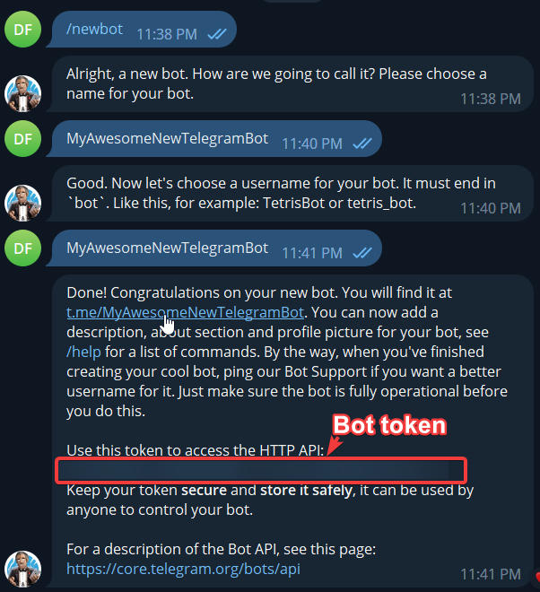
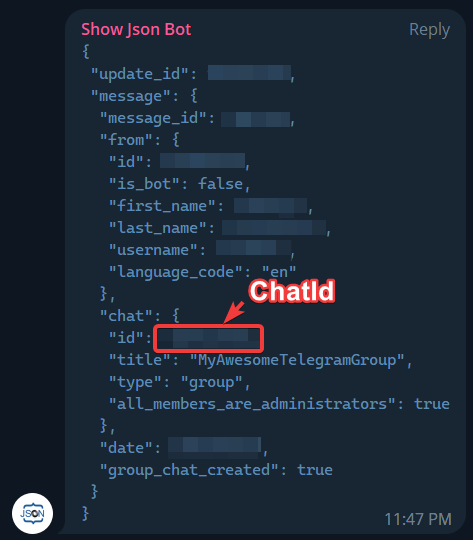

# Показать состояние по сообщению в Telegram

**Telegram Message** читает новые входящие сообщения вашего бота. Например, сообщение `проверка` в личном чате может включить надпись «Идёт проверка», а `готово` — убрать её. Текст приходит из Telegram, состояние хранит триггер, а надпись создаёт отдельно добавленный оверлей.

Нужны Telegram, доступ EyeAuras к Telegram Bot API и бот, которым вы управляете. Для первого опыта используйте личный чат человека с ботом. Отправка ботом уведомления через [Send To Telegram](/ru/actions/send-telegram-message) — другая задача и не проверяет этот входящий путь.

## Подготовить своего бота

1. Откройте официального [@BotFather](https://t.me/BotFather), отправьте `/newbot` и следуйте вопросам об имени и уникальном имени пользователя, заканчивающемся на `bot`. Подробности есть в [руководстве Telegram](https://core.telegram.org/bots/features#botfather).
2. Сохраните выданный токен у себя. Он даёт управление ботом: не включайте его в снимки, опубликованные ауры или переписку с поддержкой.
3. Откройте личный чат со своим ботом и нажмите **Start**. На этом этапе бот может не отвечать: EyeAuras будет читать сообщения, а автоматический ответ в этом сценарии не настроен.

Старый снимок показывает, где BotFather выдаёт токен. Используйте только собственный токен.

## Принять две команды

1. Добавьте ауре триггер **Telegram Message**. В **Telegram Bot Token** вставьте свой токен. Пока оставьте **Chat Id (optional)** пустым, чтобы определить идентификатор своего чата. Делайте это с отдельным ботом, которому сейчас пишете только вы.
2. Дождитесь подключённого состояния и отправьте боту **новое** сообщение из своего Telegram-аккаунта, например `мой чат`. Начальная порция старых обновлений при подключении пропускается: сообщение, отправленное до подключения, не подходит для проверки.
3. Найдите запись в **Message history**, скопируйте показанный рядом идентификатор кнопкой **Copy Chat ID to clipboard** и вставьте его в **Chat Id (optional)**. Теперь триггер будет принимать только этот чат.
4. В **Activate** выберите **Regex**, выражение `\Aпроверка\z`. Включите **Deactivate on message** и задайте второму условию **Regex** `\Aготово\z`. Выключите **Test mode** у обоих условий.
5. Добавьте этой же ауре [Text overlay](/ru/overlays/text) с текстом `Идёт проверка` и обычной видимостью по активности ауры. Уберите принудительный просмотр оверлея в редакторе.
6. Напишите боту `проверка` со своего пользовательского аккаунта. После появления записи в истории триггер станет активным и покажет надпись. Напишите `готово`: он станет неактивным и скроет её. Если в истории есть запись, но состояние не меняется, проверяйте условия, а не токен заново.

| Настройка | Смысл выбора |
| --- | --- |
| Telegram Bot Token | Учётные данные вашего бота для получения обновлений. |
| Chat Id (optional) | Точный идентификатор чата, включая знак минус, если он есть. Пустое поле пропускает все доступные боту чаты, а не только ваш. |
| Proxy server (optional) | SOCKS5-прокси в форме `host:port` или `username:password@host:port`, если он нужен для доступа. Без необходимости оставьте пустым. |
| Activate | Условие включения по тексту. Пустое выражение подходит любому принятому сообщению. |
| Deactivate on message | При включении сохраняет активность до подходящего сообщения отключения. При выключении используется короткая автоматическая активация с запросом отключения примерно через `50 мс`. |
| Text, Regex, C# | Режимы [сопоставления текста](/ru/features/text-match-expressions), включая **Ignore Case** и **Test mode**. |
| Message history / Clear history | Входящие сообщения и очистка списка. Очистка истории не сбрасывает активное состояние. |

Повтор `проверка` при уже активном триггере не создаёт новый переход **On Enter**. Посторонний текст не меняет сохранённое состояние, если он не подходит ни одному условию. Не оставляйте условие отключения пустым случайно: оно будет подходить любому сообщению.

## Группа и ограничения получения

Для группы добавьте своего бота в её участники и получите **Chat Id** тем же способом через историю EyeAuras. Какие сообщения группы бот видит, зависит от его прав и [режима приватности Telegram](https://core.telegram.org/bots/faq#what-messages-will-my-bot-get): обычная фраза может быть ему недоступна, хотя команда боту или ответ на его сообщение доступны. Сначала проверьте появление текста в истории, затем включайте реакцию.

На старом снимке идентификатор группы показан сторонним Show Json Bot. Это иллюстрация поля `chat.id`, а не обязательный участник: текущий редактор EyeAuras позволяет скопировать Chat ID из собственной истории.

Текущий получатель использует [длительный опрос getUpdates](https://core.telegram.org/bots/api#getupdates). Не подключайте тот же токен одновременно к другому независимому получателю обновлений; установленный webhook также конфликтует с этим способом. Внутри EyeAuras триггеры с одинаковыми токеном и прокси используют общий клиент.

В проверку поступает поле текста нового обычного сообщения. Редактирование старой записи, публикация в канале, фотография или подпись к ней не заменяют такой вход. **Chat Id** ограничивает чат, а не отправителя внутри группы. Если управление должно быть доступно только вам, личный чат отдельного бота проще группового.

Дополнительные иллюстрированные руководства по созданию бота: [tlgrm.ru](https://tlgrm.ru/docs/bots#botfather), [SendPulse](https://sendpulse.com/ru/knowledge-base/chatbot/create-telegram-chatbot). Их интерфейс может отличаться; для получения сообщений настраивайте триггер, а не действие отправки.
