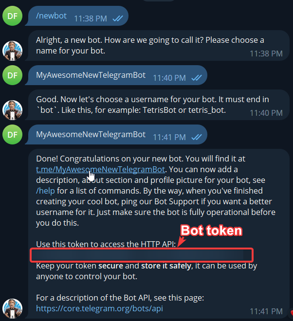
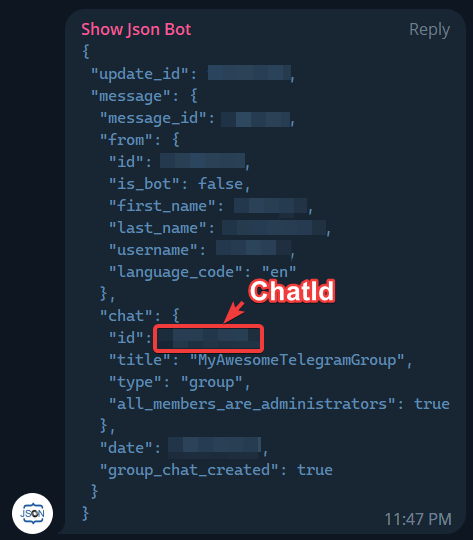

# Показать состояние по сообщению в Telegram

**Telegram Message** читает новые входящие сообщения вашего бота. Например, сообщение `проверка` в личном чате включает надпись «Идёт проверка», а `готово` убирает её.

Вам понадобятся Telegram, доступ EyeAuras к Telegram Bot API и свой бот. Для начала пишите боту в личный чат. Отправка уведомлений через [Send To Telegram](/ru/actions/send-telegram-message) — другая задача, входящие сообщения она не проверяет.

## Подготовить своего бота

1. Откройте официального [@BotFather](https://t.me/BotFather) и отправьте `/newbot`. Он спросит имя бота и уникальное имя пользователя, которое должно заканчиваться на `bot`. Подробности — в [руководстве Telegram](https://core.telegram.org/bots/features#botfather).
2. Сохраните выданный токен у себя. Он даёт управление ботом, поэтому не показывайте его на снимках, в опубликованных аурах и в переписке с поддержкой.
3. Откройте личный чат со своим ботом и нажмите **Start**. Бот может ничего не ответить, это нормально: EyeAuras только читает сообщения, автоответ здесь не настроен.

## Принять две команды

1. Добавьте ауре триггер **Telegram Message**. В **Telegram Bot Token** вставьте свой токен. Поле **Chat Id (optional)** пока оставьте пустым, чтобы узнать идентификатор своего чата. Делайте это с отдельным ботом, которому сейчас пишете только вы.
2. Дождитесь подключения и отправьте боту **новое** сообщение со своего аккаунта, например `мой чат`. Сообщение, отправленное до подключения, не подойдёт: первую порцию старых обновлений триггер пропускает.
3. Найдите запись в **Message history**, скопируйте идентификатор рядом с ней кнопкой **Copy Chat ID to clipboard** и вставьте его в **Chat Id (optional)**. Теперь триггер принимает только этот чат.
4. В **Activate** выберите **Regex** и задайте `\Aпроверка\z`. Включите **Deactivate on message** и задайте второму условию **Regex** `\Aготово\z`. Выключите **Test mode** у обоих условий.
5. Добавьте этой же ауре [Text overlay](/ru/overlays/text) с текстом `Идёт проверка`, видимый, пока аура активна. Уберите принудительный просмотр оверлея в редакторе.
6. Напишите боту `проверка` со своего аккаунта. Когда запись появится в истории, триггер станет активным и покажет надпись. Напишите `готово` — он станет неактивным и скроет её. Если запись в истории есть, а состояние не меняется, проверяйте условия, а не токен.

| Настройка | Смысл выбора |
| --- | --- |
| Telegram Bot Token | Токен вашего бота, по нему EyeAuras получает обновления. |
| Chat Id (optional) | Точный идентификатор чата вместе со знаком минус, если он есть. Пустое поле пропускает все чаты, доступные боту, а не только ваш. |
| Proxy server (optional) | SOCKS5-прокси в виде `host:port` или `username:password@host:port`. Если прокси не нужен, оставьте пустым. |
| Activate | Условие включения по тексту. Пустое выражение подходит любому принятому сообщению. |
| Deactivate on message | Включено — триггер остаётся активным до подходящего сообщения отключения. Выключено — триггер включается ненадолго и сам запрашивает отключение примерно через `50 мс`. |
| Text, Regex, C# | Режимы [сопоставления текста](/ru/features/text-match-expressions), включая **Ignore Case** и **Test mode**. |
| Message history / Clear history | Входящие сообщения и очистка списка. Очистка не сбрасывает активное состояние. |

Повторная `проверка` при уже активном триггере не даёт нового перехода **On Enter**. Не оставляйте условие отключения пустым по ошибке: оно подойдёт любому сообщению.

## Группа и ограничения получения

Чтобы работать с группой, добавьте в неё своего бота и получите **Chat Id** так же, через историю EyeAuras. Какие сообщения группы видит бот, зависит от его прав и [режима приватности Telegram](https://core.telegram.org/bots/faq#what-messages-will-my-bot-get). Обычную фразу он может не увидеть, а команду боту или ответ на его сообщение — увидит. Сначала убедитесь, что текст появляется в истории, потом включайте реакцию.

Триггер получает сообщения через [длительный опрос getUpdates](https://core.telegram.org/bots/api#getupdates). Не подключайте тот же токен одновременно к другому получателю обновлений. Установленный webhook тоже конфликтует с этим способом. Внутри EyeAuras триггеры с одинаковыми токеном и прокси используют общий клиент.

Проверяется текст нового обычного сообщения. Правка старого сообщения, публикация в канале, фотография и подпись к ней не считаются. **Chat Id** ограничивает чат, а не отправителя внутри группы. Если управлять должны только вы, личный чат с отдельным ботом проще группы.

Ещё два руководства по созданию бота с картинками: [tlgrm.ru](https://tlgrm.ru/docs/bots#botfather), [SendPulse](https://sendpulse.com/ru/knowledge-base/chatbot/create-telegram-chatbot).
