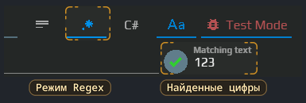

# Telegram Message: перейти со старой инструкции

Это старая страница про триггер **Telegram Message**. Он получает текст новых сообщений, которые пишут вашему боту. Как создать бота, получить Chat ID и подключить реакцию, описано в актуальной инструкции [«Сообщение в Telegram»](/ru/triggers/telegram-message).

## Перенести проверку текста

Осталось выражение из старой ауры, и вы хотите узнать, примет ли оно команду `проверка`? Проверьте его без отправки сообщения:

1. Откройте условие **Activate** своего триггера **Telegram Message**. Для простой пробы выберите **Regex** и введите `\Aпроверка\z`.
2. Включите **Test mode** и в поле тестового входа введите `проверка`. Должно быть совпадение. Замените вход на `готово` — совпадения быть не должно. Так проверяется выражение, а не соединение с Telegram.

   
3. Выключите **Test mode**, чтобы триггер снова читал настоящие сообщения. Для живой проверки настройте токен и **Chat Id (optional)** по актуальной инструкции, затем отправьте боту новое сообщение со своего аккаунта. Не публикуйте токен вместе с аурой.
4. Проверьте запись в **Message history**. Если **Deactivate on message** выключен, подходящее сообщение включает триггер ненадолго, и он сам отключается. Чтобы состояние сохранялось, включите эту опцию и задайте отдельную команду отключения. Реакцию добавьте отдельно: в **On Enter** или через оверлей.

| Старое название | Соответствие текущей настройке |
| --- | --- |
| Text or expression | Выражение условия. Доступны **Text**, **Regex**, **C#** и **Ignore Case**. Правила и контекст C# описаны в [сопоставлении текста](/ru/features/text-match-expressions). |
| Input test text | Тестовый вход при включённом **Test mode**. |
| Matching text | Результат сопоставления. Для Regex — захватывающая группа №1, если в выражении есть группы, иначе всё совпадение. Для Text и C# — входной текст при успехе. |
| Token | Сейчас поле **Telegram Bot Token**. |
| Чат | **Chat Id (optional)**. Пустое поле пропускает все чаты, доступные боту, а не только ваш. |

Проверка текста теперь находится рядом с **Activate**, а соединение и чат — в группе настроек Telegram.

Триггер читает текст новых обычных сообщений. Старые сообщения при подключении, правка сообщения и публикации в каналах не считаются. В группах всё зависит от прав и режима приватности бота, поэтому сначала добейтесь записи в истории. Уведомление, отправленное действием **Send To Telegram**, для проверки входящих не годится.

Руководства по созданию бота из прежней инструкции: [tlgrm.ru — BotFather](https://tlgrm.ru/docs/bots#botfather), [SendPulse](https://sendpulse.com/ru/knowledge-base/chatbot/create-telegram-chatbot). Актуальные условия Telegram смотрите в [официальном руководстве](https://core.telegram.org/bots/features#botfather).
