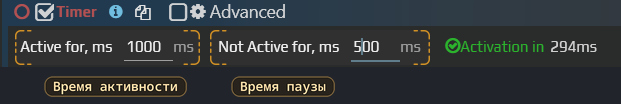
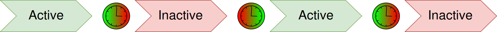

# Показывать свою надпись через равные интервалы

**Timer** по кругу включается и выключается через заданные интервалы. Соберём с ним памятку «Пора сделать паузу»: она примерно на секунду появляется и примерно на секунду исчезает. Текст задаёте вы. Клавиатура, окно игры и внешние события для этого не нужны.

## Настроить цикл 1000/1000 мс

1. Создайте отдельную ауру без действий и других триггеров. Добавьте **Timer**. Инверсию и дополнительные задержки активации и деактивации не включайте.
2. В полях **Active for** и **Not Active for** укажите одно и то же значение **1000**. Единицы — **ms**, то есть миллисекунды.
3. В **Overlays** добавьте **Text**. В **Content** напишите `Пора сделать паузу`, задайте **Font = 24** и выключите **Size to fit**. Поставьте текст в свободное место на экране и включите **Locked**. Остальные параметры описаны в [Text](/ru/overlays/text).
4. Включите ауру и выберите в дереве другую ауру: пока оверлей выбран, режим настройки держит его на экране. Понаблюдайте несколько циклов.
5. Отключите тестовую ауру её переключателем. Надпись перестанет появляться. При повторном включении цикл начинается заново с неактивного состояния, а не продолжает остаток прежней паузы.

В начале цикла Timer находится в **Inactive**. Он ждёт первый интервал, переходит в **Active**, ждёт второй — и так по кругу. При равных значениях текст примерно секунду скрыт, затем примерно секунду виден. Полный круг занимает около двух секунд, но точность до миллисекунды не гарантируется.

На снимке старого редактора показаны два интервала в миллисекундах. Для первой пробы поставьте `1000` в **оба** поля, что бы ни было на картинке.

| Настройка или поведение | Что учитывать |
|---|---|
| `Active for` и `Not Active for` | Два интервала цикла в миллисекундах. В этом примере оба равны `1000`. Не ставьте разные значения, пока не проверили состояния. |
| Изменение периода | Перезапускает цикл с Inactive и новой паузой. Оставшееся время текущей фазы не пересчитывается. |
| Минимальный интервал | Интервалы меньше `100 ms` поднимаются до этого минимума. Значение `0` фазу не выключает. |
| Отключение | Отключённая аура не работает. Отключённый триггер — это не обычная фаза Inactive. |
| Общие настройки триггера | Инверсия и дополнительные задержки могут изменить состояние, которое вы видите. Для первой пробы они не нужны. |

Если нужны разные периоды, сначала понаблюдайте за **Active/Inactive в своей сборке** и сверьте реальные длительности с полями, которые меняете. Действия привязывайте после этого. С равными значениями такая сверка не нужна.

На диаграмме показана повторяющаяся часть цикла. Начальная неактивная пауза перед первым Active на ней не выделена. [Исходная схема SVG](/assets/wiki-media/m076-original.svg).

Если нужна просто пауза между двумя действиями, берите [Delay](/ru/actions/delay), а не Timer. Для задержки внутри дерева поведения есть [Wait](/ru/behavior-trees/nodes/wait). Это просто паузы, а Timer переключает состояние ауры по кругу.

Timer управляет только условием ауры. Реакция настраивается отдельно: здесь это видимость Text, в другом случае — действия на смену состояния. О готовности способности или о состоянии другого приложения Timer ничего не знает.
