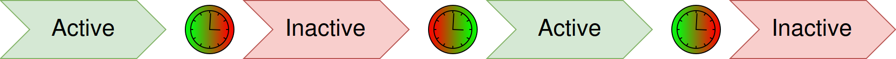

# Показывать свою надпись через равные интервалы

Создайте памятку «Пора сделать паузу», которая появляется примерно на секунду и затем примерно на секунду исчезает. Источник условия здесь — внутренний цикл **Timer**. Текст задаёте вы; клавиатура, окно игры и внешнее событие для этого опыта не нужны.

## Настроить цикл 1000/1000 мс

1. Создайте отдельную ауру без действий и других триггеров. Добавьте **Timer**. Оставьте обычное условие без инверсии и дополнительных задержек активации или деактивации.
2. В полях **Active for** и **Not Active for** укажите одинаковое значение **1000**. Единицы — **ms**, то есть миллисекунды.
3. В **Overlays** добавьте **Text**. В **Content** напишите `Пора сделать паузу`, задайте **Font = 24** и выключите **Size to fit**. Разместите текст в свободной части экрана и включите **Locked**; остальные параметры описаны в [Text](/ru/overlays/text).
4. Включите ауру и выберите другую ауру в дереве, чтобы режим настройки выбранного оверлея не удерживал его на экране. Наблюдайте несколько циклов.
5. Отключите тестовую ауру её переключателем. Периодический показ прекращается. При повторном включении новый цикл снова начинается с неактивного состояния, а не продолжает остаток прежней паузы.

После начала цикла Timer находится в **Inactive**, ждёт первый интервал, переходит в **Active**, ждёт второй и повторяет переключения. При равных значениях текст примерно секунду скрыт, затем примерно секунду виден. Полный повтор занимает около двух секунд; это не обещание точного времени планировщика.

На снимке прежнего редактора показаны два интервала в миллисекундах. Для первого опыта замените **оба** значения на `1000`, независимо от значений на изображении.

| Настройка или поведение | Что учитывать |
|---|---|
| `Active for` и `Not Active for` | Два интервала цикла в миллисекундах. В этом опыте оба равны `1000`; не используйте разные значения до проверки состояний. |
| Изменение периода | Перезапускает цикл с Inactive и новой паузой; это не изменение оставшегося времени текущей фазы. |
| Минимальный интервал | Интервалы меньше `100 ms` ограничиваются этим минимумом. Значение `0` не выключает фазу. |
| Отключение | Отключение ауры прекращает её работу; отключённый триггер не следует считать обычной фазой Inactive. |
| Общие настройки триггера | Инверсия и дополнительные задержки могут изменить наблюдаемое состояние. Для первого опыта они не нужны. |

Для разных периодов сначала понаблюдайте **Active/Inactive в своей сборке** и сопоставьте фактические длительности с изменяемыми полями, прежде чем привязывать к ним действия. Равные значения позволяют начать с повторения без такого сопоставления.

Диаграмма показывает повторяющуюся часть цикла; начальная неактивная пауза перед первым Active на ней отдельно не выделена.

Повторяющаяся часть цикла Timer. Начальная неактивная пауза описана выше. [Исходная схема SVG](/assets/wiki-media/m076-original.svg).

Если нужна только пауза между двумя действиями, используйте [Delay](/ru/actions/delay), а не повторяющийся триггер. Для задержки внутри дерева поведения подходит [Wait](/ru/behavior-trees/nodes/wait); эти паузы отличаются от повторяющихся переходов состояния ауры в Timer.

Timer управляет условием ауры, а реакция на него настраивается отдельно: здесь это видимость Text, в другом сценарии — действия на переход состояния. Периодическая проверка не сообщает о готовности способности или состоянии другого приложения сама по себе.
