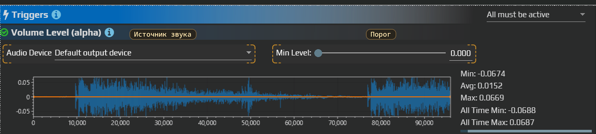

# Уровень звука: старая альфа-версия

**Volume Level** сравнивал захваченный звук с порогом. С его помощью можно было заметить, что выбранный источник зазвучал, и, например, включить индикатор. Триггер измерял текущий звук, а не положение ползунка громкости Windows, и мелодии не распознавал.

В текущем EyeAuras этого триггера нет в списке доступных, и редактора для него тоже нет. Страница оставлена, чтобы объяснить старую настройку.

## Если вы открыли старую ауру

1. Проверьте, что в вашей версии редактор **Volume Level** действительно открывается, а не просто хранится как неизвестный элемент конфигурации. Если редактора нет, дальше по этой странице идти нельзя.
2. В совместимой старой версии выберите источник захвата и своё устройство. Не путайте выход, который воспроизводит звук, с микрофонным входом: это разные источники.
3. Найдите в редакторе **Min Level** и показания уровня. Включите на выбранном источнике короткий тестовый звук и сравните показания до, во время и после него. Порог подбирайте по этим показаниям, а не по процентам громкости в Windows.
4. Сначала убедитесь, что триггер включается на звуке и выключается, когда уровень падает. Потом добавляйте реакцию, например индикатор.

## Что измеряла настройка

| Параметр или показатель | Значение и границы |
| --- | --- |
| Источник устройства | Захват аудиоустройства. В модели различаются устройство по умолчанию для входа, устройство по умолчанию для выхода и конкретное устройство. |
| Источник процесса | В сохранённой модели есть захват звука процесса по выбранному окну. |
| Min Level | Порог, с которым сравнивается максимум очередной порции аудиосэмплов. |
| Минимум, максимум, среднее | Статистика захваченных сэмплов. Среднее считается по их абсолютным значениям. Для включения берётся максимум, а не среднее. |
| Состояние | Когда приходят данные: максимум не ниже порога — триггер активен, ниже — неактивен. Если новых данных нет, это ещё не тишина, и старый результат может не сброситься. |
