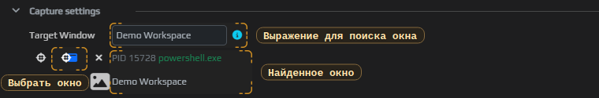

# Window Exists — узнать, что окно появилось

Window Exists следит, есть ли в системе окно, подходящее под заданное выражение. Окно найдено — условие выполнено, пропало — не выполнено. Так можно, например, подать звуковой сигнал, когда открылся Блокнот.

Окну не обязательно быть на переднем плане. Если важен именно фокус, берите [Window Is Active](/ru/triggers/window-is-active).

## Настройте уведомление о появлении окна

1. Откройте одно окно Блокнота. Создайте ауру и добавьте в неё только **Window Exists**.
2. В **Target Window** введите `notepad`. В списке найденных окон должен быть Блокнот. Если подошли и другие окна, уточните [выражение сопоставления](/ru/features/window-matching-expressions).
3. В **On Enter** добавьте [Play Sound](/ru/actions/play-sound), выберите Ping и проверьте громкость.
4. Закройте все окна, подходящие под выражение. Дождитесь состояния Not Active.
5. Откройте Блокнот снова.

Триггер станет Active, аура выполнит On Enter и подаст сигнал. Если вы просто переключитесь на другую программу, окно останется найденным. Сигнал повторится, когда все подходящие окна исчезнут и окно появится снова.

На снимке в общем поле найдено окно Demo Workspace. У себя выберите окно Блокнота и сверьте найденное название. [Прежний редактор Window Exists](https://s3.eyeauras.net/media/2024/05/EyeAuras_i1HqMJPIQLu7SC7C.png).

## Настройка и состояния

| Параметр или состояние | Что означает |
| --- | --- |
| Target Window | Выражение, по которому выбирается окно. Оно может учитывать заголовок, процесс и другие данные. Обычный текст ищется не только в заголовке. |
| Active | Подходящее окно найдено, и его удалось выбрать. |
| Not Active | Подходящих окон нет либо выбрать окно не удалось. |

Если выбрать окно из списка, выражение может запомнить его временный дескриптор. После перезапуска программы такое выражение проверьте заново. Чтобы получать уведомление при каждом запуске, лучше написать выражение, которое найдёт и новое окно той же программы.

Window Exists проверяет окно, а не содержимое скрытой вкладки браузера. Если выражение опирается на заголовок страницы, то при переключении вкладки заголовок окна может поменяться, а с ним и результат поиска. Чтобы найти надпись внутри окна, нужен [Text Search](/ru/triggers/images/text-search).
