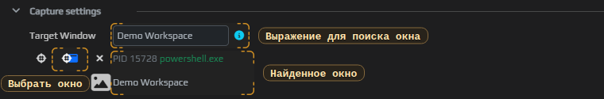

# Window Is Active — реагировать на переход в нужное окно

Window Is Active проверяет, находится ли подходящее окно на переднем плане. Например, с ним можно услышать сигнал, когда вы возвращаетесь в Блокнот. Триггер только сообщает состояние. Звук или другую реакцию вы добавляете отдельно.

## Подайте сигнал при возвращении в Блокнот

1. Откройте Блокнот. Создайте ауру с одним триггером **Window Is Active**.
2. В **Target Window** введите `notepad` и проверьте найденные окна. Для первой пробы оставьте одно окно Блокнота.
3. В **On Enter** добавьте [Play Sound](/ru/actions/play-sound) со звуком Ping. Проверьте громкость кнопкой прослушивания.
4. Перейдите в другую программу, затем вернитесь в Блокнот через Alt+Tab или щелчком по его окну.

Когда Блокнот окажется на переднем плане, триггер станет Active и прозвучит сигнал. Уйдёте в другую программу — он станет Not Active. Пока Блокнот остаётся активным, On Enter повторно не выполняется.

На снимке в общем поле найдено окно Demo Workspace. У себя выберите окно Блокнота и сверьте найденное название. [Прежний редактор Window Is Active](https://s3.eyeauras.net/media/2024/05/EyeAuras_TntB9EP1WPMvNOEe.png).

## Настройка и состояния

| Параметр или состояние | Что означает |
| --- | --- |
| Target Window | [Выражение сопоставления окон](/ru/features/window-matching-expressions). Если подошло несколько окон, условие выполнено, когда на переднем плане любое из них. |
| Active | Окно на переднем плане есть в списке совпадений. |
| Not Active | На переднем плане другое окно, подходящих окон нет либо текущее окно определить не удалось. Закрытие Блокнота тоже даёт Not Active. |

Если окна нет, это Not Active, а не Unknown. Unknown бывает у триггера, который ещё не работает или отключён, но результатом проверки «окно закрыто» он не является.

## Ограничьте горячую клавишу одним приложением

Создайте отдельную ауру с Window Is Active и выбранным окном. Затем в [Hotkey Is Active](/ru/triggers/hotkey-is-active) другой ауры добавьте её через **Interception Condition → Links**. Такая связь определяет, когда клавиша вообще обрабатывается. Если просто положить оба триггера в одну ауру, условия перехвата не получится.

Если нужно только знать, что приложение открыто, даже когда вы работаете в другом окне, берите [Window Exists](/ru/triggers/window-exists).
