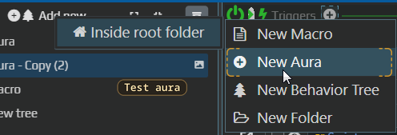
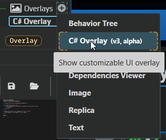

# Build your first panel

In EyeAuras you can write your own panel in C#, with buttons, a counter or settings. The easiest way to start is **C# Overlay**: it already comes with a working counter. You do not need a separate website.

[Blazor](https://dotnet.microsoft.com/en-us/apps/aspnet/web-apps/blazor) connects the UI markup to C# handlers. In [Razor](https://learn.microsoft.com/en-us/aspnet/core/blazor/components/?view=aspnetcore-8.0) you write markup and C# expressions side by side.

| Part | Purpose |
| --- | --- |
| [HTML](https://www.w3schools.com/html/) | Text, buttons and layout. |
| [CSS](https://www.w3schools.com/html/html_css.asp) | Colour, size, spacing and look. |
| `.razor` | Ties the markup to the component's data and events. |
| `.cs` | Holds the component's state and runs its handlers. This code can also live in a Razor `@code` block. |
| `Script.csx` | The script entry point. It is a separate context, not the Razor component itself. |

## Open the generated counter

1. Create a test aura with **Add new → New Aura**.



2. Under **Overlays**, add **C# Overlay**. The older screenshot calls it `C# Overlay (v3, alpha)`.



3. Do not change the generated files. To keep the panel visible, add **Fixed Value → Is Active** to the aura and leave the aura loaded.


4. Click **Click Me** in the panel. The number grows with each click.


The number is stored in the component itself. If the component is created again, the count starts from zero.

| Task | Next step |
| --- | --- |
| Choose a framed window or a borderless overlay | [How the window works and WebView2](/en/scripting/blazor-windows/2-webview). |
| Change the markup and a C# handler | [Files of your first component](/en/scripting/blazor-windows/3-hello-world). |
| Switch your own aura with a button | [One toggle](/en/scripting/blazor-windows/4-toggle-hotkeyisactive). |
| Open a dialog from a C# Script action | [A window opened from a script](/en/scripting/blazor-windows/getting-started). |

<details>
<summary>A small counter inside one Razor file</summary>

In your C# Overlay project, keep the generated `@namespace` line in `UserOverlay.razor` and replace everything below it with this fragment. Then remove the generated counter field and handler from `UserOverlay.cs`. Leave its empty partial class and the same namespace, so the counter is declared only once.

```razor
@using System.Threading.Tasks
@using Microsoft.AspNetCore.Components.Web
@using PoeShared.Blazor
@inherits BlazorReactiveComponent

<h1>Counter</h1>
<p>Current count: @currentCount</p>
<button class="btn btn-primary" @onclick="IncrementCount">Click me</button>

@code {
    private int currentCount;
    private async Task IncrementCount()
    {
        currentCount++;
        await Refresh("counter clicked");
    }
}
```

`@onclick` connects the button to the C# method. `Refresh` asks the reactive component to redraw on its dispatcher. The [next example](/en/scripting/blazor-windows/3-hello-world) has complete files with an explicit namespace.


</details>

<details>
<summary>Example pack and further reading</summary>

The [downloadable examples](https://tinyurl.com/msfhaupc) are a separate example pack. [Tutorial — Blazor Windows, revision 3](https://eyeauras.net/share/S20250511162645vYh4n3mqSLm0/3) was made for EyeAuras **1.7.8354.0**.

[CodePen](https://codepen.io/) has HTML/CSS styling examples. You will need to adapt the markup and styles to your component.

The [Razor component generator](https://github.com/iXab3r/EyeAuras/blob/c8b2304ac9ada59d217984035c8302b6e375ad10/Sources/EyeAuras.Blazor.Shared/CodeEditor/Templates/RazorComponentTemplate.cs) is the earlier template behind these screenshots. When you edit the two parts of a component, keep them in the same namespace.

</details>
