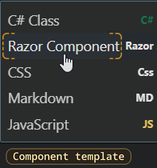
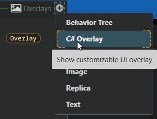

# Open a dialog from a C# Script action

Let's make a small window with a counter and a title that the script passes in. The script waits while the dialog is open and finishes when you close it. The next run starts with a fresh counter.

You need the desktop EyeAuras app with the WebView2 Runtime installed. The example runs in a **C# Script action**. It does not work in an EyePad-only project or on a browser page.

## Create the project files

1. Create a test aura and add a **C# Script** action under **On Enter**. For now, start it by hand with **Run**, so repeated activations do not open several windows.


2. In the script editor, choose **New file → Component (with code-behind)** and name it `UserComponent`. The older screenshot calls this template Razor Component. Then add an ordinary C# file named `WindowModel.cs`.



3. Replace the contents of all four files with the code below. The model and both parts of the component use the `BlazorDemo` namespace, and `Script.csx` imports it.

### Script.csx

```csharp
using BlazorDemo;
using EyeAuras.Shared.Scripting;

{
    using var window = GetService<IDialogWindowUnstableScriptingApi>()
        .CreateWindow<UserComponent>(new WindowModel { Title = "My window" });

    window.Title = "Test dialog";
    window.Width = 480;
    window.Height = 260;
    window.WindowStartupLocation = System.Windows.WindowStartupLocation.CenterScreen;
    window.ShowDialog(cancellationToken);
}
```

### WindowModel.cs

```csharp
namespace BlazorDemo;

public sealed class WindowModel
{
    public string Title { get; set; } = "Settings";
}
```

### UserComponent.cs

```csharp
using System.Threading.Tasks;
using PoeShared.Blazor;

namespace BlazorDemo;

public partial class UserComponent : BlazorReactiveComponent<WindowModel>
{
    private int count;

    private async Task Increment()
    {
        count++;
        await Refresh("dialog counter clicked");
    }
}
```

### UserComponent.razor

```razor
@namespace BlazorDemo
@using Microsoft.AspNetCore.Components.Web
@using PoeShared.Blazor
@inherits BlazorReactiveComponent<WindowModel>

<h2>@DataContext.Title</h2>
<button class="btn btn-primary" @onclick="Increment">Increment</button>
<p>Clicks: @count</p>
```

4. Wait for compilation to finish and click **Run**. A `480 × 260` window opens in the centre of the screen. Its title bar says **Test dialog**, and the heading inside says **My window**. Click the counter button, then close the window. The script finishes, and the next Run starts from zero.


| Part | What it does |
| --- | --- |
| `CreateWindow<UserComponent>(model)` | Creates a native Blazor window and passes the model to the component as its `DataContext`. |
| `window.Title`, `Width`, `Height`, `WindowStartupLocation` | Set up the native window before it is shown. The model's `Title` is a different thing: it is the text inside the component. |
| `ShowDialog(cancellationToken)` | Shows the window and holds the Run until the dialog is closed or the Run is cancelled. |
| Explicit `{ ... }` with `using var window` | The window is created, set up and shown inside this block. Leaving the block disposes the window. The `using` imports stay above the block. |
| **Stop** | Cancels the current Run through its token. The wait ends and the script leaves the block. |
| `WindowModel` | The starting data passed to the component. If you change its plain property from outside later, the window does not redraw by itself. |
| `BlazorReactiveComponent<WindowModel>` | Gives the component a typed `DataContext`. The counter handler awaits `Refresh` on the component's dispatcher. |

`GetService` and `cancellationToken` exist only in the top-level `Script.csx`. Razor and ordinary helper classes do not see the script's globals, so pass them what they need explicitly. The base component has its own logger.

The window API is called `IDialogWindowUnstableScriptingApi`. `Unstable` in the name means the contract can change between versions. Its [contract page](/en/scripting/api/IDialogWindowUnstableScriptingApi) lists what the service offers.

`Show()` does not wait. If you replace `ShowDialog(...)` with `Show()` in this short block, the script reaches the end of the block at once and the window is disposed. `.AddTo(ExecutionAnchors)` is another way to tie cleanup to the Run. Anchors do not keep a Run alive, though: the script still has to be doing work or waiting for a window.

If the data on screen can change without a button click, the component needs to watch it. The [reactive toggle](/en/scripting/blazor-windows/reactive-toggle) shows how to watch an aura trigger from a component. Take only the watching part from that page: here the script still creates the window and waits for it.

<details>
<summary>When to use C# Overlay instead</summary>

Use **C# Overlay** when a panel should appear and hide together with an aura. Its `Script.csx` must finish before the overlay shows, so do not put the `ShowDialog` code from this page there. Start with [the overlay counter](/en/scripting/blazor-windows/1-intro).





HTML, CSS and Razor work the same way in an overlay, but its window is controlled by the overlay settings. The shared base class is described in the [reactive component contract](/en/scripting/api/core/blazor). A handler can live in a Razor `@code` block or in the matching partial C# class. [The counter files](/en/scripting/blazor-windows/3-hello-world) show both.

</details>
