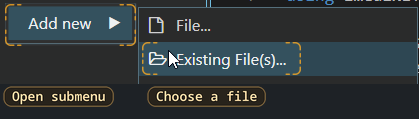
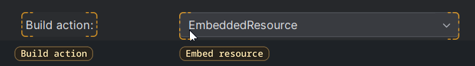

# Include a help file with your script

An embedded resource is a file stored right inside the script assembly. It travels with the project, and you can read it without a path on disk. As an example, we will add **docs/help.txt**. You can store images, videos, models, executables and DLLs the same way.

You need an editable **C# Script** project. The examples run in its top-level **Script.csx**, where EyeAuras gives you **GetService**, **Log** and **cancellationToken**. An ordinary helper class does not get them, so pass what it needs explicitly.

## Add the file and read its text

1. Create a text file `help.txt` with the text `Project help`.
2. Open the file tree with **File Tree**. In the tree's context menu, choose **Add → Existing File(s)...** and select the file. On older screenshots these are called **Show Files** and **Add Existing File...**.



3. Use **Rename...** to name the resource `docs/help.txt`. If you select a binary resource in the tree, you see its description, not an editor.


4. Replace the contents of **Script.csx** with this code:

```csharp
using System.IO;
using EyeAuras.Repl;

{
    var files = GetService<IScriptFileProvider>();
    var file = files.GetFileInfo("docs/help.txt");
    if (!file.Exists)
    {
        Log.Warn("Resource docs/help.txt was not found");
        return;
    }
    using var stream = file.CreateReadStream();
    using var reader = new StreamReader(stream);
    Log.Info(reader.ReadToEnd());
}
```

5. Click **Run**. The log shows `Project help`. If it says the resource was not found, check the name and the lookup rules below.

The stream and the StreamReader close on their own when the block ends. Do not dispose **IScriptFileProvider**.

To remove a resource, delete it from the project list. To replace its contents, remove the old resource and add the changed file under the same name, or import it from the IDE. Then recompile the script.

**New file** creates an ordinary editable text document, such as Markdown. The file service sees it too. That case is covered in the [README example](/en/scripting/examples/basic/file-provider).

## Choose a resource name and reader

A resource name starts with the project's **DefaultNamespace**, or with the project name if it is not set. Slashes in the path become dots: namespace `MyScript` and file `Images/logo.png` give `MyScript.Images.logo.png`.

| How you read | How the resource is found |
| --- | --- |
| IScriptFileProvider.GetFileInfo | Accepts the full manifest name, the full name with slashes, or an unambiguous suffix that starts at a name boundary. Full names are compared without regard to case. |
| `Images/logo.png` | Can match `MyScript.Images.logo.png`. Variants with `wwwroot` are checked too. If several files match, you get Exists == false, not a random one of them. |
| Assembly.GetManifestResourceNames() | Lists the exact full resource names in that assembly. |
| Assembly.GetManifestResourceStream(fullName) | Opens a stream by the exact, case-sensitive manifest name. You must close the stream. |
| GetDirectoryContents | Shows the resource names as a tree for diagnostics. This is not always the original folder layout with the project prefix removed. |

A partial name with dots is not the same as a path with slashes. If a short name matches several files, write the full one: `MyScript.Images.logo.png` or `MyScript/Images/logo.png`.

To list the full names from **Script.csx**:

```csharp
foreach (var name in typeof(Script).Assembly.GetManifestResourceNames())
{
    Log.Info(name);
}
```

**Script** here is the type generated for your script. An ordinary library has no such type. The same listing with a prefix in the log:

```csharp
var asm = typeof(Script).Assembly;
foreach (var name in asm.GetManifestResourceNames())
{
    Log.Info($"Resource: {name}");
}
```

To list files through the file service, add `using EyeAuras.Repl;` at the top of **Script.csx** and use this fragment:

```csharp
var files = GetService<IScriptFileProvider>();
foreach (var fi in files.GetDirectoryContents("/"))
{
    Log.Info($"Found: {fi.Name} ({fi.Length} b)");
}
```

The file service can look in several sources. Assembly resources are checked first, then the earlier source of project files. The first file found wins, but that does not resolve an ambiguous name inside one source.

## Keep resources when working in an IDE

When you [export the project](/en/scripting/ide-integration), EyeAuras writes the resource files to disk and adds **EmbeddedResource** items to `.csproj`. For `Image 12.jpg`:

```xml
<ItemGroup>
   <EmbeddedResource Include="Image 12.jpg" />
   <None Remove="Image 12.jpg" />
</ItemGroup>
```

In Rider or Visual Studio this is the **EmbeddedResource** build action.



On import, EyeAuras reads the explicit **Include** entries and the files themselves, by paths relative to the project. List every resource explicitly. Import does not run arbitrary MSBuild targets and may not handle every wildcard rule. **None Remove** only takes the file out of the None set.

<details>
<summary>Display an image or stream a large file</summary>

Once `Image 12.jpg` is added to the project, a **Razor component in a prepared window** can contain:

```html

```

The window must serve project files, see [Blazor Windows](/en/scripting/blazor-windows/getting-started).

Read a large file as a stream instead of loading it whole into an array. Add `video/tutorial.mp4`, then run this separate **Script.csx**. It only counts bytes. The cancellation check lets **Stop** end the loop:

```csharp
using System.IO;
using EyeAuras.Repl;

{
    var file = GetService<IScriptFileProvider>().GetFileInfo("video/tutorial.mp4");
    if (!file.Exists) { Log.Warn("Video not found"); return; }
    using var stream = file.CreateReadStream();
    var buffer = new byte[8192];
    long total = 0;
    int count;
    while ((count = stream.Read(buffer, 0, buffer.Length)) > 0)
    {
        cancellationToken.ThrowIfCancellationRequested();
        total += count;
    }
    Log.Info($"Read {total} bytes");
}
```

</details>

<details>
<summary>Reference a DLL stored as a resource</summary>

If the library is on [NuGet](https://nuget.org/), it is better to use the [package](/en/scripting/nuget): it sets the version and the dependencies. For your own compatible DLL, add it to the resources and reference it at the start of **Script.csx**:

```csharp
#r "assemblyPath: MyDll.dll"
```

For a file named MyLib.dll:

```csharp
#r "assemblyPath: MyLib.dll"
```

At compile time the reference takes its metadata from the resource. At runtime the assembly-load handler can load the assembly from the resources. The DLL's dependencies and runtime compatibility are up to you.

For example, **after adding a compatible Newtonsoft.Json.dll** to the project you can run:

```csharp
#r "assemblyPath: Newtonsoft.Json.dll"
using Newtonsoft.Json;
Log.Info(JsonConvert.SerializeObject(new { Hello = "World" }));
```

</details>

## When a file change is not visible

Resources are baked into the DLL. If you change the file on disk, the loaded assembly stays the same: this provider's **Watch** returns **NullChangeToken**. Update the resource in the project or import it from the IDE, wait for compilation and run the new version.

If you get **Exists == false**, check three things: the file is in the project, the full name is right, and there are no identical endings such as `a/logo.png` and `b/logo.png`. For a DLL, also check its **assemblyPath** directive and the diagnostics for its dependencies.
