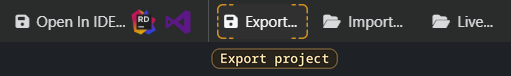
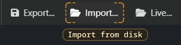

# Edit a project in your IDE and bring it back to EyeAuras

Once a script grows to several classes and folders, it is easier to write it in an IDE. EyeAuras exports the script as an ordinary C# solution. You edit the files in the IDE and import them back. The script still runs in EyeAuras: the exported project compiles, but EyeAuras itself does not run inside the IDE.

You need:

- your own editable **C# Script**
- a separate empty folder for the export
- a C# IDE that opens `.sln`: [Rider](https://www.jetbrains.com/rider/), [Visual Studio](https://visualstudio.microsoft.com/) or [VS Code](https://code.visualstudio.com/)
- to build in the IDE, the SDK and dependencies listed in the exported project

You can start from [Hello, world](/en/scripting/examples/basic/hello-world).

## Complete one round trip

1. In the script editor, click **Export...** and choose a separate folder. **Export deletes every file and subfolder in it except `.git`.** Do not pick a folder that holds anything you need.



2. Open the exported `.sln` in your IDE. Next to it are the projects and the NuGet settings for the EyeAuras SDK. Restore the dependencies and check for errors.


3. In **Script.csx**, change the message to `Log.Info("Hello from IDE");` and save the file.
4. In EyeAuras, click **Import...**, select that `.sln` and wait for it to load. Import replaces the script project with what is on disk. Edits you made only in EyeAuras after the export are lost.



5. Click **Run** in EyeAuras and find `Hello from IDE` in the action's **Event Log**.


In the current EyePad, the files of an open solution are marked **Read-only**: edit them in the IDE and check the result here. In **CompileOnce** mode, import and file watching are off. To edit your own copy, turn that mode off first.

## Choose how changes return

| Command | What happens |
| --- | --- |
| Export... | Writes `.sln`, `.csproj`, sources, resources and dependency references to the chosen folder. |
| Import... | Loads the project from disk once. This is a replacement: edits from the two sides are not merged. |
| Live Import / Live... | Watches the chosen solution and imports saved changes. |
| Open in IDE... | Exports the project, opens `.sln` with the program Windows has assigned to that extension, and turns on Live Import. |

To skip the manual import after every edit, turn on **Live Import** and choose your `.sln`. Change the message in the IDE and save the file. Wait for the project to update, restart the action and look at the log. If the code did not change, check the selected path and the synchronization diagnostics.


Synchronization goes one way, from disk into EyeAuras. The state of the running code is not kept: a change can recreate the script context and reset its fields. Watching respects `.gitignore` and `.eaignore` and skips generated files. Resources are covered in [embedded resources](/en/scripting/embedded-resources).

## Edit an overlay interface

You can edit the Razor components of a **C# Overlay** window the same way, see [Blazor Windows](/en/scripting/blazor-windows/getting-started). After the import and a successful compilation, check a specific text or control in the window. An update can recreate the window's content.


<details>
<summary>Export limits and IDE features</summary>

An IDE gives you autocomplete, navigation, documentation, folders, ordinary classes, NuGet and Razor editing, with code-behind where the IDE supports it. You can move pure logic into classes and test it in a separate project. Just do not reference the test project as a dependency of the script: import takes the script project and its dependencies, not the whole solution.

The export contains generated host stubs. They are there so the project compiles. They do not make **Log**, **Variables**, **Sleep** or **cancellationToken** available in helper classes. Pass dependencies explicitly, see the [script-host context](/en/scripting/api/scripting/runtime).

Import into EyeAuras does not run pre-/post-build actions. If the IDE generates JavaScript from TypeScript, import the finished JS files. For libraries, see [embedded resources](/en/scripting/embedded-resources) and [NuGet](/en/scripting/nuget).

The same workflow works for [macros](/en/macros/getting-started), [behaviour-tree scripts](/en/behavior-trees/scripting), [image search](/en/scripting/examples/basic/image-search), [input](/en/scripting/examples/basic/send-text), [memory](/en/scripting/api/memory) and [ImGui](/en/scripting/imgui/getting-started). How export looked at the start is described in the [early export announcement](/en/changelogs/7930).


If the export of your working script does not build, send a [problem report](/en/features/problem-reports). The **Auras.zip** attachment carries your configuration, so check what is in it before you send it.

</details>

## Connect an IDE's MCP client

MCP is a protocol that lets an AI client call the tools of another program. Through it EyeAuras offers analysis of the **selected exported EyePad project**: compilation errors, symbols, documentation, references and packages. The project is picked again on every `script_ondisk_*` call, so check the **resolvedWorkspace** that comes back. The code on disk is edited by the IDE or its client.

1. Open [AI Assistant](/en/features/ai-assistant), then the **AI** tab.
2. If you do not see the settings, click **Show Settings**. Check **MCP Port** and click **Start MCP**.
3. Wait for **MCP server is running.** The default port is `48080`. Use the address shown on your screen:

```text
http://127.0.0.1:48080/mcp
```

4. In your client, add an HTTP MCP server with that address. In Rider it is under **Settings | Tools | AI Assistant | Model Context Protocol (MCP)**. In VS Code, set the address in the MCP settings or in `mcp.json`. In Visual Studio, use the settings of your AI tool that supports MCP. The interface depends on the client version, see the [JetBrains guide](https://www.jetbrains.com/help/ai-assistant/mcp.html) and the [VS Code guide](https://code.visualstudio.com/docs/copilot/chat/mcp-servers).
5. In the client, check the list of available tools and the project that a diagnostic request returns.

How the project is picked is visible in the [source code](https://github.com/iXab3r/EyeAuras/blob/c8b2304ac9ada59d217984035c8302b6e375ad10/Sources/EyeAuras.UI/AI/Mcp/EyeAurasMcpOnDiskScriptingPlugin.cs).
