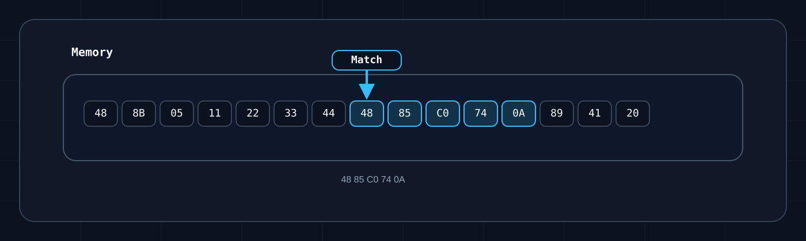

# Pattern Scanning in the Memory API

`Pattern scanning` is useful when you cannot rely on a fixed address because of updates, `ASLR`, or changing memory layouts. Instead of “read from `0x12345678`”, you search for a stable byte sequence near the place you need. For background, a good starting point is [Dynamic Memory Allocation](https://gamehacking.academy/pages/2/08/) and [Pattern Scanner](https://gamehacking.academy/pages/7/02/).

## Where to start

These process examples run in a top-level EyeAuras C# Script with the Memory
module loaded; the host supplies `Log`. A helper class must receive its logger
and process. In an embedded host, configure `UseMemory()` and await
`EnsureReadyAsync()` first. A reader created by `LocalProcess.ByProcessId` belongs
to the caller; `process.Memory` is borrowed. A module view scopes scans but does
not bounds-check every direct read.


In most cases, you should scan the memory of a specific module instead of the entire process:

```csharp
using System.Diagnostics;
using EyeAuras.Memory;
using EyeAuras.Memory.Scaffolding;

using var process = LocalProcess.ByProcessId(Process.GetCurrentProcess().Id);
using var memory = process.MemoryOfModule("kernel32.dll");
```

This is both faster and easier to reason about, because the resulting offset is immediately tied to that module.

## Supported signature formats

Everything is built around `BytePattern`. Out of the box, it supports:

- exact byte sequences
- hex strings
- wildcards with `?` and `??`
- C-style syntax like `\xAA\xBB`
- byte arrays with a separate mask
- the `^` marker, which marks the point of interest inside the match

```csharp
var exact = BytePattern.FromPattern(new byte[] { 0x48, 0x85, 0xC0, 0x74, 0x0A });
var hex = BytePattern.FromTemplate("48 85 C0 74 0A");
var wildcards = BytePattern.FromTemplate("48 85 ?? 74 0A");
var cStyle = BytePattern.FromTemplate(@"\x48\x85\xC0\x74\x0A");
var masked = BytePattern.FromMaskedPattern(new byte[] { 0x48, 0x85, 0xC0, 0x74, 0x0A }, "xxxxx");
var withOffset = BytePattern.FromTemplate("48 ^ 85 C0 74 0A");
```

In the examples below, we use the same pattern `48 85 C0 74 0A` throughout so it is easier to connect the diagram, code, and search result.

`^` sets `PatternOffset`. Single `FindOffset`/`GetOffset` return the match start;
multi-pattern `FindOffsets`/`GetOffsets` already add the marker offset.



Quick breakdown of the diagram:

1. The `Memory` block contains a normal sequence of bytes.
2. The highlighted fragment `48 85 C0 74 0A` is the matched pattern.
3. The arrow shows the start of the match. That point is what the returned `offset` usually refers to.
4. From there, you decide what to do next: use the instruction as an anchor, add an offset, or follow a pointer chain to the final address.

## How to search

Main methods:

- `FindOffset(...)` — returns the offset or `-1`
- `GetOffset(...)` — returns the offset or throws an exception
- `FindOffsets(...)` and `GetOffsets(...)` — the same idea for multiple signatures

```csharp
// Known buffer: expected Raw=0x1, marked=0x2
using EyeAuras.Memory;
using EyeAuras.Memory.Scaffolding;

{
    using var memory = MemoryAccessor.FromByteArray(
        new byte[] { 0x90, 0x48, 0x85, 0xC0, 0x74, 0x0A, 0x90 });
    var pattern = BytePattern.FromTemplate("48 ^ 85 ?? 74 0A");
    var raw = memory.FindOffset(pattern);
    var marked = memory.GetOffsets(pattern)[pattern];
    Log.Info($"Raw=0x{raw:X}, marked=0x{marked:X}");
}

```

For a loaded module, run this separate script. The exact signature may be absent
on your Windows build; the output is an offset/VA or an absence message.

```csharp
using System.Diagnostics;
using EyeAuras.Memory;
using EyeAuras.Memory.Scaffolding;

{
    using var process = LocalProcess.ByProcessId(Process.GetCurrentProcess().Id);
    using var memory = process.MemoryOfModule("kernel32.dll");
    var pattern = BytePattern.FromTemplate("48 85 C0 74 0A");
    var offset = memory.FindOffset(pattern);
    if (offset >= 0)
    {
        var va = memory.BaseAddress + offset;
        Log.Info($"Offset=0x{offset:X}, VA=0x{va:X}");
    }
    else
    {
        Log.Info("Signature not found in kernel32.dll");
    }
}
```

Single search copies the whole range synchronously, with no cancellation token.
Unreadable memory may throw even from `Find*`. These source contracts do not
verify native access to your target.

## Offset vs address

- `offset` is the position inside the current `IMemory`
- `VA` is the absolute virtual address in the process

If you search inside `MemoryOfModule(...)`, the absolute address is usually calculated as `memory.BaseAddress + offset`.

Using the diagram above as an example, `FindOffset(BytePattern.FromTemplate("48 85 C0 74 0A"))` returns the offset of the first highlighted byte, `48`.

## When to use `Find*` and `Get*`

- Use `Find*` when a missing signature is an expected scenario.
- Use `Get*` when a missing signature already means an incompatible client version or an error.

## Practical tips

- Scan a module, not the whole process, if you know which `.exe` or `.dll` you need.
- Do not make the signature too short.
- Hide unstable bytes behind wildcards.
- Account for the single/multi-search difference when using `^`.
- Multi-search returns one result per template, not all occurrences. It need not return the lowest match, ignores `StartOffset` and can miss a match across 84000-byte block boundaries.
- `BytePattern` equality uses `Template`; different `Name` or `StartOffset` values do not guarantee distinct keys.
- In game-related scenarios like an `entity list` or `view matrix`, the signature is usually just an anchor point. After that, you still read pointers and structures.

## What to read next

- [PE basics](/scripting/memory-api/pe-basics)
- [Code Cave](/scripting/memory-api/code-caves)
- [API pattern scanning](/scripting/api/memory/pattern-scanning)
