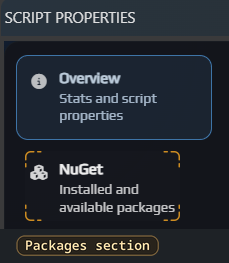
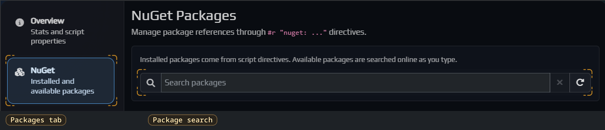

# Read JSON using a NuGet package

If a script needs a third-party library, add its [NuGet package](https://www.nuget.org/). As an example, we will parse a JSON string with **Newtonsoft.Json** and log a delay of **250 milliseconds** from it.

You need an editable **C# Script** and access to the configured package sources, so the package can download the first time. Write **#r** directives in **Script.csx**, not in an ordinary `.cs` class.

1. Open the script and click **Properties**.



[Full editor showing the Properties button](https://s3.eyeauras.net/media/2026/04/EyeAuras_Vlj2LmgbOY.png)

2. On the **NuGet** tab, find `Newtonsoft.Json`, select version **13.0.3** and click **Add Package**. If another version is already installed, click **Update Package**.



[Full package list and installed package details](https://s3.eyeauras.net/media/2026/04/EyeAuras_9TwUfSgAH2.png)

3. Paste the code below. If Properties already added the directive, do not add it again: keep one reference to this version.

```csharp
#r "nuget: Newtonsoft.Json, 13.0.3"

using Newtonsoft.Json.Linq;

var settings = JObject.Parse("{\"delayMs\":250}");
var delayMs = settings.Value<int>("delayMs");
Log.Info($"Delay: {delayMs} ms");
```

4. Wait until the package is restored and the script compiles, then click **Run**. **Event Log** shows `Delay: 250 ms`. If `JObject` is not found, look at the dependency diagnostics, not only at the Installed Packages list.

[Version 13.0.3](https://www.nuget.org/packages/Newtonsoft.Json/13.0.3) is pinned here so you can repeat the example exactly.

## Choose a reference form

| Form | What it adds |
| --- | --- |
| Properties → NuGet | Search for packages, pick a version, add, update and remove them. It uses the same mechanism as `#r "nuget: ..."`. |
| `#r "nuget: ID, version"` | A package by its exact ID and version. Handy when the script has to be portable. |
| Properties → References | An assembly already available in EyeAuras, or an external DLL by path. |
| `#r "assemblyPath: ..."` | A specific DLL on disk or in [embedded resources](/en/scripting/embedded-resources). |
| `#r "assemblyName: ..."` | An assembly by name, from those whose metadata the host can find. A missing library is not downloaded. |

A **using** line only picks names. It does not add an assembly reference. Adding a reference, restoring the package, loading its code and registering services are separate steps. Some SDKs need a [container extension](/en/scripting/script-container-extensions). A reference does not make a package's native assets or MSBuild targets work automatically.

<details>
<summary>A local DLL or an assembly that is already available</summary>

This fragment needs your own compatible DLL at the given path. Put in your own path:

```csharp
#r "assemblyPath: D:\Work\EAExile\EAExileAgent.Shared.dll"

Log.Info("Assembly reference declared"); // Check diagnostics and the required types
```

The file will not be there on another PC. To ship the DLL with the script, add it as a resource. Its own dependencies must be found too.

By name you can reference an assembly that EyeAuras can find on its own, for example one already loaded through Assembly.Load. Being in the .NET Framework GAC is not enough:

```csharp
#r "assemblyName: Grpc.Net.Client"

Log.Info("Assembly reference declared"); // Not a network-call test
```

The fragment works if **Grpc.Net.Client** is available. The set of assemblies EyeAuras references by default changes from version to version, so declare the dependencies you need.

</details>

## When editing in an IDE

The [exported project](/en/scripting/ide-integration) contains a `.csproj` and the NuGet source settings. From the main script project, import takes **PackageReference** items with an explicit ID and version and turns them into script references. The full MSBuild pipeline does not run, and dependencies of helper projects have their own limits. After the import, check the restore and the diagnostics in EyeAuras, even if the solution builds in the IDE.
