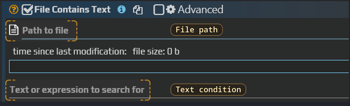

# Continue from the older File Contains Text guide

This is the old guide to **File Contains Text**, the trigger that checks what is in a file. It is the same trigger, so you do not need a new one. The full, current guide is [File Contains Text](/en/triggers/file-contains-text).

Example: you have a small text settings file and want to notice when it says `enabled=true`.

1. Save a local file in **UTF-8**. For the test, use a small file where the line `enabled=true` appears only in the state you need.
2. Open the existing **File Contains Text**, or add it to an aura. In **File path**, select the file with **…**, then look at **File contents** to see what was read.

   

   In the picture these fields are called Path to file and Text or expression to search for.
3. Choose **Regex** and enter `(?m)^enabled=true\r?$`. Only a separate line with that exact value matches. `enabled=false` does not. Turn off **Test mode**.
4. Save `enabled=true` in the file, and the trigger becomes active. Change it to `enabled=false` and save, and it becomes inactive. To see a reaction, add an overlay or an **On Enter** action, as in the current guide.

| Earlier setting or behavior | Current meaning |
| --- | --- |
| File path | One specific local file. Not a folder, and not only the new lines of a log. |
| Text / Regex / C# | Ways to [match text](/en/features/text-match-expressions). A C# expression runs inside the evaluator. It is not a standalone script. |
| Reevaluate on change | After you save, the whole file is read again. The trigger stays active while the expression matches. It is not a pulse for every write. |
| Large log | Still read in full. The trigger cannot read only the appended part. If a large file changes often, use a small status file instead. |

If there is no file at the selected path, the result is **Unknown**. If the file exists but cannot be read, check access to it and what **File contents** shows.
