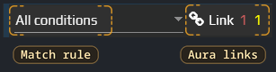

# Aura Is Active — combine existing conditions

Aura Is Active looks at the state of other auras. That lets you build one rule out of several conditions you already have.

Example: a sound should play only when Notepad is open **and** you have turned on a manual switch. Two auras each hold one condition. A third aura links them and plays the sound.

## Combine a window check and a switch

1. Create an aura called “Notepad open” with one [Window Exists](/en/triggers/window-exists). Set **Target Window** to `notepad` and check the matches. This aura needs no actions.
2. Create an aura called “Allow notification” with one [Fixed Value](/en/triggers/fixed-value). Choose **Is NOT Active** for now.
3. Create an aura called “Notification allowed”. Add **Aura Is Active** to it and use **Links** to select the two previous auras. Leave the required state of both links as Active.
4. Set **Logical operator** to **All must match (AND)**. Add [Play Sound](/en/actions/play-sound) with Ping to **On Enter** and check the volume.
5. Open Notepad. Then set “Allow notification” to Is Active.

Both conditions now match, so “Notification allowed” becomes active and plays the sound. Turn off the switch or close all matching windows, and it becomes inactive. When both conditions match again, the sound plays again.

To keep the result on screen, add a [Text overlay](/en/overlays/text) to “Notification allowed” and type your message in **Content**. The text shows while the aura is active. In [Common Options](/en/overlays/common-options) you can lock it and check how it looks outside the editor.

## Link settings

| Setting | Effect |
|---|---|
| Links | The list of linked auras. You can link folders too, but pick two specific auras for the first example. |
| Required state of a link | Which state of the linked aura counts as a match. The example uses Active for both links. |
| Logical operator — All must match (AND) | Every link must match. Older editor: All Conditions (AND). |
| Logical operator — At least one must match (OR) | One matching link is enough. Older editor: At Least One (OR). |

The trigger only watches the state of linked auras. It does not run their actions. To run an existing chain of actions, use [Execute Actions](/en/actions/execute).

With no links, Aura Is Active is inactive. A linked aura in Unknown does not count as Active, so in AND mode the combined aura does not activate. Build links from the source conditions towards the final result, and do not close them into a loop.
