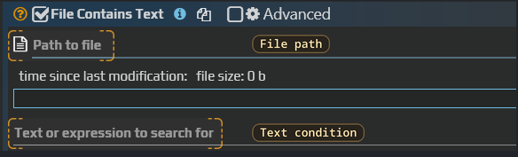

# Show when a status file is ready

**File Contains Text** reads a local text file and checks everything in it. For example, a small status file changes from `Waiting` to `Ready`, and EyeAuras shows “Review complete”.

## Configure a small status file

1. In a folder you can access, create **status.txt** in **UTF-8**. Type `Waiting` and save. For a first try, do not use a large log that keeps growing.
2. Add **File Contains Text** to an aura. Enter the full **File path** or select the file with **…**. **File contents** should show `Waiting`.
3. Choose **Regex** and enter `\AReady\s*\z`. This checks the whole file. Spaces and a final newline after the word are allowed. Turn off **Test mode**.
4. Add a [Text overlay](/en/overlays/text) to the aura with the text `Review complete`, visible while the aura is active. Turn off forced editor preview.
5. Replace the file contents with `Ready` and save. **File contents** and the trigger state update, and the text appears. Put `Waiting` back and save, and the text disappears.

| Setting or result | Meaning |
| --- | --- |
| File path | One specific file on the computer running EyeAuras. It is not a folder search pattern. |
| File contents | The text the trigger read. Look here first if the expression does not match. |
| Text | Exact comparison of the whole text. The modes are explained in [text-matching rules](/en/features/text-match-expressions). |
| Regex | A regular expression over all the text that was read. In the example, the `\A` and `\z` anchors stop an old line in the middle of a log from matching. |
| C# | An expression that runs inside the text evaluator, not a standalone script. The same guide describes its context. |
| Ignore Case | Ignore letter case. |
| Test mode | Uses test text instead of the file. Turn it off after checking, so the state depends on the file again. |

## Updates and state

The file is first read when the trigger connects to it. After that EyeAuras watches for the file being changed, created, deleted or renamed. Events that come close together are grouped into a window of about **250 ms**.

If the text matches, the trigger is active. If not, it is inactive. It stays active for as long as the matching text is in the file. To run an action once when the result appears, add it to **On Enter**. Saving the same matching text again does not trigger On Enter a second time.

If no path is selected or there is no file at that path, the state is **Unknown**. If you rename the file, the trigger keeps looking at the old path. Select the new path or put the file back. A file that exists but cannot be read is not the same as a missing file. Check access and the contents that were read first.

The whole file is read every time. The encoding is taken from the encoding marker. Without one, UTF-8 is used. You cannot choose a legacy code page in this editor. A large or frequently changing log can cost a lot of memory and time, because the trigger cannot read only the appended tail.
