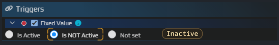

# Fixed Value — test an aura manually

Fixed Value is a manual switch. You decide whether the trigger is active or not. Use it to check an action without waiting for a window or text to appear. For example, turn an aura on by hand and make sure it plays its sound.

## Test one sound notification

1. Create an aura with only a **Fixed Value** trigger.
2. Select **Is NOT Active**, so you start from an inactive aura.
3. Add [Play Sound](/en/actions/play-sound) with Ping to **On Enter**. Check the volume with the preview button.
4. Select **Is Active** in Fixed Value.

The aura becomes active and runs On Enter once, so you hear Ping. To try again, select Is NOT Active, then Is Active. Actions in **While Active** repeat for as long as the aura is active.

If you want something visible instead of a sound, use a [Text overlay](/en/overlays/text) with your own **Content**. [Common Options](/en/overlays/common-options) explains how to place and lock it. If several auras should follow the same switch, keep Fixed Value in one aura and use [Aura Is Active](/en/triggers/aura-is-active) in the others.

## Choose a value

| Value | Trigger state |
|---|---|
| Is Active | Always Active while this setting is selected. |
| Is NOT Active | Always Not Active. |
| Not set | Unknown: the condition has no result. This is a separate state, not another name for Not Active. |

With several triggers, the result depends on the rule that combines them. Unknown takes part in that rule too.

After testing, replace Fixed Value with a real source such as [Window Exists](/en/triggers/window-exists). If a constant Is Active stays next to other conditions, check the combination rule. The aura should not become active regardless of them.
